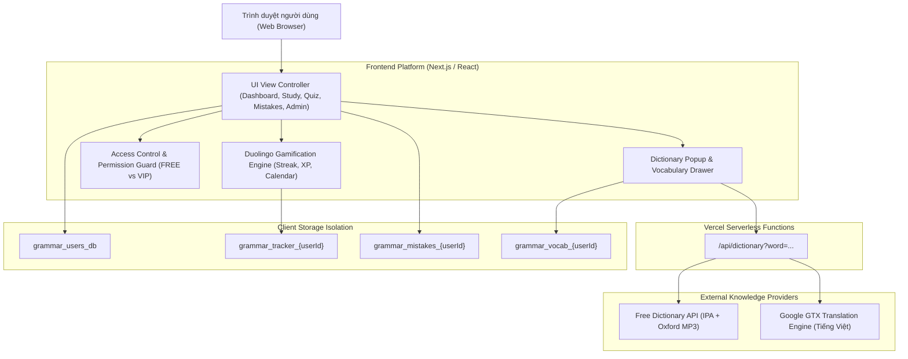

# 📊 BÁO CÁO TỔNG QUAN TÌNH TRẠNG DỰ ÁN (PROJECT STATUS OVERVIEW)
**Dự án:** Grammar Engine - Nền tảng Tự học & Luyện thi Ngữ pháp Tiếng Anh Toàn diện  
**Nguồn học liệu:** Giáo trình *Ngữ pháp tiếng Anh* - Mai Lan Hương & Hà Thanh Uyên  
**Thời gian cập nhật:** 11/11/2026  
**Trạng thái triển khai:** 🟢 Production Ready (Hoạt động ổn định trên Vercel)  
**Địa chỉ Production:** [https://grammar-platform.vercel.app](https://grammar-platform.vercel.app)  
**Kho mã nguồn (GitHub):** [https://github.com/doanphuongtanthoihiep-crypto/grammar-platform](https://github.com/doanphuongtanthoihiep-crypto/grammar-platform)

---

## 🧭 1. XÁC ĐỊNH GIAI ĐOẠN HIỆN TẠI (CURRENT PHASE)

> ### 🎯 HIỆN TẠI: **CUỐI GIAI ĐOẠN 1 (PHASE 1 COMPLETE - ADVANCED MVP & GAMIFIED EDTECH PLATFORM)**
> Hệ thống đã vượt xa một bản Mockup hoặc Prototype thông thường. Toàn bộ 12 chuyên đề ngữ pháp, 53 bài học lý thuyết sư phạm sâu, ngân hàng 2.939 câu hỏi bài tập thực hành, engine thi trắc nghiệm Quiz, hệ thống Gamification học tập kiểu Duolingo, cơ chế phân quyền VIP/FREE, trang quản trị Admin, cùng Bộ từ điển tra cứu âm thanh chuẩn quốc tế đều đã được hoàn thiện 100% và đang vận hành trực tiếp trên Production.

### Lộ trình 3 Giai đoạn của Dự án:
* ✅ **GIAI ĐOẠN 1 (ĐÃ HOÀN THÀNH - HIỆN TẠI):** 
  - Số hóa toàn bộ giáo trình gốc của Mai Lan Hương & Hà Thanh Uyên.
  - Chuẩn hóa 376 phân mục lý thuyết sâu, 215 quy tắc đánh số thứ tự, 82 công thức cú pháp, 7 bảng ma trận ngữ pháp.
  - Xây dựng kho 2.939 câu hỏi thực hành đa dạng hình thức (Trắc nghiệm, Điền từ, Viết lại câu).
  - Tích hợp Bộ đề Quiz ngẫu nhiên 50 câu kèm Sổ tay câu sai.
  - Xây dựng hệ thống học tập tích lũy Duolingo (Streak ngọn lửa, XP, lịch 7 ngày, gợi ý bài học).
  - Hệ thống Tài khoản người dùng, cách ly dữ liệu cá nhân hóa (Personalized Isolated State).
  - Phân quyền giới hạn lượt làm bài (FREE) và mở khóa toàn diện (VIP).
  - Trang Quản trị hệ thống (Admin Control Panel) quản lý User và chính sách truy cập.
  - Bộ từ điển thông minh Click-to-Lookup / Bôi đen / Double-click, phiên âm IPA, API Audio phát âm chuẩn Oxford/US và Sổ tay từ vựng cá nhân.
* ⏳ **GIAI ĐOẠN 2 (TIẾP THEO):**
  - Kết nối Database đám mây (PostgreSQL / Supabase / Neon) thay thế cho Client Storage.
  - Tích hợp cổng thanh toán trực tuyến tự động (VietQR / MoMo / Stripe) cho chức năng tự động nâng cấp VIP.
  - AI Tutor giải thích ngữ pháp thông minh theo ngữ cảnh bằng mô hình Gemini/LLM.
* 🔮 **GIAI ĐOẠN 3 (TƯƠNG LAI):**
  - Ứng dụng di động Native (React Native / Flutter) trên iOS & Android.
  - Luyện phát âm và nhận diện giọng nói (Speech-to-Text / AI Pronunciation Scoring).
  - Bảng xếp hạng cộng đồng (Leaderboard thi đua thời gian thực).

---

## 📈 2. SỐ LIỆU TỔNG QUAN HỆ THỐNG (SYSTEM METRICS)

| Hạng mục dữ liệu | Số lượng thực tế | Ghi chú chi tiết |
| :--- | :---: | :--- |
| **Tổng số Chuyên đề (Chapters)** | **12** | Đầy đủ 12 chuyên đề chuẩn ngữ pháp tiếng Anh |
| **Tổng số Bài học (Lessons)** | **53** | 13 thì, các mệnh đề, từ loại, câu bị động, gián tiếp... |
| **Phân mục lý thuyết (Sections)** | **376** | Phân chia sư phạm bài bản, có số thứ tự `01`, `02`... |
| **Quy tắc ngữ pháp đánh số** | **215** | Đánh số `1.`, `2.`, `3.` hoặc `A.`, `B.` kèm ví dụ |
| **Công thức chuẩn hóa** | **82** | Phân loại rõ ràng (+), (-), (?) bằng màu sắc trực quan |
| **Bảng tra cứu & Ma trận** | **7** | Bảng phối hợp thì, câu điều kiện, đại từ, bị động... |
| **Tổng số Câu hỏi bài tập** | **2.939** | Trích xuất chuẩn xác 100% từ giáo trình Mai Lan Hương |
| **Dạng bài tập hỗ trợ** | **4** | Multiple Choice, Fill in Blanks, Rewrite, Transform |
| **Bộ từ điển tích hợp** | **API kép** | Free Dictionary API + Google GTX Translation |
| **Tài khoản mẫu thử nghiệm** | **3** | Có sẵn 1-click test cho Admin, VIP và Free |

---

## 🧩 3. CÁC PHÂN HỆ TÍNH NĂNG ĐÃ HOÀN THIỆN (COMPLETED MODULES)

### 3.1. Phân hệ Lý thuyết Chuyên sâu (Deep-dive Pedagogical Knowledge)
- **Chuẩn hóa bố cục:** Toàn bộ câu từ bị ngắt dòng do file Word gốc đã được xử lý bằng thuật toán `unwrap`, giúp các câu văn liền mạch, mạch lạc, dễ hiểu.
- **Thẻ phân mục trực quan:** Mỗi mục lý thuyết mang một huy hiệu ngữ nghĩa (`CÔNG THỨC & CẤU TRÚC`, `QUY TẮC SỬ DỤNG`, `CÁCH DÙNG & TÌNH HUỐNG`, `LƯU Ý QUAN TRỌNG`, `BẢNG SO SÁNH`).
- **Khung công thức cú pháp:** Phân biệt rõ rệt thể Khẳng định (viền xanh lá), Phủ định (viền đỏ), Nghi vấn (viền xanh dương).
- **Thẻ quy tắc có đánh số (Numbered Rule Cards):** Mỗi quy tắc có huy hiệu số (`1`, `2`, `3`), tiêu đề in đậm, phần giải thích ngữ cảnh và các khối ví dụ song ngữ Anh - Việt.
- **Audio phát âm câu ví dụ:** Mỗi câu tiếng Anh mẫu đều có nút `🔊 Đọc` để nghe phát âm ngay tức thì.
- **Hộp cảnh báo bẫy thi cử:** Khung màu hổ phách `⚠️ LƯU Ý QUAN TRỌNG & BẪY THI CỬ` làm nổi bật các ngoại lệ và điểm hay nhầm lẫn.

### 3.2. Phân hệ Luyện tập Bài tập theo Chương (Practice Exercises)
- **Hỗ trợ 4 dạng bài tập cốt lõi:**
  1. *Trắc nghiệm 4 lựa chọn (A, B, C, D):* Chấm điểm ngay khi chọn, giải thích tại sao đúng/sai.
  2. *Điền vào chỗ trống (Fill in the Blanks):* Tự động sinh ô input tại vị trí ngoặc đơn động từ `(see)`, `(go)`, hỗ trợ kiểm tra không phân biệt hoa thường và khoảng trắng.
  3. *Viết lại câu (Sentence Transformation / Rewrite):* Nhập câu hoàn chỉnh và bấm `Kiểm tra đáp án` hoặc `Xem đáp án gợi ý`.
- **Nút Check đáp án tức thì:** Học viên kiểm tra được ngay từng câu mà không cần đợi nộp cả bài.
- **Tự động lưu câu sai:** Bất kỳ câu nào làm sai sẽ được tự động đồng bộ vào **Sổ tay câu sai (Mistake Notebook)** của học viên đó.

### 3.3. Phân hệ Đề thi Quiz ngẫu nhiên 50 câu (Quiz Engine)
- Thuật toán xáo trộn (Fisher-Yates Shuffle) chọn ngẫu nhiên 50 câu từ kho 2.939 câu hỏi.
- Hỗ trợ lọc theo chuyên đề cụ thể (Thì, Mệnh đề, Câu bị động...) hoặc trộn trên tất cả 12 chương.
- Chấm điểm phần trăm, xếp loại học lực, thống kê số câu đúng/sai và lưu câu sai vào sổ tay.

### 3.4. Hệ thống Theo dõi Học tập kiểu Duolingo (Gamified Learning Tracker)
- **Ngọn lửa Streak (🔥 N ngày):** Tự động phát hiện ngày học liên tiếp, duy trì chuỗi khi đăng nhập học mỗi ngày.
- **Tích lũy XP (⚡ XP):** Giải đúng bài tập nhận +10 XP, học xong lý thuyết nhận +25 XP.
- **Lịch mini 7 ngày:** Theo dõi trực quan những ngày trong tuần đã duy trì việc học.
- **Thuật toán Đề xuất Bài học hôm nay:** Tự động phát hiện bài học tiếp theo mà học viên cần hoàn thành.

### 3.5. Hệ thống Tài khoản & Phân quyền VIP/FREE (Auth & RBAC)
- **Tài khoản người dùng độc lập:** Mỗi User sở hữu chuỗi Streak, điểm XP, danh sách bài học đã hoàn thành, lịch sử giải bài, sổ tay câu sai và sổ từ vựng riêng biệt.
- **Tài khoản dùng thử 1-click tích hợp sẵn trong Modal:**
  1. 🛡️ **Quản trị viên (Admin):** `admin@grammarpro.com` / `admin123`
  2. ⭐ **Học viên VIP:** `vip@grammarpro.com` / `vip123`
  3. 👤 **Học viên Miễn phí (Free):** `nam@grammarpro.com` / `free123`
- **Chính sách giới hạn quyền truy cập (Access Control Policy):**
  - *Tài khoản FREE:* Được làm tối đa **10 câu đầu tiên / mỗi chương** và **2 lượt Quiz / ngày**. Từ câu 11 trở đi hoặc lượt Quiz thứ 3 sẽ hiển thị thông báo khóa nội dung và khuyến khích nâng cấp VIP.
  - *Tài khoản VIP:* Mở khóa toàn diện 100% tài nguyên (2.939 câu hỏi, không giới hạn Quiz).

### 3.6. Trang Quản trị Hệ thống (Admin Management Panel)
- Chỉ hiển thị với tài khoản có vai trò `ADMIN`.
- **Bảng điều khiển chính sách:** Cho phép Admin thay đổi trực tiếp giới hạn làm bài (số câu/chương và số lượt Quiz/ngày) của tài khoản Free.
- **Quản lý người dùng:** Nâng cấp VIP (`⭐ Nâng VIP`), hạ về Free (`👤 Hạ FREE`), khóa tài khoản (`🔒 Khóa`), xóa tài khoản, thêm tài khoản mới.

### 3.7. Bộ Từ điển Thông minh & Sổ tay Từ vựng (Dictionary & Vocab Notebook)
- **Tra cứu không làm phiền:** Cách ly hoàn toàn các nút bấm, menu, thanh điều hướng và sidebar khỏi bộ bắt từ điển. Chỉ kích hoạt khi người dùng **bôi đen từ** hoặc **nhấp đúp chuột (Double Click)** vào từ tiếng Anh trong nội dung bài học.
- **Bộ lọc thông minh:** Tự động loại bỏ tiếng Việt, chỉ tra cứu từ tiếng Anh hợp lệ.
- **Đầy đủ thông tin học thuật:** Từ gốc, Từ loại (Part of Speech), Phiên âm chuẩn IPA (ví dụ: `/ˈɑːkɪtɛkt/`), nghĩa tiếng Việt, định nghĩa tiếng Anh mẫu và link tra cứu chuyên sâu Cambridge Dictionary.
- **API Audio phát âm:** Tích hợp file âm thanh chuẩn Oxford/US từ Free Dictionary API, dự phòng tự động bằng Web Speech API (`SpeechSynthesis en-US`).
- **Sổ tay từ vựng cá nhân (`⭐ Sổ từ`):** Nút 1-click lưu từ vựng vào sổ tay riêng, có modal xem lại danh sách, nghe lại phát âm và lọc từ vựng.

---

## 🏗️ 4. KIẾN TRÚC KỸ THUẬT & CÔNG NGHỆ (TECHNICAL ARCHITECTURE)

* **Frontend:** Next.js (React), tối ưu hóa tải trang nhanh, không phụ thuộc thư viện CSS nặng, phong cách Dark Mode hiện đại lấy cảm hứng từ Linear & Vercel Design System.
* **Backend API:** Next.js Serverless Functions (`/api/dictionary`), xử lý song song Promise giữa Dictionary API và Google Translation Engine, giải quyết triệt để vấn đề CORS phía Client.
* **Lưu trữ dữ liệu:**
  - File tĩnh chuẩn hóa cao: `data/ui/preview_data.json` (931 KB) chứa 12 chương, 53 bài học, 376 section; `data/ui/quiz_bank.json` (1.2 MB) chứa ngân hàng 2.939 câu hỏi trắc nghiệm.
  - Lưu trữ trạng thái phiên người dùng: `LocalStorage` phân tách theo khóa định danh `grammar_tracker_<id>`, `grammar_mistakes_<id>`, `grammar_vocab_<id>` đảm bảo dữ liệu của từng học viên không bị lẫn lộn.
* **Hosting & CI/CD:** Vercel kết nối tự động với GitHub Repository, mỗi khi push code lên nhánh `main` hệ thống sẽ tự động build và deploy trong vòng ~35 giây.

---

## 🧪 5. HƯỚNG DẪN KIỂM THỬ NHANH DÀNH CHO BÊN THỨ BA (TESTING GUIDE)

Bất kỳ ai truy cập vào [https://grammar-platform.vercel.app](https://grammar-platform.vercel.app) đều có thể kiểm thử toàn bộ hệ thống qua các kịch bản sau:

### Kịch bản 1: Kiểm tra Đăng nhập & Đổi vai trò (Free vs VIP vs Admin)
1. Bấm vào nút tài khoản góc trên bên phải.
2. Bấm vào nút `👤 Free Demo`: Thử vào làm bài tập chương 1 -> Sau câu 10 hệ thống sẽ hiện hộp khóa VIP.
3. Bấm lại vào tài khoản, chọn `⭐ VIP Demo`: Thử lại bài tập chương 1 -> Mở khóa toàn bộ câu 11 đến câu cuối cùng.
4. Bấm lại vào tài khoản, chọn `🛡️ Admin Demo`: Trên thanh Menu xuất hiện thẻ `🛡️ Quản trị Admin`. Bấm vào để thử thay đổi giới hạn chính sách hoặc nâng/hạ quyền người dùng.

### Kịch bản 2: Kiểm tra Bộ từ điển & Phát âm Audio
1. Vào bất kỳ bài học lý thuyết nào (ví dụ: *Thì hiện tại đơn* hoặc *Mệnh đề điều kiện*).
2. Dùng chuột **bôi đen một từ tiếng Anh** bất kỳ (hoặc **nhấp đúp chuột** vào từ đó).
3. Popup từ điển lập tức xuất hiện:
   - Hiển thị phiên âm quốc tế IPA (ví dụ: `/ˈɑːkɪtɛkt/`).
   - Bấm nút `🔊 Nghe phát âm` để nghe giọng bản ngữ.
   - Bấm `☆ Lưu vào Sổ từ` để lưu lại.
4. Bấm nút `⭐ Sổ từ (N)` trên thanh điều hướng trên cùng để xem danh sách từ đã lưu.

### Kịch bản 3: Kiểm tra Trình độ và Học tập Gamification
1. Vào tab `Bộ đề Quiz (50 câu)`: Chọn chủ đề và bắt đầu làm bài.
2. Bấm nộp bài để xem điểm số, phân tích câu đúng/sai.
3. Vào tab `Sổ tay câu sai` để làm lại riêng các câu vừa làm sai.
4. Vào tab `Lộ trình` (Dashboard) để thấy số XP tăng lên và ngọn lửa Streak duy trì ngày học.

---

## 📌 6. TỔNG KẾT & TRẠNG THÁI HIỆN THỜI

Web platform hiện tại đang ở trạng thái **hoàn thiện toàn diện Giai đoạn 1**, sẵn sàng để người học sử dụng thực tế, demo cho đối tác, nhà đầu tư hoặc tích hợp thêm cơ sở dữ liệu đám mây trong Giai đoạn 2.
