# 🗺️ BẢN ĐỒ PHÁT TRIỂN & KIẾN TRÚC HỆ THỐNG (LIVING ROADMAP & ENTERPRISE ARCHITECTURE GUIDE)
> **Dự án:** Grammar Engine - Nền tảng Tự học & Luyện thi Ngữ pháp Tiếng Anh Toàn diện (Personalized English Grammar Learning Platform)  
> **Nguồn học liệu:** Giáo trình *Ngữ pháp tiếng Anh* - Mai Lan Hương & Hà Thanh Uyên  
> **Kiến trúc:** Enterprise EdTech (Next.js + Supabase PostgreSQL 17 + Offline Sync Engine + AI Diagnostic Roadmap + Monetization Engine)  
> **Phiên bản hiện tại:** `v2.12-enterprise-roadmap-master`  
> **Cập nhật gần nhất:** 11/11/2026  
> **Tài liệu điều hướng tối cao:** Mọi phiên làm việc / Prompt tiếp theo **BẮT BUỘC ĐỌC FILE NÀY ĐẦU TIÊN** để nắm bắt chính xác tiến độ, kiến trúc và bước đi tiếp theo.

---

## 📌 1. ĐỊNH VỊ GIAI ĐOẠN HIỆN TẠI (CURRENT PHASE STATUS)

```text
[ Phase 1: MVP & Core Grammar ] ---> [ Phase 2 Core (2.1–2.8): Cloud, Diagnostic & Viz ] ---> [ Phase 2–3 Enhancements: 2.3–2.6, 2.8+ & 2.9–2.12 ]
         ✅ HOÀN THÀNH                                ✅ CORE LIVE TRÊN PROD                         🚀 SẴN SÀNG TRIỂN KHAI TỪNG MILESTONE
```

* **Trọng tâm hiện tại:** **HOÀN TẤT NỀN TẢNG CORE (2.1–2.8) — CHUYỂN SANG TRIỂN KHAI NÂNG CẤP TỪNG MILESTONE (2.3–2.6 & 2.8 ENHANCED, 2.9–2.12)**.
* **Hiện trạng Thực tế trên Production (`https://grammar-platform.vercel.app`):**
  1. **Database PostgreSQL 17 Live (21 Bảng & 100% RLS):** Đã vận hành 10 bảng Core/Auth/Audit + 6 bảng Diagnostic/Roadmap + 5 bảng Pedagogical Explanation/Remedial trên Supabase (`wtvlbbcyvtqqygtojxay`).
  2. **Layered Architecture Bảo mật:** Tách biệt hoàn toàn Browser Client (`NEXT_PUBLIC_SUPABASE_ANON_KEY`) và Server Admin Client (`SUPABASE_SERVICE_ROLE_KEY`), Repositories (`7 files`), Services (`7 files`).
  3. **Trải nghiệm Học tập Trực quan & Âm thanh (2.7 Hoàn thành 100%):** Đầy đủ 8 sơ đồ trực quan tương tác + Audio Service US/UK (0.75x/1.0x/1.25x).
  4. **Các Phân hệ Core Live sẵn sàng nâng cấp tiếp:** Offline Sync Queue & Hybrid Sync (`2.3`), Admin Panel & Audit Logs (`2.4`), Structured 5-Field Explanations & Remedial (`2.5`), Design Tokens WCAG AA (`2.6`), Placement Test 30 Câu & 4-Week Roadmap (`2.8`).
* **Thông tin Môi trường kết nối:**
  - 🌐 **Production URL:** [https://grammar-platform.vercel.app](https://grammar-platform.vercel.app)
  - 🐙 **GitHub Repository:** [doanphuongtanthoihiep-crypto/grammar-platform](https://github.com/doanphuongtanthoihiep-crypto/grammar-platform)
  - ⚡ **Vercel Project ID:** `prj_yfOLrVVbBV0b8O8G2ihrDhR5HLsa`
  - 🐘 **Supabase Project:**
    - Project ID / Ref: `wtvlbbcyvtqqygtojxay`
    - Tên Project: `doanphuongtanthoihiep-crypto's Project`
    - Region: `ap-northeast-2` (Seoul, độ trễ cực thấp về Việt Nam)
    - URL Endpoint: `https://wtvlbbcyvtqqygtojxay.supabase.co`
    - Trạng thái DB: `ACTIVE_HEALTHY` (PostgreSQL 17 • Next.js `14.2.15` • React `18.3.1` • Prisma `5.22.0`)

---

## 🏛️ 2. MA TRẬN PHÂN CHIA MILESTONE & THỨ TỰ ƯU TIÊN (PRIORITY MATRIX)

Nhằm giảm thiểu tối đa rủi ro gián đoạn hệ thống và đảm bảo tính liên tục của nền tảng học tập, lộ trình triển khai tuần tự từng Milestone được tổ chức theo thứ tự ưu tiên nghiêm ngặt:

| Nhóm chức năng | Milestone | Tên Milestone | Mức độ ưu tiên | Trạng thái |
| :--- | :--- | :--- | :---: | :---: |
| **Infrastructure** | **2.1** | **Database Provisioning, Security Hardening & RLS (21 Tables)** | **P0 (Critical)** | ✅ Hoàn thành |
| **Infrastructure** | **2.2** | **Supabase SDK Layering (Client / Server / Services)** | **P0 (Critical)** | ✅ Hoàn thành |
| **Infrastructure** | **2.3** | **Resilient Offline-First Architecture & Multi-Device Sync** | **P0 (Critical)** | ✅ Core Live / Resilient Sync Spec Active |
| **Management** | **2.4** | **Enterprise Admin Dashboard, RBAC & Immutable Audit Logs** | **P1 (High)** | ✅ Core Live / Enterprise Governance Spec Active |
| **Content** | **2.5** | **Structured Pedagogical Intelligence & Remedial Engine** | **P1 (High)** | ✅ Core Live / Knowledge Graph Spec Active |
| **Design** | **2.6** | **Enterprise-Grade Design System & WCAG 2.2 AA** | **P2 (Medium)**| ✅ Core Live / Design System Spec Active |
| **Content** | **2.7** | **Grammar Visualization Engine & Audio Engine (8 Models)** | **P1 (High)** | ✅ Hoàn thành (100%) |
| **Core EdTech** | **2.8** | **AI-Powered Grammar Diagnostic & Personalized Roadmap** | **P1 (Central Module)**| ✅ Core Live / Adaptive EdTech Spec Active |
| **Intelligence** | **2.9** | **Continuous Adaptive Learning & Intelligent Mastery Tracking**| **P2 (High)** | ⏳ Kế tiếp (Adaptive Spec Active) |
| **Gamification** | **2.10**| **Achievement, Level Progression & Intelligent Gamification** | **P2 (Medium)**| ⏳ Kế tiếp (Gamification Spec Active) |
| **Quality** | **2.11**| **Performance, Security Hardening & Pre-Prod Verification** | **P0 (Pre-Prod)**| ⏳ Kế tiếp (Prod Readiness Spec Active) |
| **Monetization** | **2.12**| **Intelligent Monetization, Behavioral Psychology & Conversion** | **P0 (Business)** | ⏳ Kế tiếp (Monetization Spec Active) |

---

## 🏛️ 3. KIẾN TRÚC DỰ ÁN & PHÂN TÁCH LỚP (LAYERED ARCHITECTURE — ACTUAL CODEBASE)

Hệ thống Next.js Pages Router được phân tầng rõ rệt nhằm triệt tiêu hoàn toàn rủi ro lộ khóa bảo mật và đảm bảo code clean, dễ kiểm thử tự động:

```text
grammar-platform/
├── components/
│   ├── audio/
│   │   └── AudioPlayer.jsx                  # Reusable Audio Player (Compact Inline & Full Card, US/UK, 0.75x/1.0x/1.25x)
│   ├── diagnostic/                          # Milestone 2.8 Diagnostic & Personalized Roadmap UI (Live)
│   │   ├── DiagnosticOnboarding.jsx         # Landing page giới thiệu bài kiểm tra 30 câu
│   │   ├── DiagnosticTestSession.jsx        # Giao diện làm bài Focus Mode, Timer, Flag, Shortcuts
│   │   ├── DiagnosticAnalysisDashboard.jsx  # Báo cáo kết quả, trình độ & ma trận 10 kỹ năng
│   │   ├── PersonalizedRoadmapView.jsx      # Lộ trình học 4 tuần với nút 1-click "Vào học ngay"
│   │   ├── DiagnosticQuestionReview.jsx     # Xem lại 30 câu kèm lời giải sư phạm 5 trường
│   │   └── GrammarDiagnosticEngine.jsx      # Bộ điều phối trung tâm Diagnostic Engine
│   ├── explanation/
│   │   └── StructuredExplanation.jsx        # Thẻ hiển thị lời giải sư phạm 5 trường & Feedback Loop (Live)
│   ├── grammar-visualization/               # Milestone 2.7 Grammar Visualization Engine — 8 Mô hình (Live)
│   │   ├── GrammarVisualization.jsx         # Master Container & Catalog Switcher tích hợp Study View
│   │   ├── VisualizationRenderer.jsx        # Bộ điều phối dynamic render theo registry
│   │   ├── VisualizationLegend.jsx          # Bảng chú giải màu sắc, thể thì và loại nút
│   │   ├── VisualizationControls.jsx        # Phím phóng to, thu nhỏ, đặt lại góc nhìn
│   │   ├── TimelineVisualization.jsx        # Trục thời gian 13 thì, lọc thể, Compare Mode
│   │   ├── DecisionTreeVisualization.jsx    # Cây quyết định câu điều kiện kèm đảo ngữ
│   │   ├── TransformationDiagram.jsx        # Sơ đồ biến đổi chủ động -> bị động S-V-O
│   │   ├── ConversionFlowVisualization.jsx  # Luồng 7 giai đoạn câu gián tiếp & ma trận lùi thì
│   │   ├── SentenceTreeVisualization.jsx    # Sơ đồ cây câu mệnh đề quan hệ & quy tắc rút gọn
│   │   ├── ComparisonScaleVisualization.jsx # Thước đo tỷ lệ so sánh 4 cấp độ & bất quy tắc
│   │   ├── ModalMatrixVisualization.jsx     # Thang đo xác suất Modal Verbs (0-100%)
│   │   └── WordFamilyTreeVisualization.jsx  # Cây họ từ 4 hướng (N-V-Adj-Adv) & hậu tố vàng
│   └── learning/
│       └── RemedialRecommendationCard.jsx   # Thẻ khuyến nghị bài học bù đắp 1-click (Live)
├── lib/
│   ├── supabase/
│   │   ├── client.js                        # Browser Supabase Client (NEXT_PUBLIC_SUPABASE_ANON_KEY)
│   │   ├── server.js                        # Server-side Client (SUPABASE_SERVICE_ROLE_KEY, Server-only)
│   │   └── middleware.js                    # Session check & token refresh helper
│   ├── sync/                                # Milestone 2.3 Core Sync Engine (Live)
│   │   ├── indexed-db.js                    # IndexedDB adapter ('grammar_platform_db') + LocalStorage fallback
│   │   ├── sync-queue.js                    # Hàng đợi Offline Write Queue
│   │   └── sync-manager.js                  # Bộ điều phối mạng online/offline & Sync Manager
│   ├── explanation/                         # Milestone 2.5 Explanation & Remedial Engine (Live)
│   │   ├── explanation.schema.js            # Schema JSON 5 trường, validator & adaptExplanationForLevel()
│   │   ├── explanation.migrator.js          # Bộ chuyển đổi lời giải cũ -> chuẩn hóa JSON 5 trường
│   │   ├── error-taxonomy.js                # Phân loại 11 nhóm lỗi ngữ pháp & tính Confidence Score
│   │   └── remedial-engine.js               # Động cơ đề xuất bài học bù đắp theo 12 chương / 53 bài
│   ├── diagnostic/                          # Milestone 2.8 Core Modules (Live)
│   │   ├── diagnostic.blueprint.js          # Ma trận 30 câu chuẩn hóa & 10 nhóm kiến thức
│   │   ├── diagnostic.scoring.js            # Deterministic Assessment Scoring & Weakness Detection
│   │   └── roadmap.generator.js             # Sinh lộ trình học tập 4 tuần liên kết 53 bài học
│   ├── audio/
│   │   ├── speech.constants.js              # Voice dictionaries (US/UK), rate multipliers, storage keys
│   │   ├── speech.utils.js                  # Sanitizer tách Markdown, phiên âm IPA, dịch nghĩa trước TTS
│   │   └── speech.service.js                # Singleton Web Speech API, chống nói đè, lưu preference
│   ├── visualization/
│   │   ├── visualization.registry.js        # Registry ánh xạ 12 chuyên đề vào 8 mô hình sơ đồ
│   │   └── visualization.utils.js           # Tính toán tọa độ và mã màu thể thì
│   └── tokens/
│       └── design-tokens.js                 # Design Tokens Light & Dark Mode đạt chuẩn WCAG AA
├── services/                                # Nghiệp vụ Domain Services (7 Modules Live)
│   ├── auth.service.js                      # Đăng ký, đăng nhập, phân quyền
│   ├── profile.service.js                   # Thông tin tài khoản & vai trò
│   ├── tracker.service.js                   # XP, Streak, Bài học hoàn thành
│   ├── mistakes.service.js                  # Sổ tay câu sai & thuật toán ôn tập
│   ├── vocabulary.service.js                # Sổ tay từ vựng
│   ├── quiz.service.js                      # Bộ đề trắc nghiệm & lưu kết quả
│   └── policy.service.js                    # Cấu hình hạn mức người dùng
├── repositories/                            # Tầng Truy cập Dữ liệu Supabase (7 Modules Live)
│   ├── user.repository.js                   # profiles, user_learning_trackers
│   ├── quiz.repository.js                   # quiz_attempts
│   ├── mistakes.repository.js               # user_mistakes
│   ├── vocabulary.repository.js             # user_vocabularies
│   ├── activity.repository.js               # user_daily_activities, user_activity_logs
│   ├── audit.repository.js                  # audit_logs (Server-side Only)
│   └── diagnostic.repository.js             # diagnostic_* & user_learning_roadmaps
├── pages/
│   ├── api/
│   │   ├── admin/
│   │   │   ├── explanations/feedback-summary.js # Tổng hợp phản ánh chất lượng sư phạm (Live)
│   │   │   ├── users.js                     # API quản trị tài khoản (Server-side RBAC)
│   │   │   ├── policy.js                    # API cập nhật hạn mức hệ thống
│   │   │   └── audit-logs.js                # API lấy lịch sử hoạt động Admin
│   │   ├── diagnostic/
│   │   │   ├── test.js                      # API cấp phát đề kiểm tra chẩn đoán 30 câu (Live)
│   │   │   ├── submit.js                    # API chấm điểm server-side & tính ma trận điểm yếu
│   │   │   └── roadmap.js                   # API lưu và nạp lộ trình học cá nhân hóa
│   │   ├── learning/
│   │   │   └── remedial-recommendations.js  # API tạo & quản lý khuyến nghị học bù đắp (Live)
│   │   ├── questions/
│   │   │   └── [questionId]/explanation.js  # API trả về lời giải JSON 5 trường theo trình độ (Live)
│   │   ├── sync/
│   │   │   └── batch.js                     # Endpoint nhận đồng bộ mẻ từ Sync Queue (Live)
│   │   ├── explanation-feedback.js          # API nhận phản hồi hữu ích & báo lỗi 6 danh mục (Live)
│   │   └── dictionary.js                    # Serverless API tra từ điển (Live)
│   ├── _app.js                              # Global wrappers, Theme Provider & Anti-Flicker Init
│   └── index.js                             # Main SPA Application (Dashboard, Study, Quiz, Mistakes, Admin, Diagnostic)
├── data/
│   ├── grammar-visualizations/              # 8 Bộ dữ liệu Sư phạm Chuẩn hóa (Live)
│   │   ├── tenses.data.js, conditionals.data.js, passive-voice.data.js, reported-speech.data.js
│   │   └── relative-clauses.data.js, comparisons.data.js, modal-verbs.data.js, word-forms.data.js
│   ├── normalized/
│   │   └── full_import_data.json            # 7.2MB quan hệ gốc 53 lessons, 982 rules
│   └── ui/
│       ├── preview_data.json                # 12 chương, 53 bài, cheat-sheets, song ngữ
│       └── quiz_bank.json                   # 2.939 câu trắc nghiệm đã làm sạch
└── ROADMAP_AND_ARCHITECTURE.md              # SINGLE SOURCE OF TRUTH
```

> **Thư mục Mở rộng Dự kiến cho Các Milestone Tiếp theo (`[Planned Modules]`):**  
> • `components/design-system/`, `components/sync/`, `components/admin/` (Spec 2.3, 2.4, 2.6 Enhanced)  
> • `lib/knowledge/`, `lib/admin/`, `lib/gamification/`, `lib/monetization/` (Spec 2.5, 2.9, 2.10, 2.12)

---

## 🐘 4. THIẾT KẾ CƠ SỞ DỮ LIỆU CHUẨN POSTGRESQL 17 (21 LIVE TABLES & RLS ARCHITECTURE)

### 4.1. Sơ đồ Thực thể Dữ liệu Toàn diện (21 Live Tables trên Supabase `wtvlbbcyvtqqygtojxay`)

```mermaid
erDiagram
    PROFILES ||--o{ USER_LEARNING_TRACKERS : owns
    PROFILES ||--o{ USER_MISTAKES : tracks
    PROFILES ||--o{ USER_VOCABULARIES : saves
    PROFILES ||--o{ QUIZ_ATTEMPTS : records
    PROFILES ||--o{ USER_ACHIEVEMENTS : earns
    PROFILES ||--o{ USER_DAILY_ACTIVITIES : logs
    PROFILES ||--o{ USER_ACTIVITY_LOGS : audits
    PROFILES ||--o{ AUDIT_LOGS : triggers

    PROFILES ||--o{ DIAGNOSTIC_ATTEMPTS : takes
    DIAGNOSTIC_TESTS ||--o{ DIAGNOSTIC_ATTEMPTS : defines
    DIAGNOSTIC_ATTEMPTS ||--o{ DIAGNOSTIC_ANSWERS : contains
    DIAGNOSTIC_ATTEMPTS ||--o{ DIAGNOSTIC_SKILL_RESULTS : analyzes
    DIAGNOSTIC_ATTEMPTS ||--o| USER_LEARNING_ROADMAPS : generates
    USER_LEARNING_ROADMAPS ||--o{ ROADMAP_ITEMS : structures

    PROFILES ||--o{ EXPLANATION_FEEDBACK : submits
    PROFILES ||--o{ REMEDIAL_RECOMMENDATIONS : receives
    PROFILES ||--o{ USER_CONCEPT_PROGRESS : masters
    EXPLANATIONS ||--o{ EXPLANATION_FEEDBACK : receives
    EXPLANATIONS ||--o{ QUESTION_CONCEPTS : maps_to

    PROFILES {
        uuid id PK "references auth.users(id)"
        text email UK
        text full_name
        text role "FREE | VIP | ADMIN"
        text status "ACTIVE | LOCKED"
        timestamptz created_at
        timestamptz updated_at
    }
    USER_LEARNING_TRACKERS {
        uuid id PK
        uuid user_id FK
        int streak
        int xp
        date last_active_date
        jsonb active_days
        jsonb daily_goal
        jsonb completed_lessons
        int quizzes_completed_today
        date quiz_date
        int version
        timestamptz updated_at
    }
    DIAGNOSTIC_TESTS {
        uuid id PK
        text title
        text description
        int total_questions "Default 30"
        int time_limit_seconds "Default 1200 (20 mins)"
        jsonb blueprint_config
        text status "ACTIVE | DRAFT"
        timestamptz created_at
    }
    DIAGNOSTIC_ATTEMPTS {
        uuid id PK
        uuid user_id FK
        uuid test_id FK
        int total_questions
        int correct_answers
        numeric total_score
        text estimated_level "A1 | A2 | B1 | B2 | C1 (Estimated)"
        text status "IN_PROGRESS | COMPLETED | ABANDONED"
        timestamptz started_at
        timestamptz completed_at
    }
    DIAGNOSTIC_ANSWERS {
        uuid id PK
        uuid attempt_id FK
        text question_id
        jsonb question_snapshot
        text selected_answer
        boolean is_correct
        int time_spent_seconds
        timestamptz answered_at
    }
    DIAGNOSTIC_SKILL_RESULTS {
        uuid id PK
        uuid attempt_id FK
        uuid user_id FK
        text topic_id
        text topic_name
        int total_questions
        int correct_answers
        numeric accuracy
        text confidence "low | medium | high"
        text classification "mastered | good | developing | needs_improvement | critical_weakness"
    }
    USER_LEARNING_ROADMAPS {
        uuid id PK
        uuid user_id FK
        uuid diagnostic_attempt_id FK
        text title
        text target_level
        text status "ACTIVE | COMPLETED | ARCHIVED"
        timestamptz created_at
        timestamptz updated_at
    }
    ROADMAP_ITEMS {
        uuid id PK
        uuid roadmap_id FK
        uuid user_id FK
        text lesson_id
        text practice_id
        text topic_id
        text title
        text item_type "THEORY | GUIDED_PRACTICE | QUIZ | REASSESSMENT"
        text priority "HIGH | MEDIUM | MAINTAIN"
        int sequence_order
        text status "PENDING | IN_PROGRESS | COMPLETED | SKIPPED"
        text reason
        timestamptz completed_at
    }
    AUDIT_LOGS {
        uuid id PK
        uuid admin_id FK
        text action_type
        text target_type
        text target_id
        jsonb before_state
        jsonb after_state
        text ip_address
        timestamptz created_at
    }
    EXPLANATIONS {
        uuid id PK
        text question_id UK
        text topic_id
        text schema_version "1.0"
        text difficulty "Beginner | Elementary | Intermediate | Advanced"
        int difficulty_score "1..4"
        jsonb signal
        jsonb rule
        jsonb translation
        jsonb common_mistakes
        jsonb exam_tips
        text status "published | draft | review | archived"
        int version
        timestamptz updated_at
    }
    EXPLANATION_FEEDBACK {
        uuid id PK
        uuid user_id FK
        text question_id
        uuid explanation_id FK
        int explanation_version
        text feedback_type "helpful | report_error"
        text error_category
        text comment
        timestamptz created_at
    }
    QUESTION_CONCEPTS {
        uuid id PK
        text question_id
        text primary_topic
        text concept_id
        text concept_name
        jsonb related_topics
        jsonb tested_concepts
        jsonb error_categories
        text lesson_id
        text prerequisite_lesson_id
        numeric weight
    }
    REMEDIAL_RECOMMENDATIONS {
        uuid id PK
        uuid user_id FK
        text question_id
        text concept_id
        text lesson_id
        text lesson_title
        text detected_error
        text recommendation_type "remedial_lesson | targeted_review | prerequisite_lesson | practice_drill"
        numeric confidence
        text status "suggested | accepted | dismissed | in_progress | completed"
    }
    USER_CONCEPT_PROGRESS {
        uuid id PK
        uuid user_id FK
        text concept_id
        int attempts
        int correct_attempts
        int incorrect_attempts
        int consecutive_correct
        text mastery_status "learning | developing | mastered"
        timestamptz updated_at
    }
```



> **Danh sách Đầy đủ 21 Bảng Live trên Supabase (`public` schema — 100% RLS enabled):**  
> • **Core / Auth / Audit (10):** `profiles`, `user_learning_trackers`, `user_mistakes`, `user_vocabularies`, `system_policies`, `quiz_attempts`, `user_achievements`, `user_daily_activities`, `user_activity_logs`, `audit_logs`.  
> • **Diagnostic & Roadmap (6):** `diagnostic_tests`, `diagnostic_attempts`, `diagnostic_answers`, `diagnostic_skill_results`, `user_learning_roadmaps`, `roadmap_items`.  
> • **Pedagogical Explanation & Remedial (5):** `explanations`, `explanation_feedback`, `question_concepts`, `remedial_recommendations`, `user_concept_progress`.

### 4.2. RLS Security Model (Chống Đệ quy & Phân quyền Độc lập)

1. **Hàm bảo mật xác thực Admin (Security Definer Helper Function):**
   Tránh lỗi `infinite recursion` khi RLS policy trên `profiles` truy vấn ngược chính bảng `profiles`:
   ```sql
   CREATE OR REPLACE FUNCTION public.is_admin()
   RETURNS boolean AS $$
   BEGIN
     RETURN EXISTS (
       SELECT 1 FROM public.profiles
       WHERE id = auth.uid() AND role = 'ADMIN' AND status = 'ACTIVE'
     );
   END;
   $$ LANGUAGE plpgsql SECURITY DEFINER SET search_path = public;
   ```

2. **Chính sách phân quyền 3 tầng rõ rệt (Áp dụng cho toàn bộ 21 Bảng Live):**
   - **Bảng người dùng, Chẩn đoán & Tiến trình (`profiles`, `user_learning_trackers`, `user_mistakes`, `user_vocabularies`, `quiz_attempts`, `user_achievements`, `user_daily_activities`, `user_activity_logs`, `diagnostic_attempts`, `diagnostic_answers`, `diagnostic_skill_results`, `user_learning_roadmaps`, `roadmap_items`, `explanation_feedback`, `remedial_recommendations`, `user_concept_progress`):**
     * `SELECT`: `auth.uid() = user_id` HOẶC `is_admin() = true`.
     * `INSERT`: `auth.uid() = user_id`. Khóa cứng không cho client tự sửa `is_correct` hay `total_score`.
     * `UPDATE`: `auth.uid() = user_id` (Cấm user cập nhật cột `role` trong bảng `profiles`).
     * `DELETE`: `auth.uid() = user_id` HOẶC `is_admin() = true`.
   - **Bảng cấu hình, bài test & tri thức (`system_policies`, `diagnostic_tests`, `explanations`, `question_concepts`):**
     * `SELECT`: Công khai hoặc `auth.role() = 'authenticated'`.
     * `INSERT / UPDATE / DELETE`: Chỉ dành riêng cho Admin (`is_admin() = true`).
   - **Bảng ghi log (`audit_logs`):**
     * `SELECT`: Chỉ dành riêng cho Admin (`is_admin() = true`).
     * `INSERT`: Bất biến (Append-only), chỉ thực hiện từ Server-Side API qua `SERVICE_ROLE_KEY`.

3. **Cơ chế Trigger Khởi tạo An toàn & Idempotent:**
   ```sql
   CREATE OR REPLACE FUNCTION public.handle_new_user()
   RETURNS trigger AS $$
   BEGIN
     INSERT INTO public.profiles (id, email, full_name, role, status)
     VALUES (
       new.id,
       new.email,
       COALESCE(new.raw_user_meta_data->>'full_name', split_part(new.email, '@', 1)),
       'FREE',
       'ACTIVE'
     )
     ON CONFLICT (id) DO UPDATE
     SET email = EXCLUDED.email,
         full_name = EXCLUDED.full_name;

     INSERT INTO public.user_learning_trackers (user_id, streak, xp, last_active_date)
     VALUES (new.id, 1, 50, CURRENT_DATE)
     ON CONFLICT (user_id) DO NOTHING;

     RETURN new;
   EXCEPTION WHEN OTHERS THEN
     RAISE WARNING 'handle_new_user error: %', SQLERRM;
     RETURN new;
   END;
   $$ LANGUAGE plpgsql SECURITY DEFINER SET search_path = public;
   ```

4. **Composite Performance Indexes:**
   ```sql
   CREATE INDEX IF NOT EXISTS idx_diag_attempts_user ON public.diagnostic_attempts(user_id, started_at DESC);
   CREATE INDEX IF NOT EXISTS idx_diag_answers_attempt ON public.diagnostic_answers(attempt_id);
   CREATE INDEX IF NOT EXISTS idx_diag_skills_attempt ON public.diagnostic_skill_results(attempt_id, topic_id);
   CREATE INDEX IF NOT EXISTS idx_roadmaps_user_status ON public.user_learning_roadmaps(user_id, status);
   CREATE INDEX IF NOT EXISTS idx_roadmap_items_seq ON public.roadmap_items(roadmap_id, sequence_order ASC);
   CREATE INDEX IF NOT EXISTS idx_mistakes_user_ch ON public.user_mistakes(user_id, chapter_title);
   CREATE INDEX IF NOT EXISTS idx_vocab_user_date ON public.user_vocabularies(user_id, added_at DESC);
   CREATE INDEX IF NOT EXISTS idx_quiz_user_date ON public.quiz_attempts(user_id, created_at DESC);
   ```

---

## 🔄 5. OFFLINE-FIRST ARCHITECTURE, RESILIENT SYNC ENGINE & MULTI-DEVICE SYNCHRONIZATION (MILESTONE 2.3)

> **Sứ mệnh cốt lõi:** Xây dựng hệ thống Offline-First cấp công nghiệp (Industrial-grade Offline-First Engine) cho phép học viên tiếp tục toàn bộ hoạt động học tập (học bài, làm quiz, đánh dấu câu sai, lưu từ vựng) trong điều kiện mất Internet hoặc kết nối chập chờn. Toàn bộ tiến trình được bảo toàn 100% trong lưu trữ cục bộ có tính giao dịch, tự động phục hồi và hội tụ nhất quán (Eventually Consistent) ngay khi thiết bị kết nối lại, đảm bảo triệt tiêu rủi ro mất điểm XP, mất chuỗi streak hoặc trùng lặp dữ liệu trên đa thiết bị.

### 5.1. Triết lý & Nguyên tắc Thiết kế Cốt lõi
Hệ thống tuân thủ 4 nguyên tắc kỹ thuật bất biến:
1. **Offline-First Resilience:** Mọi thao tác học tập đều được ghi nhận tức thì vào lưu trữ cục bộ (Local-First Commit) trước khi phát sinh yêu cầu mạng; giao diện phản hồi 0ms không phụ thuộc độ trễ máy chủ.
2. **Event-Driven Synchronization:** Mọi biến động dữ liệu được đóng gói thành các sự kiện đồng bộ tuần tự bất biến (`SyncEvent`), lưu trữ trong hàng đợi có chỉ mục (Transactional IndexedDB Queue).
3. **Eventually Consistent Convergence:** Áp dụng mô hình đồng bộ trạng thái hội tụ giữa các thiết bị thông qua dấu thời gian logical (Vector Clock / Server Sync Cursors) và bộ giải quyết xung đột nghiệp vụ chuyên sâu.
4. **Strict Idempotency:** Mỗi sự kiện đồng bộ mang một mã định danh ngẫu nhiên bất biến (`idempotency_key` UUIDv4). Máy chủ từ chối xử lý lặp lại ngay cả khi client gửi lại nhiều lần do ngắt kết nối giữa chừng.

### 5.2. Sơ đồ Kiến trúc Đồng bộ Hai chiều Đa Thiết bị (End-to-End Architectural Flow)

```text
  [ Học viên thao tác: Làm bài / Luyện Quiz / Lưu câu sai / Bookmark từ vựng ]
                                      │
                                      ▼
                      ┌──────────────────────────────┐
                      │    Optimistic UI Updates     │ ──► Giao diện phản hồi 0ms
                      └──────────────┬───────────────┘
                                      │
                                      ▼
                    ┌──────────────────────────────────┐
                    │  IndexedDB Transactional Store   │
                    │      (Offline Event Queue)       │
                    └─────────────────┬────────────────┘
                                      │
                         ┌────────────┴────────────┐
                         ▼                         ▼
              [ Tab 1 (Leader Lock) ]    [ Tab 2 (Follower Tab) ]
                         │                         │
                         │    BroadcastChannel     │
                         ├─────────────────────────┤ (Đồng bộ trạng thái giữa các Tab)
                         │                         │
                         ▼                         ▼
              ┌────────────────────────────────────────┐
              │    Resilient Sync Manager (Worker)     │
              │  - Network State & Heartbeat Ping      │
              │  - Batching (Max 50 events / flush)    │
              │  - Exponential Backoff with Jitter     │
              └───────────────────┬────────────────────┘
                                  │
                                  │ (HTTPS POST /api/sync/batch)
                                  ▼
              ┌────────────────────────────────────────┐
              │       Supabase Serverless Edge         │
              │  - Idempotency Deduplication Cache     │
              │  - RBAC & Token Signature Guard        │
              │  - Atomic Multi-Entity DB Transaction  │
              └───────────────────┬────────────────────┘
                                  │
                                  ▼
              ┌────────────────────────────────────────┐
              │       Conflict Resolution Matrix       │
              │  - XP: Transactional Delta Increment   │
              │  - Streak: Server UTC Date Audit       │
              │  - Quiz: Immutable Snapshot Insertion  │
              │  - Mistakes: Last-Write / Delete Flag  │
              │  - Progress: Mathematical Set Union    │
              └───────────────────┬────────────────────┘
                                  │
                                  ▼
              ┌────────────────────────────────────────┐
              │  Supabase PostgreSQL 17 (Cloud State)  │
              └───────────────────┬────────────────────┘
                                  │
                                  │ (Sync Ack & Server Change Delta)
                                  ▼
              ┌────────────────────────────────────────┐
              │  Local Cache Invalidation & Synced (🟢)│
              └────────────────────────────────────────┘
```

### 5.3. Cấu trúc Lưu trữ Ngoại tuyến & Schema Sự kiện Đồng bộ (`lib/sync/indexed-db.js` & `sync-queue.js`)

- **Hiện trạng Live:** `StorageAdapter` (`lib/sync/indexed-db.js`) sử dụng **IndexedDB** (`grammar_platform_db` / `offline_sync_queue`) làm kho lưu trữ chính kèm fallback sang **LocalStorage** (`grammar_sync_queue`). `SyncQueue` (`lib/sync/sync-queue.js`) hiện đóng gói `{ actionType, payload, queuedAt, retryCount }` với 6 loại hành động Live trong `/api/sync/batch`: `INCREMENT_XP`, `SYNC_TRACKER`, `COMPLETE_LESSON`, `RECORD_MISTAKE`, `RECORD_QUIZ`, `SAVE_VOCAB`.
- **Nâng cấp Chuẩn Enterprise (`Planned Spec 2.3`):** Chuyển sang IndexedDB Multi-Store Transactional Cache (lưu thêm học liệu, 2,939 câu hỏi và mastery state) kèm schema sự kiện bất biến:

```typescript
// Target Schema Sự kiện Đồng bộ Bất biến (Sync Event Schema v1.0 — Planned Spec 2.3)
interface SyncEvent {
  idempotency_key: string;       // UUIDv4 bất biến sinh tại client
  user_id: string;              // UUID học viên (hoặc 'guest_session')
  device_id: string;            // UUID duy nhất cho từng trình duyệt/thiết bị
  event_type:                   // Phân loại biến động dữ liệu
    | 'XP_EARNED' 
    | 'LESSON_COMPLETED' 
    | 'MISTAKE_RECORDED' 
    | 'MISTAKE_RESOLVED' 
    | 'QUIZ_SUBMITTED' 
    | 'VOCABULARY_SAVED' 
    | 'VOCABULARY_DELETED'
    | 'DIAGNOSTIC_COMPLETED';
  payload: Record<string, any>; // Dữ liệu ngữ cảnh chi tiết
  client_timestamp: number;     // Unix timestamp miligiây tại client
  retry_count: number;          // Số lần thử gửi thất bại
  last_error?: string;          // Nguyên nhân thất bại gần nhất
  status: 'PENDING' | 'SYNCING' | 'FAILED' | 'RESOLVED';
}
```

### 5.4. Phối hợp Đa Tab & Chống Trùng lặp Giao dịch (`lib/sync/sync-coordinator.js` — **Planned Spec 2.3**)
Khi học viên mở nhiều tab cùng lúc trên một trình duyệt, nguy cơ race condition và spam yêu cầu mạng đồng thời lên máy chủ rất cao. Hệ thống sẽ triển khai bộ điều phối:
- **Web Locks API (`navigator.locks.request`):** Bầu chọn Tab Trưởng (Leader Tab) độc quyền sở hữu quyền kích hoạt đồng bộ mạng. Các tab còn lại đóng vai trò Follower.
- **BroadcastChannel (`'grammar_sync_channel'`):** Tab Trưởng truyền thông tin trạng thái hàng đợi và kết quả đồng bộ thành công sang các tab khác trong 2ms mà không cần truy vấn lại đĩa cứng.
- Fallback sử dụng `storage` event của `window.localStorage` cho các trình duyệt chưa hỗ trợ Web Locks.

### 5.5. Động cơ Đồng bộ Tự phục hồi & Giao thức Batch Flush (`lib/sync/sync-manager.js`)
- **Live Core:** Lắng nghe `online`/`offline`, kiểm tra hàng đợi khi khởi tạo và đẩy đồng bộ tuần tự tới `POST /api/sync/batch`.
- **Nâng cấp `Planned Spec 2.3` — Exponential Backoff with Full Jitter:** Khi gặp sự cố mạng (HTTP 502/503/504 hoặc Network Timeout), thời gian chờ tái thử nghiệm tuân theo công thức:
  $$T_{backoff} = \min\left(T_{max}, T_{base} \times 2^{retry}\right) \times \text{random}(0.5, 1.5)$$
  *(Với $T_{base} = 1000\text{ms}$, $T_{max} = 30000\text{ms}$)*.
- **Micro-Batching & Network Liveness (`Planned Spec 2.3`):** Gom tối đa 50 sự kiện đang chờ vào 1 payload chunk, kết hợp Heartbeat Ping định kỳ 60s tới `/api/health` để xác thực đường truyền thực tế (tránh captive portal).

### 5.6. Ma trận Chiến lược Giải quyết Xung đột Dữ liệu (Conflict Resolution Matrix)

| Thực thể dữ liệu | Chiến lược xử lý | Quy tắc giải quyết xung đột (Live Core + Target Spec 2.3) |
| :--- | :--- | :--- |
| **Điểm kinh nghiệm (XP)** | **Transactional Delta Accumulation** | **Live:** `/api/sync/batch` cộng dồn `xpDelta` vào `user_learning_trackers.xp` (không ghi đè tuyệt đối). **Spec 2.3:** Atomic SQL transaction + `idempotency_key` chống cộng trùng. |
| **Chuỗi học tập (Streak)** | **Server-side Temporal Audit** | **Live:** Server đối chiếu `last_active_date` với ngày UTC hiện tại (cách 1 ngày: `streak += 1`, trùng ngày: giữ nguyên, > 1 ngày: reset `1`). **Spec 2.3:** Tính chuẩn theo timezone người dùng. |
| **Phiên thi & Quiz** | **Immutable Snapshot Append** | **Live:** Append bản ghi mới vào `quiz_attempts` (kèm cộng XP). **Spec 2.3:** Lưu snapshot danh sách câu hỏi tại thời điểm làm bài. |
| **Sổ tay câu sai (Mistakes)** | **Composite Key Upsert & Soft-Delete** | **Live:** Append bản ghi sai vào `user_mistakes`. **Spec 2.3:** Ràng buộc `(user_id, question_id)` upsert `review_count += 1`, `is_mastered`, xử lý `updated_at` trên đa thiết bị. |
| **Tiến trình bài học** | **Mathematical Set Union ($S_{srv} \cup S_{cli}$)** | **Live:** Dùng JavaScript `Set` hợp nhất `completed_lessons` giữa Cloud và Client; học viên không bao giờ mất bài đã hoàn thành khi đổi thiết bị. |
| **Từ vựng đã lưu (Bookmarks)** | **Tombstone Precedence** | **Live:** Append từ vựng mới vào `user_vocabularies`. **Spec 2.3:** Áp dụng cờ xóa ảo `deleted_at` (`deleted_at > updated_at`) triệt tiêu lỗi từ vựng "hồi sinh". |

### 5.7. Giao thức API Serverless Phục vụ Đồng bộ (`pages/api/sync/*`)
1. `POST /api/sync/batch` (**Live**): Nhận danh sách mẻ sự kiện, thực thi transaction PostgreSQL trên Supabase (`xp`, `completed_lessons`, `user_mistakes`, `quiz_attempts`, `user_vocabularies`). *(Sắp nâng cấp: Deduplication theo `idempotency_key` UUIDv4).*
2. `GET /api/sync/pull` (**Planned Spec 2.3**): Tiếp nhận con trỏ thời gian `since_timestamp` của thiết bị, trả về toàn bộ thay đổi dữ liệu phát sinh từ các thiết bị khác sau mốc đó.
3. `GET /api/sync/status` (**Planned Spec 2.3**): Cung cấp đồng hồ chuẩn máy chủ (Server Clock UTC) để client tính toán độ lệch đồng hồ (Clock Skew Offset).

### 5.8. Giao diện Chỉ báo Trạng thái Đồng bộ UI (`SyncStatusIndicator` — Live trong `pages/index.js`)
Được nhúng trực tiếp trên Navbar (sắp tách thành component độc lập `components/sync/SyncStatusIndicator.jsx`), phản hồi 5 trạng thái trực quan:
- 🟢 **Cloud Synced:** Thiết bị khớp hoàn toàn với máy chủ. Tooltip: *"Dữ liệu học tập đã được sao lưu an toàn trên Cloud."*
- 🟡 **Syncing...:** Hiển thị icon xoay mượt mà khi đang truyền dữ liệu mẻ.
- 🟠 **Pending Changes ($N$ items):** Hiển thị số lượng sự kiện đang xếp hàng chờ đồng bộ.
- 🔴 **Sync Error:** Cảnh báo khi thử lại quá số lần quy định; cung cấp nút bấm *"Thử lại ngay"* thủ công.
- ⚪ **Offline Mode:** Huy hiệu biểu tượng đám mây gạch chéo thông báo ứng dụng đang vận hành hoàn toàn độc lập ngoại tuyến.

### 5.9. Chiến lược Service Worker & Caching Ngoại tuyến (**Planned Spec 2.3**)
- Cấu hình Workbox precaching toàn bộ tài sản tĩnh (HTML shell, CSS, Fonts, Icons).
- Cache-First cho toàn bộ dữ liệu 12 chuyên đề ngữ pháp, 53 bài học lý thuyết (`data/ui/preview_data.json`).
- Network-First với Fallback sang Cache (IndexedDB Multi-Store) cho ngân hàng 2,939 câu hỏi luyện tập (`data/ui/quiz_bank.json`).

### 5.10. Giám sát, Đo lường & Telemetry (**Planned Spec 2.3**)
- Client ghi nhận các chỉ số hiệu năng vào bảng cục bộ: Tỷ lệ đồng bộ thành công (% success), Thời gian hoàn tất mẻ đồng bộ P95 (< 600ms), Tỷ lệ giải quyết xung đột dữ liệu.

---

## 🛡️ 5A. MILESTONE 2.4: ENTERPRISE ADMIN DASHBOARD, RBAC GOVERNANCE & IMMUTABLE AUDIT TRAIL (P1)

> **Sứ mệnh cốt lõi:** Thiết lập hệ thống Quản trị & Giám sát Tập trung (Centralized Administrative & Governance System) đáp ứng tiêu chuẩn Enterprise dành cho Giảng viên, Chuyên gia Sư phạm và Quản trị viên Nền tảng. Hệ thống cung cấp khả năng kiểm soát vai trò chặt chẽ (RBAC), điều phối chính sách hạn mức hệ thống động (Dynamic Quota Policies), bảo vệ dữ liệu học viên và lưu vết toàn bộ thay đổi thông qua Nhật ký Kiểm toán Bất biến (Immutable Append-Only Audit Trail) chống giả mạo. *(Hiện tại: Admin View, RBAC cơ bản, Policy & Audit Logs đã chạy Live trong `pages/index.js` & `pages/api/admin/*`; đang chuẩn hóa tách module UI, Step-up Auth & Database Trigger bất biến).*

### 5A.1. Sứ mệnh Quản trị & Kiến trúc Kiểm soát Tập trung
Bảng điều khiển quản trị viên được phân ly kiến trúc hoàn toàn với giao diện học viên:
- **Zero-Trust Access:** Mọi thao tác truy vấn và biến đổi dữ liệu trên giao diện Admin đều phải đi qua Server-side Authorization Middleware (`lib/supabase/middleware.js` + `lib/admin/admin-guard.js` *[Planned]*), kiểm tra chữ ký JWT phiên làm việc và đối chiếu quyền trong bảng `public.profiles`.
- **Defense in Depth:** Kết hợp bảo vệ 3 lớp: UI Route Guards -> Next.js API Middleware -> Supabase Row-Level Security (RLS) Policies.

### 5A.2. Bảng Điều khiển Vận hành Hệ thống (`AdminOverview.jsx` — *Live trong `pages/index.js` / Tách module Spec 2.4*)
Cung cấp góc nhìn thời gian thực về sức khỏe và chỉ số vận hành nền tảng:
- **Chỉ số Người dùng:** Tổng số tài khoản, Học viên tích cực hôm nay (DAU), Học viên tích cực tuần này (WAU), Tỷ lệ chuyển đổi VIP ⭐.
- **Chỉ số Học tập:** Số bài học lý thuyết đã hoàn thành trong 24h, Số lượt thi Quiz 50 câu, Tỷ lệ trả lời chính xác trung bình toàn hệ thống.
- **Chỉ số Đồng bộ & Kỹ thuật:** Số lượng sự kiện đồng bộ ngoại tuyến được xử lý/phút, Tỷ lệ lỗi API (4xx/5xx), Độ trễ phản hồi trung bình (P95 Response Time).
- **Trạng thái Dịch vụ:** Supabase Database Connection Pool, Audio Engine Health, Vercel Edge Cache Hit Ratio.

### 5A.3. Ma trận Phân quyền RBAC & Quản trị Học viên (`UserManagementTable` — *Live trong `pages/index.js` / Tách module Spec 2.4*)

#### A. Ma trận Quyền hạn Chi tiết (RBAC Permissions Matrix)

| Danh mục Quyền | FREE (Học viên Miễn phí) | VIP (Học viên Cao cấp) | ADMIN (Quản trị viên) |
| :--- | :---: | :---: | :---: |
| Học lý thuyết 12 Chuyên đề & 53 Bài học | ✅ Đầy đủ | ✅ Đầy đủ | ✅ Đầy đủ |
| Luyện tập bài tập trắc nghiệm | ⚠️ Theo `system_policies` (Mặc định 10/chương) | ✅ Toàn bộ 2,939 câu | ✅ Toàn bộ 2,939 câu |
| Thi thử Quiz 50 câu chuẩn THPT | ⚠️ Theo `system_policies` (Mặc định 2 đề/ngày) | ✅ Không giới hạn | ✅ Không giới hạn |
| Lời giải Sư phạm Chuẩn hóa (JSON Schema) | ⚠️ Bản cơ bản (Beginner) | ✅ Đầy đủ 4 Cấp độ | ✅ Đầy đủ 4 Cấp độ |
| Phát âm Audio Engine bản xứ (US/UK) | ⚠️ Theo chính sách hiện hành | ✅ Không giới hạn | ✅ Không giới hạn |
| Chẩn đoán Năng lực & Lộ trình Cá nhân hóa | ⚠️ Theo chính sách hạn mức | ✅ Định kỳ linh hoạt | ✅ Không giới hạn |
| Đồng bộ Đa thiết bị (Offline Sync Engine) | ✅ Tiêu chuẩn | ✅ Ưu tiên cao | ✅ Không giới hạn |
| Quản lý Người dùng & Đổi vai trò | ❌ Bị chặn | ❌ Bị chặn | ✅ Quyền tối cao |
| Cấu hình Chính sách Hạn mức Hệ thống | ❌ Bị chặn | ❌ Bị chặn | ✅ Toàn quyền |
| Truy cập Nhật ký Kiểm toán (Audit Logs) | ❌ Bị chặn | ❌ Bị chặn | ✅ Read-only Toàn quyền |

#### B. Thao tác Quản trị Học viên Tập trung
- **Nâng cấp / Hạ cấp Vai trò 1-Chạm:** Chuyển đổi trạng thái `FREE` $\leftrightarrow$ `VIP` $\leftrightarrow$ `ADMIN` với xác thực phân quyền máy chủ.
- **Quản lý Trạng thái Tài khoản:** Khóa tài khoản vi phạm quy định (`LOCKED`) hoặc kích hoạt lại (`ACTIVE`). Khi bị khóa, toàn bộ thao tác API và đăng nhập của học viên bị chặn.
- **Bộ lọc & Tìm kiếm Tức thì:** Tìm kiếm theo Email, Họ tên, UUID; lọc theo Vai trò, Trạng thái hoạt động (`ALL | ACTIVE | LOCKED`), Mốc ngày tạo và Chuỗi Streak.
- **Xuất Dữ liệu (Bulk Export — *Planned Spec 2.4*):** Trích xuất danh sách học viên định dạng CSV/JSON phục vụ báo cáo sư phạm.

### 5A.4. Quản lý Hạn mức Động & Chính sách Hệ thống (`public.system_policies` — Live)
Thay vì hardcode hạn mức trong mã nguồn, hệ thống cho phép Admin cấu hình động các thông số trong bảng `public.system_policies`:
- `free_exercise_limit`: Số câu bài tập tối đa người dùng Free được làm mỗi chương (Mặc định: 10).
- `free_daily_quiz_limit`: Số lượt làm Quiz 50 câu mỗi ngày cho người dùng Free (Mặc định: 2).
- *(Planned Spec 2.4):* `diagnostic_cooldown_days`, `offline_sync_max_batch` kèm Semantic Versioning (`policy_version`) và tín hiệu invalidate cache sau 60 giây.

### 5A.5. Nhật ký Kiểm toán Bất biến (Immutable Audit Trail - `public.audit_logs`)
Mọi hành vi có tính biến đổi cấu hình, can thiệp tài khoản hoặc thay đổi vai trò đều bắt buộc ghi vào bảng `public.audit_logs` qua `AuditRepository`:
- **Cấu trúc Bản ghi Kiểm toán (Live Schema):** `id`, `admin_id`, `action_type` (`UPDATE_USER_ROLE` | `BAN_USER` | `UNBAN_USER` | `UPDATE_POLICY` | `CONTENT_APPROVAL`), `target_type`, `target_id`, `before_state`, `after_state`, `ip_address`, `created_at`.
- **Bảo vệ Bất biến Cấp Cơ sở Dữ liệu (*Planned Spec 2.4*):** Thiết lập PostgreSQL Trigger chặn hoàn toàn lệnh `UPDATE` hoặc `DELETE` trên bảng `public.audit_logs`. Ngay cả tài khoản Quản trị viên cao cấp nhất cũng không thể sửa đổi hoặc xóa dấu vết nhật ký.

### 5A.6. Bảo vệ Thao tác Nhạy cảm, Rate Limiting & Xác thực Hai bước (*Planned Spec 2.4*)
- **Step-up Confirmation Dialog:** Đối với các thao tác rủi ro cao (Khóa vĩnh viễn tài khoản, Chỉ định quyền ADMIN mới, Điều chỉnh hạn mức cốt lõi), yêu cầu Quản trị viên nhập chuỗi xác nhận bảo mật (`"CONFIRM_SECURITY_ACTION"`).
- **Rate Limiting nghiêm ngặt:** Giới hạn tối đa 30 yêu cầu thao tác nhạy cảm/phút/IP.

### 5A.7. Bộ API Quản trị Serverless (`pages/api/admin/*`)
1. `GET /api/admin/overview` (**Planned Spec 2.4**): Trả về dữ liệu KPI tổng quan hệ thống, trạng thái dịch vụ và cảnh báo bất thường.
2. `GET / PATCH /api/admin/users` (**Live**): Truy vấn danh sách học viên, cập nhật vai trò (`role`) hoặc trạng thái (`status`), tự động ghi nhận audit log.
3. `GET & PUT /api/admin/policy` (**Live**): Truy xuất cấu hình hạn mức hiện hành và cập nhật chính sách mới.
4. `GET /api/admin/audit-logs` (**Live**): Truy vấn danh mục nhật ký kiểm toán.
5. `GET /api/admin/explanations/feedback-summary` (**Live**): Tổng hợp đánh giá và báo lỗi lời giải sư phạm từ học viên.

### 5A.8. Tối ưu Hiệu năng Truy vấn & Chỉ mục Quản trị (**Planned Spec 2.4**)
- Tạo Composite Indexes trên `profiles(role, created_at DESC)` và `audit_logs(created_at DESC, action_type)`.
- Áp dụng Server-side Caching (`s-maxage=30, stale-while-revalidate=60`) cho endpoint thống kê `/api/admin/overview`.

---

## 🧠 6. MILESTONE 2.5: STRUCTURED PEDAGOGICAL INTELLIGENCE, KNOWLEDGE GRAPH & PERSONALIZED REMEDIAL LEARNING (P1)

> **Sứ mệnh cốt lõi:** Chuyển hóa toàn bộ hệ thống giải thích ngữ pháp từ dạng văn bản tự do (unstructured text) sang **Động cơ Trí tuệ Sư phạm Cấu trúc (Structured Pedagogical Intelligence Engine)** chuẩn hóa JSON. Hệ thống tích hợp Đồ thị Tri thức Ngữ pháp (Grammar Knowledge Graph), Phân cấp độ sâu sư phạm thích ứng 4 cấp độ học lực, Hệ thống phản hồi đánh giá chất lượng từ học viên, Phân loại 11 nhóm lỗi sai chuẩn xác và Động cơ Đề xuất Bài học Bù đắp Tự động (Deterministic Remedial Recommendation Engine) kết hợp Lặp lại Ngắt quãng (Spaced Repetition).

### 6.1. Sứ mệnh Sư phạm & Kiến trúc Trí tuệ Giáo dục
Trong học tập ngôn ngữ, lời giải không chỉ để thông báo đáp án đúng/sai, mà là công cụ giảng dạy trực tiếp tại khoảnh khắc học viên vấp ngã (teachable moment). Hệ thống giải thích cấu trúc giải quyết 3 bài toán:
1. Chuẩn hóa tính chính xác và nhất quán sư phạm cho toàn bộ 2,939 câu hỏi dựa trên nguyên tác *Ngữ pháp tiếng Anh - Mai Lan Hương & Hà Thanh Uyên*.
2. Cá nhân hóa chiều sâu lý giải phù hợp với trình độ người học (từ mới bắt đầu đến nâng cao).
3. Tự động chẩn đoán lỗ hổng kiến thức căn nguyên và dẫn hướng học viên bù đắp kiến thức ngay lập tức.

### 6.2. Chuẩn Hóa Schema Lời Giải Sư Phạm 5 Trường (`lib/explanation/explanation.schema.js` — Live Contract v1.0)
Mọi câu hỏi trong nền tảng đều được kiểm định qua hàm `validateExplanation()` theo đúng cấu trúc JSON 5 trường sư phạm đang chạy thực tế:

```json
{
  "schema_version": "1.0",
  "question_id": "ch1_ex1_q05",
  "topic_id": "TENSES",
  "difficulty": "Intermediate",
  "difficulty_score": 3,
  "estimated_time_seconds": 60,
  "language": "vi",
  "signal": {
    "keywords": ["for 5 years", "since 2018", "so far"],
    "grammar_clues": [
      "Xuất hiện cụm giới từ chỉ khoảng thời gian 'for + khoảng thời gian'.",
      "Ngữ cảnh hành động bắt đầu trong quá khứ và vẫn tiếp diễn ở hiện tại."
    ],
    "identified_pattern": "S + have/has + V3/V-ed + for + duration"
  },
  "rule": {
    "topic": "Thì Hiện tại hoàn thành (Present Perfect Tense)",
    "formula": "S + have/has + V3/V-ed",
    "explanation": "Diễn tả hành động xảy ra trong quá khứ và vẫn đang kéo dài đến hiện tại hoặc để lại kết quả ở hiện tại.",
    "conditions": ["Chủ ngữ số nhiều / I / You / We / They đi với 'have'", "Chủ ngữ số ít đi với 'has'"],
    "exceptions": ["Không dùng thì tiếp diễn với các Stative Verbs như know, believe, like..."]
  },
  "translation": {
    "original": "They have lived in this city for 5 years.",
    "vietnamese": "Họ đã sống ở thành phố này được 5 năm.",
    "vocabulary": [
      { "word": "live", "meaning": "sinh sống" },
      { "word": "city", "meaning": "thành phố" }
    ]
  },
  "common_mistakes": [
    {
      "mistake": "lived (Past Simple)",
      "reason": "Thì Quá khứ đơn chỉ hành động đã chấm dứt hoàn toàn trong quá khứ.",
      "correction": "have lived",
      "prevention_tip": "Kiểm tra xem hành động có kéo dài đến hiện tại qua 'for' / 'since' không."
    }
  ],
  "exam_tips": [
    {
      "strategy": "Gặp 'since + mốc thời gian' hoặc 'for + khoảng thời gian' -> ưu tiên Present Perfect.",
      "example": "since 2018 / for 5 years -> have lived",
      "warning": "Cẩn thận bẫy 'for + duration' xuất hiện trong ngữ cảnh quá khứ hoàn toàn (VD: when he was young)."
    }
  ]
}
```

### 6.3. Động cơ Phân cấp 4 Cấp độ Học lực Thích ứng (`adaptExplanationForLevel()` trong `lib/explanation/explanation.schema.js` — Live)
Hàm thích ứng sư phạm phi hủy diệt `adaptExplanationForLevel(explanation, targetDifficulty)` tự động điều chỉnh độ sâu phân tích theo trình độ học viên:
- **Cấp độ 1 – `Beginner` (Score 1, 30s):** Tối giản thuật ngữ phức tạp, ẩn `rule.exceptions`, nhấn mạnh nhận diện từ khóa và ghi nhớ công thức nền tảng.
- **Cấp độ 2 – `Elementary` (Score 2, 45s):** Trọng tâm áp dụng công thức và nguyên tắc hòa hợp chủ vị cơ bản.
- **Cấp độ 3 – `Intermediate` (Score 3, 60s):** Phân tích ngữ cảnh đầy đủ và phân biệt các cấu trúc dễ gây nhầm lẫn.
- **Cấp độ 4 – `Advanced` (Score 4, 90s):** Mở rộng ngoại lệ ngữ pháp, sắc thái nâng cao và kỹ thuật loại trừ thần tốc trong phòng thi.

### 6.4. Vòng lặp Phản hồi Chất lượng Sư phạm & Báo cáo Lỗi 6 Danh mục (`components/explanation/StructuredExplanation.jsx` — Live)
Tích hợp trực tiếp dưới chân mỗi thẻ giải thích (`StructuredExplanation.jsx`):
- **Đánh giá Hữu ích (Helpful Rating):** Nút "👍 Hữu ích" cho phép học viên bình chọn; cập nhật tỷ lệ hài lòng của bài tập.
- **Modal Báo cáo Lỗi Chuẩn hóa (6 Danh mục từ `FEEDBACK_ERROR_CATEGORIES`):**
  1. `incorrect_grammar_rule`: Sai quy tắc hoặc công thức ngữ pháp.
  2. `incorrect_translation`: Bản dịch tiếng Việt chưa chuẩn hoặc thiếu tự nhiên.
  3. `confusing_explanation`: Lời giải tối nghĩa, khó hiểu đối với học viên.
  4. `missing_information`: Thiếu giải thích nguyên nhân các phương án khác bị sai.
  5. `incorrect_exam_tip`: Mẹo làm bài chưa chính xác hoặc không áp dụng được.
  6. `other`: Góp ý nội dung khác kèm khung nhập văn bản chi tiết.
- **Bảo vệ Chống Spam:** Ràng buộc dữ liệu duy nhất `UNIQUE(user_id, question_id, explanation_version)` trên bảng `public.explanation_feedback`.

### 6.5. Phân loại Lỗi Ngữ pháp Chuẩn hóa 11 Nhóm & Tính Điểm Tin cậy (`lib/explanation/error-taxonomy.js` — Live)
Phân loại chính xác bản chất sai sót của học viên vào 11 danh mục chuẩn quốc tế:
`TENSE_CONFUSION`, `SUBJECT_VERB_AGREEMENT`, `WORD_FORM`, `PREPOSITION_ERROR`, `ARTICLE_ERROR`, `CONDITIONAL_ERROR`, `PASSIVE_VOICE_ERROR`, `REPORTED_SPEECH_ERROR`, `VOCABULARY_ERROR`, `CONTEXT_MISUNDERSTANDING`, `UNKNOWN_ERROR` kèm **Độ tin cậy Chẩn đoán (Confidence Score)** từ `0.85` đến `0.99`.

### 6.6. Bản đồ Đồ thị Tri thức Ngữ pháp (Grammar Knowledge Graph & Prerequisite DAG — *Planned Spec 2.5*)
Xây dựng đồ thị có hướng không chu trình (DAG) tại `lib/knowledge/knowledge-graph.js` kết nối toàn bộ hệ thống tri thức sách Mai Lan Hương:
- **Cấu trúc Nút (Nodes):** 12 Chuyên đề $\rightarrow$ 53 Bài học $\rightarrow$ 376 Mục sư phạm $\rightarrow$ 215 Quy tắc $\rightarrow$ 82 Công thức $\rightarrow$ 2,939 Câu hỏi.
- **Cạnh Phụ thuộc (Prerequisite Edges):** VD `Thì Hiện tại hoàn thành (Ch1_L3)` phụ thuộc vào `Hiện tại đơn (Ch1_L1)` & `Quá khứ đơn (Ch1_L2)`; `Câu Bị động` phụ thuộc vào `12 Thì`; `Câu Tường thuật` phụ thuộc vào `Lùi thì` & `Đại từ`.

### 6.7. Động cơ Đề xuất Bài học Bù đắp Tự động (`lib/explanation/remedial-engine.js` & `components/learning/RemedialRecommendationCard.jsx` — Live)
Khi học viên trả lời sai một câu hỏi trong bài luyện tập hoặc đề thi Quiz 50 câu:
1. Động cơ phân tích câu sai, xác định mã lỗi và khái niệm bị khuyết (`knowledge_gap`).
2. Tra cứu danh mục 12 Chuyên đề / 53 Bài học chuẩn Mai Lan Hương để tìm bài học gốc cần bồi dưỡng.
3. Xuất thẻ kiến nghị sư phạm trực quan (`components/learning/RemedialRecommendationCard.jsx`) kèm nút hành động 1-chạm: `"📖 Học ngay bài bù đắp"`, điều hướng thẳng tới đúng bài học lý thuyết tương ứng.

### 6.8. Theo dõi Mức độ Thành thạo & Lặp lại Ngắt quãng (*Planned Spec 2.5 + 2.9*)
- **Công thức Đo lường Mức độ Thành thạo:** Kết hợp độ chính xác, tần suất sai và chuỗi ôn tập.
- **Lịch Ôn tập Ngắt quãng (Spaced Repetition Schedule):** 1 ngày $\rightarrow$ 3 ngày $\rightarrow$ 7 ngày $\rightarrow$ 14 ngày $\rightarrow$ 30 ngày kèm thuật toán suy hao tri thức (*Knowledge Decay* 5%/tuần sau quá hạn 14 ngày).

### 6.9. Thiết kế Cơ sở Dữ liệu Supabase PostgreSQL 17 (5 Bảng Live + 4 Bảng Mở rộng)
- **Đã triển khai Live (5 bảng):** `public.explanations`, `public.explanation_feedback`, `public.question_concepts`, `public.remedial_recommendations`, `public.user_concept_progress`.
- **Kế hoạch Mở rộng Knowledge Graph & Spaced Repetition (4 bảng — *Planned Spec 2.5*):** `public.concepts`, `public.concept_dependencies`, `public.spaced_repetition_queue`, `public.error_taxonomy_registry`.

### 6.10. Bộ API Phục vụ Học tập & Sư phạm (`/api/questions/*`, `/api/learning/*`)
1. `GET /api/questions/[questionId]/explanation?level=...` (**Live**): Trả về lời giải cấu trúc 5 trường thích ứng theo trình độ học viên (`Beginner` $\rightarrow$ `Advanced`).
2. `POST /api/explanation-feedback` (**Live**): Tiếp nhận phản hồi đánh giá và báo cáo sai sót 6 danh mục.
3. `POST & GET & PATCH /api/learning/remedial-recommendations` (**Live**): Tạo mới, truy vấn và đánh dấu hoàn thành bài học bồi dưỡng.
4. `GET /api/admin/explanations/feedback-summary` (**Live**): Tổng hợp báo cáo phản ánh chất lượng sư phạm cho Quản trị viên.
5. `GET /api/learning/mastery` (**Planned Spec 2.5 / 2.9**): Truy xuất bản đồ năng lực thành thạo 12 chuyên đề.

---

## 🔗 6A. CROSS-MILESTONE INTEGRATION & SHARED INFRASTRUCTURE (MILESTONES 2.3 – 2.5)

> **Mô tả tích hợp:** Ba cột mốc 2.3, 2.4 và 2.5 không vận hành độc lập mà tạo thành một tam giác kiến trúc khép kín: **Hạ tầng Ngoại tuyến (2.3) $\rightarrow$ Động cơ Sư phạm Thông minh (2.5) $\rightarrow$ Quản trị & Kiểm soát Tập trung (2.4)**.

### 1. Luồng Dữ liệu Xuyên suốt Toàn diện (Unified Cross-Milestone Data Flow)

```text
[ Học viên làm bài khi Offline ]
               │
               ▼
  [ 2.3 IndexedDB Event Queue ] 
               │
               ▼ (Thiết bị có kết nối lại)
  [ 2.3 Resilient Sync Manager ] ──(HTTPS Batch Sync)──► [ Supabase Serverless Engine ]
                                                                     │
                                    ┌────────────────────────────────┴────────────────────────────────┐
                                    ▼                                                                 ▼
               [ 2.5 Pedagogical Intelligence Engine ]                                  [ 2.4 Admin Audit Logging ]
                                    │                                                                 │
                 - Tính toán phân loại lỗi 11 nhóm                                       - Ghi nhận biến động mẻ đồng bộ
                 - Cập nhật Điểm Thành thạo (Mastery)                                    - Cảnh báo bất thường nếu có
                 - Kích hoạt Đề xuất Học bù đắp (Remedial)                               - Lưu vết trạng thái tài khoản
                                    │                                                                 │
                                    ▼                                                                 ▼
                     [ 2.5 Remedial & Spaced Repetition ]                             [ 2.4 Admin Overview Monitoring ]
```

### 2. Cấu trúc Thư viện Dùng chung (Shared Library Modules)
- `lib/sync/`: `[Live]` `indexed-db.js`, `sync-queue.js`, `sync-manager.js` | `[Planned]` `sync-coordinator.js`.
- `lib/explanation/`: `[Live]` `explanation.schema.js`, `explanation.migrator.js`, `error-taxonomy.js`, `remedial-engine.js`.
- `lib/knowledge/` & `lib/admin/`: `[Planned]` `knowledge-graph.js`, `spaced-repetition.js`, `admin-guard.js`, `audit-logger.js`.

### 3. Yêu cầu Phi Chức năng (Non-Functional Requirements & Performance SLAs)
- **Độ trễ API (Latency):** Thời gian phản hồi P95 < 500ms cho toàn bộ các endpoint đồng bộ, quản trị và sư phạm dưới tải 500 người dùng đồng thời.
- **Bảo toàn Dữ liệu (Data Integrity):** Tỷ lệ mất mát dữ liệu do ngắt kết nối đột ngột hoặc xung đột đa thiết bị bằng 0.00%.
- **Khả năng Tiếp cận (Accessibility):** 100% các thành phần UI mới (Chỉ báo đồng bộ, Thẻ khuyến nghị học bù đắp, Bảng điều khiển quản trị) tuân thủ tiêu chuẩn WCAG 2.2 AA.
- **Bảo vệ Bảo mật (Security):** 100% các bảng Supabase mới đều được áp dụng Row-Level Security (RLS) nghiêm ngặt; mọi endpoint nhạy cảm đều có middleware xác thực chữ ký phiên.

---

## 🎨 6B. MILESTONE 2.6: ENTERPRISE-GRADE DESIGN SYSTEM, SEMANTIC DESIGN TOKENS & WCAG 2.2 AA COMPLIANCE (P2)

> **Sứ mệnh cốt lõi:** Xây dựng một Design System tập trung, nhất quán và có khả năng mở rộng cho toàn bộ Grammar Learning Platform. Mục tiêu không chỉ là đồng bộ màu sắc giữa Light Mode và Dark Mode mà còn chuẩn hóa Typography, Spacing, Layout, Component States, Interactions, Animations và Accessibility (WCAG 2.2 Level AA). Toàn bộ giao diện phải sử dụng chung một hệ thống Design Tokens, đảm bảo không xảy ra tình trạng mỗi trang tự định nghĩa màu sắc, font chữ, khoảng cách hoặc trạng thái giao diện riêng. *(Hiện tại: Semantic Palette Light/Dark tokens tại `lib/tokens/design-tokens.js` & Anti-Flicker `<Head>` script tại `pages/_app.js` đã chạy Live; 8 hướng nâng cấp Design System đang sẵn sàng triển khai).*

### 6B.1. Sơ đồ Cấu trúc Tổng thể Hệ thống Design System

```text
                                DESIGN SYSTEM HOÀN CHỈNH
                                           │
                     ┌─────────────────────┴─────────────────────┐
                     │                                           │
               DESIGN TOKENS                               ACCESSIBILITY
         (`design-tokens.js` Live)                         (WCAG 2.2 AA)
          ┌──────────┴──────────┐                                │
          │                     │                                │
    LIGHT MODE              DARK MODE                   Contrast ≥ 4.5:1
  (High Contrast)       (Soft Neutral Eye-Care)         Target Size ≥ 24px
          │                     │                       No Keyboard Trap
          └──────────┬──────────┘                       Focus Not Obscured
                     │
              TYPOGRAPHY SCALE (`Geist` Live ➔ `Inter / JetBrains Mono` Spec)
                     │
              SPACING & LAYOUT (4px Grid & Radius Tokens — Planned Spec)
                     │
              SHARED COMPONENT LIBRARY (Buttons, Cards, Inputs, Modals — Planned Spec)
                     │
              INTERACTION & MOTION (Reduced Motion & Transitions — Planned Spec)
                     │
              RESPONSIVE LAYOUT (Mobile-First Breakpoints)
                     │
              VISUAL REGRESSION TESTING (Playwright & Token Audit — Planned Spec)
                     │
              ENTIRE GRAMMAR PLATFORM (Dashboard, Study, Quiz, Roadmap)
```

### 6B.2. Kiến trúc Design Tokens 3 Tầng Tập Trung (`lib/tokens/design-tokens.js`)

- **Tầng Đang Chạy Live (`Layer 2 – Semantic Tokens`):** Đã chuẩn hóa `DESIGN_TOKENS.light` và `DESIGN_TOKENS.dark` cùng helper `getThemeTokens(isLight)` cho:
  - **Background:** `bg`, `bgSub`, `bgElevated`, `bgActive`.
  - **Surface & Cards:** `card`, `cardSubtle`, `cardBorder`.
  - **Borders:** `border`, `borderSubtle`, `borderStrong`.
  - **Typography phân cấp:** `text`, `textSecondary`, `textMuted`, `textHeading`.
  - **Semantic Accents:** `accent`, `accentHover`, `accentBg`, `accentBorder`, `success*`, `warning*`, `danger*`.
  - **Surfaces & Form elements:** `hoverBg`, `inputBg`, `inputBorder`, `formulaBg`, `formulaBorder`, `codeBg`, `calloutBg`, `shadow`, `shadowElevated`.
- **Nâng cấp 3 Tầng Hoàn Chỉnh (`Planned Spec 2.6 Enhanced`):**
  1. **Layer 1 – Primitive Tokens:** Bảng màu thô Slate/Zinc/Sky/Blue/Emerald/Amber/Red thang 50–950.
  2. **Layer 2 – Expanded Semantic Tokens:** Bổ sung `cardHover`, `info*`, `focusRing`, `focusOutline`, `overlay`, `backdrop`.
  3. **Layer 3 – Component Tokens:** Đóng gói đặc thù cho Button, Card, Input, Modal, Tooltip (`primaryBg`, `radiusMd`, `space2`...).

> [!IMPORTANT]
> **Quy tắc Bất biến:** Các module UI mới phải tiêu thụ Semantic Tokens (`T.accent`, `T.text`, `T.bg`) hoặc Component Tokens thay vì hardcode mã HEX rải rác.

### 6B.3. Bảng Chuẩn hóa Màu sắc Light Mode & Dark Mode (Đồng bộ 100% với `lib/tokens/design-tokens.js` — Live)

| Nhóm Token | Light Mode (WCAG AA) | Dark Mode (Eye-Care High Contrast) | Tỷ lệ Tương phản Đã Kiểm Định |
| :--- | :---: | :---: | :--- |
| **Nền chính (`bg` / `bgSub`)** | `#f8fafc` / `#ffffff` | `#09090b` / `#121215` | Nền Sáng Slate-50 / Nền Tối Zinc-950 |
| **Bề mặt thẻ (`card` / `cardBorder`)** | `#ffffff` (viền `#e2e8f0`) | `#111115` (viền `#272733`) | Độ nổi khối tách lớp rõ nét |
| **Chữ chính (`text`)** | `#0f172a` (Slate-900) | `#fafafa` (Zinc-50) | **15.5:1** (Light) • **18.5:1** (Dark) |
| **Chữ phụ (`textSecondary`)**| `#334155` (Slate-700) | `#d4d4d8` (Zinc-300) | **9.6:1** (Light) • **11.2:1** (Dark) |
| **Chữ mờ (`textMuted`)** | `#475569` (Slate-600) | `#a1a1aa` (Zinc-400) | **6.1:1** (Light) • **6.8:1** (Dark) |
| **Thương hiệu (`accent`)** | `#2563eb` (Blue-600) | `#38bdf8` (Sky-400) | **5.2:1** (Light) • **8.2:1** (Dark) |
| **Thành công (`success`)** | `#059669` (Emerald-600) | `#34d399` (Emerald-400) | **4.5:1** (Light) • **9.1:1** (Dark) |
| **Cảnh báo (`warning`)** | `#b45309` (Amber-700) | `#fbbf24` (Amber-400) | **5.3:1** (Light) • **9.8:1** (Dark) |
| **Nguy hiểm (`danger`)** | `#dc2626` (Red-600) | `#f87171` (Red-400) | **4.8:1** (Light) • **7.9:1** (Dark) |

### 6B.4. Hệ thống Typography Chuẩn hóa (`lib/tokens/typography.tokens.js` — **Planned Spec 2.6 Enhanced**)

- **Font Family:** Hiện đang tải **Google Fonts `Geist` & `Geist Mono`** tại `pages/_app.js` (`Live`); Spec 2.6 chuẩn hóa thành bộ token hỗ trợ `Inter` / `Geist`, system-ui, và `JetBrains Mono` / `Geist Mono`.
- **Thang đo Typography Phân cấp:**
  * `display` (40px / 800) • `h1` (32px / 800) • `h2` (24px / 700) • `h3` (20px / 700) • `h4` (18px / 600)
  * `bodyLg` (16px / 500) • `body` (14px / 500) • `bodySm` (13px / 500) • `caption` (12px / 500) • `overline` (11px / 700 uppercase).
- **Line Height:** 1.4 – 1.7 cho nội dung đọc sư phạm; 1.2 – 1.35 cho tiêu đề.
- **Responsive Typography:** Sử dụng `clamp()` tự động co giãn phông chữ theo độ rộng viewport, chống tràn chữ trên thiết bị di động.

### 6B.5. Hệ thống Khoảng cách Spacing & Bố cục Layout (`lib/tokens/spacing.tokens.js` — **Planned Spec 2.6 Enhanced**)

- **Thang đo Spacing 4px Grid:** `space1` (4px) ➔ `space2` (8px) ➔ `space3` (12px) ➔ `space4` (16px) ➔ `space6` (24px) ➔ `space8` (32px) ➔ `space12` (48px) ➔ `space16` (64px).
- **Hệ thống Bo góc (Border Radius):** `radiusSm` (4px), `radiusMd` (8px), `radiusLg` (12px), `radiusXl` (16px), `radiusFull` (9999px).
- **Đổ bóng (Elevation Shadows):** `shadowXs`, `shadowSm`, `shadowMd`, `shadowLg`, `shadowElevated`.
- **Layout Grid & Breakpoints:** Mobile Small (<375px), Mobile (375-767px), Tablet (768-1023px), Desktop (1024-1439px), Large Desktop (≥1440px). Max container width 1120px / 960px.

### 6B.6. Bộ Component UI Dùng Chung Chuẩn Hóa (`components/design-system/` — **Planned Spec 2.6 Enhanced**)

1. **Buttons & Actions:** `Button` (Primary, Secondary, Ghost, Danger), `IconButton`, `ButtonGroup`.
2. **Form Controls:** `Input`, `Select`, `Textarea`, `Checkbox`, `Radio`, `Switch` tích hợp focus ring và error state.
3. **Feedback & Status:** `Badge`, `Alert`, `Toast`, `Progress`, `Tooltip`.
4. **Layout & Containers:** `Card`, `Container`, `Grid`, `Divider`.
5. **Overlays:** `Modal`, `Drawer`, `Dropdown`, `Popover` có bẫy focus (focus trap) và phục hồi focus sau khi đóng.
6. **Loading & States:** `Skeleton` đồng bộ kích thước ngăn ngừa Layout Shift (CLS), `EmptyState` có hình minh họa và CTA rõ ràng.

### 6B.7. Tuân Thủ Toàn Diện Chuẩn Tiếp Cận WCAG 2.2 Level AA (**Planned Spec 2.6 Enhanced** trên nền tảng WCAG AA **Live**)

- **Tương phản Màu sắc (Color Contrast — `Live`):** Văn bản thông thường ≥ 4.5:1; Văn bản lớn / Icon ý nghĩa ≥ 3.0:1. Không dùng màu sắc làm phương tiện duy nhất để truyền tải thông tin (luôn kèm icon và văn bản bổ trợ).
- **Khả năng Tiếp cận qua Bàn phím (Keyboard Accessibility — `Planned Spec`):** Điều hướng 100% bằng Tab, Shift+Tab, Enter, Space, Escape, Mũi tên; hiển thị rõ ràng Visible Focus Ring (`2px solid T.accent`).
- **Tiêu chuẩn WCAG 2.2 Bổ sung (`Planned Spec`):**
  * **2.4.11 Focus Not Obscured:** Không để thanh Header dính (sticky) hoặc Modal che khuất phần tử đang focus.
  * **2.5.8 Target Size (Minimum):** Vùng tương tác cảm ứng tối thiểu 24 × 24 CSS pixels; ưu tiên 44 × 44 pixels trên Mobile.
  * **Hỗ trợ Zoom:** Cho phép phóng to văn bản lên 200% – 400% mà không bị vỡ bố cục hoặc mất thông tin.

### 6B.8. Cơ chế Chống Nhấp Nháy Theme (Anti-Flicker & Theme Initialization — **Live tại `pages/_app.js`**)

Script khởi tạo inline chặn ngay trong `<Head>` của `pages/_app.js`:
- **Live:** Đọc `localStorage.getItem('grammar_theme')`, gán thuộc tính `data-theme` (`light` hoặc mặc định `dark`) và đặt ngay `documentElement.style.backgroundColor` (`#f8fafc` / `#09090b`) trước khi DOM paint, triệt tiêu FOUC.
- **Planned Spec 2.6 Enhanced:** Nếu chưa có key trong `localStorage`, tự động nhận diện `window.matchMedia('(prefers-color-scheme: light/dark)')`.

### 6B.9. Tương tác Chuyển động & Reduced Motion (`Planned Spec 2.6 Enhanced`)

- **Thời lượng Animation Chuẩn:** `durationFast` (120ms), `durationNormal` (200ms), `durationSlow` (300ms).
- **Hỗ trợ Bắt buộc `@media (prefers-reduced-motion: reduce)`:** Tự động vô hiệu hóa transition và animation cho học viên có cơ địa nhạy cảm chuyển động hoặc rối loạn tiền đình.

### 6B.10. Kiểm Thử Tự Động Token & Visual Regression Testing (`Planned Spec 2.6 Enhanced`)

- **Tự động Kiểm tra Mã Màu:** Script `scripts/validate-design-tokens.js` rà quét toàn bộ JSX để phát hiện mã HEX bị hardcode (ví dụ một số file cũ như `RemedialRecommendationCard.jsx` vẫn dùng màu inline) hoặc vi phạm tương phản.
- **Visual Regression Testing:** Tích hợp Playwright chụp snapshot giao diện (Dashboard, Study, Quiz, Mistakes, Roadmap) trên 3 thiết bị (Mobile, Tablet, Desktop) ở cả 2 chế độ Light/Dark để phát hiện lệch giao diện ngoài ý muốn.

---

## 🎨 7. GRAMMAR VISUALIZATION ENGINE & AUDIO ARCHITECTURE (MILESTONE 2.7)

### 7.1. Bảng Trực quan Hóa Tương tác Theo Từng Chủ điểm

| Chủ điểm Ngữ pháp | Hình thức Trực quan Hóa | Trạng thái | Trải nghiệm Tương tác & Chi tiết Sư phạm |
| :--- | :--- | :--- | :--- |
| **13 Thì tiếng Anh (Tenses)** | **Dòng thời gian (Timeline Axis)** | ✅ **Đã hoàn thành** | Trục thời gian 3 miền (Past - Present - Future) kết hợp 4 thể (Simple, Continuous, Perfect, Perfect Continuous); chế độ Side-by-side Compare Mode; vector tọa độ trực quan; phát âm bản ngữ. |
| **Câu điều kiện (Conditionals)** | **Cây quyết định (Decision Tree)** | ✅ **Đã hoàn thành** | Cây phân nhánh logic Zero, Loại 1, 2, 3 và Mixed; breadcrumbs lưu vết lựa chọn; hỗ trợ Back/Reset; bảng công thức đảo ngữ; phân tích *"Vì sao chọn kết quả này?"*. |
| **Câu bị động (Passive Voice)** | **Sơ đồ Biến đổi (Transformation Diagram)** | ✅ **Đã hoàn thành** | Pipeline 5 bước; highlight màu sắc chuẩn S (Blue), V (Amber), O (Green); mũi tên dịch chuyển vị trí S ➔ By O và O ➔ S mới; tab chuyển đổi thì; cẩm nang quy tắc lược bỏ *By + O*. |
| **Câu gián tiếp (Reported Speech)** | **Luồng Chuyển đổi (Conversion Flow)** | ✅ **Đã hoàn thành** | Quy trình 7 giai đoạn liên hoàn; Ma trận Lùi thì (Backshift Matrix); Bảng chuyển đổi trạng từ thời gian & nơi chốn; Cảnh báo các trường hợp ngoại lệ không lùi thì. |
| **Mệnh đề quan hệ (Relative Clauses)** | **Sơ đồ Cấu trúc Câu (Sentence Tree)** | ✅ **Đã hoàn thành** | Phân tích cú pháp tương tác, liên kết đại từ (Who, Whom, Which, Whose, That), so sánh mệnh đề xác định vs không xác định (dấu phẩy, that), và quy tắc rút gọn V-ing / V3 / to-V. |
| **So sánh (Comparisons)** | **Thẻ So sánh Đa cấp (Comparison Scale)** | ✅ **Đã hoàn thành** | Thước đo tỷ lệ trực quan 4 cấp độ (=, >, MAX, ↗↗), quy tắc tính từ ngắn vs dài, nhấn mạnh (much/far) và bảng tra cứu bất quy tắc (better, worse, further...). |
| **Động từ khuyết thiếu (Modal Verbs)**| **Ma trận Cấp độ Nghĩa (Meaning Matrix)** | ✅ **Đã hoàn thành** | Thang đo mức độ chắc chắn 0% đến 100% (Can't -> Might -> May -> Should -> Must), phân loại 4 nhóm chức năng (Ability, Permission, Obligation, Advice) và suy đoán quá khứ Perfect Modals. |
| **Từ loại & Cấu tạo từ (Word Forms)** | **Cây Họ từ (Word Family Tree)** | ✅ **Đã hoàn thành** | Cây phân nhánh gốc từ 4 hướng (Danh - Động - Tính - Trạng), phiên âm IPA, bộ quy tắc nhận diện hậu tố vàng (-tion, -ment, -ize, -ful, -ly) và vị trí đứng trong câu. |

### 7.2. Kiến trúc Registry & Phân Tách Dữ liệu Sư phạm

Nhằm tránh hiện tượng "hardcoded diagrams" trong từng trang bài học, hệ thống áp dụng mô hình **Data-Driven Registry**:
1. **Dữ liệu cấu trúc hóa độc lập (`data/grammar-visualizations/`):**
   * Toàn bộ nội dung lý thuyết, công thức, vector tọa độ, câu ví dụ và bẫy sai được định nghĩa dưới dạng JS/JSON schema chuẩn hóa độc lập:
     * `tenses.data.js`: Trục thời gian 13 thì tiếng Anh.
     * `conditionals.data.js`: Cây quyết định câu điều kiện & đảo ngữ.
     * `passive-voice.data.js`: Sơ đồ biến đổi câu bị động & lược bỏ *By + Agent*.
     * `reported-speech.data.js`: Luồng 7 giai đoạn câu gián tiếp & ma trận lùi thì.
     * `relative-clauses.data.js`: Sơ đồ cấu trúc câu & liên kết đại từ quan hệ.
     * `comparisons.data.js`: Thẻ so sánh đa cấp & thang đo tỷ lệ.
     * `modal-verbs.data.js`: Ma trận cấp độ nghĩa & thang đo xác suất.
     * `word-forms.data.js`: Cây họ từ & động cơ hậu tố nhận diện từ loại.
2. **Dynamic Registry Dispatcher (`lib/visualization/visualization.registry.js`):**
   * Hàm `getVisualizationForLesson(lesson, chapter)` tự động phân giải mã bài học (`code`) hoặc số chương (`number`) để nạp mô hình trực quan tương ứng:
     * Chương 1 hoặc `TENSE_*` ➔ `timeline`
     * Chương 3 (`CLAUSE_CONDITION`) ➔ `decision-tree`
     * Chương 3 (`CLAUSE_RELATIVE`) ➔ `sentence-tree`
     * Chương 10 hoặc `PASSIVE_*` ➔ `transformation`
     * Chương 9 hoặc `REP_*` ➔ `conversion-flow`
     * Chương 7 (`POS_COMPARISON`) ➔ `comparison-scale`
     * Chương 7 (`POS_VERBS` / `MODAL_*`) ➔ `modal-matrix`
     * Chương 8 (`WORD_FORMS`, `WORD_FORMATIONS`) ➔ `word-family-tree`
     * Fallback linh hoạt cho các chuyên đề khác đảm bảo 100% bài học có mô hình trực quan.
3. **Thành phần Dựng hình Đa tầng (`components/grammar-visualization/`):**
   * `GrammarVisualization.jsx`: Container chính tích hợp trực tiếp vào Study View (`pages/index.js`) với hiệu ứng accordion đóng/mở mượt mà, lưu trạng thái thu gọn và tích hợp **Visualizer Catalog Switcher** cho phép chuyển đổi tức thì giữa 8 mô hình trực quan.
   * `VisualizationRenderer.jsx`: Trình điều phối render động các visualizer theo type từ Registry.
   * `VisualizationControls.jsx`: Bộ công cụ thu nhỏ/phóng to giao diện và nút đặt lại góc nhìn ban đầu.
   * `VisualizationLegend.jsx`: Bảng giải thích màu sắc, hình khối và ký hiệu sư phạm đồng bộ cho toàn bộ 8 mô hình.

### 7.3. Chi tiết Kỹ thuật 8 Mô Hình Trực Quan Hóa Lõi

#### 1. Dòng thời gian 13 Thì (TimelineVisualization.jsx)
* **Phân định miền thời gian (Time Spheres):** Quá khứ (`past`), Hiện tại (`present`), Tương lai (`future`).
* **Bốn thể ngữ pháp (Aspects):** Đơn (`simple` - chấm mốc), Tiếp diễn (`continuous` - dải sóng kéo dài), Hoàn thành (`perfect` - cầu nối sự kiện), Hoàn thành tiếp diễn (`perfect_continuous` - dải kéo dài liên tục đến mốc mốc).
* **So sánh đối chiếu 2 thì (Compare Mode):** Cho phép đặt 2 thì bất kỳ cạnh nhau (ví dụ: *Past Simple vs Present Perfect*) để so sánh trực diện công thức, cách dùng và ngữ cảnh thi cử.
* **Tích hợp phát âm câu mẫu:** Nút loa bản ngữ trực tiếp cho câu ví dụ của từng thì.

#### 2. Cây quyết định câu điều kiện (DecisionTreeVisualization.jsx)
* **Cấu trúc rẽ nhánh:** Bắt đầu từ câu hỏi gốc (Sự thật hiển nhiên ➔ Zero; Có thể xảy ra ở hiện tại/tương lai ➔ Type 1; Giả định trái ngược hiện tại ➔ Type 2; Giả định trái ngược quá khứ ➔ Type 3; Giả định hỗn hợp ➔ Mixed Conditionals).
* **Điều hướng thông minh:** Breadcrumb theo dõi hành trình lựa chọn, nút Back (lùi 1 bước), Reset (quay về câu hỏi đầu).
* **Cẩm nang đảo ngữ:** Tích hợp trực tiếp công thức đảo ngữ câu điều kiện (`Should + S + V`, `Were + S`, `Had + S + V3`).

#### 3. Sơ đồ biến đổi câu bị động (TransformationDiagram.jsx)
* **Quy trình 5 bước sư phạm:**
  1. Xác định thành phần S - V - O.
  2. Dịch chuyển Tân ngữ (O) lên đầu làm Chủ ngữ mới.
  3. Xác định dạng thích hợp của động từ TO BE theo thì và ngôi của Chủ ngữ mới.
  4. Đưa động từ chính về Quá khứ phân từ (V3/V-ed).
  5. Đặt tác nhân thực hiện sau `by + O` (hoặc áp dụng quy tắc lược bỏ).
* **Mã màu phân tích câu:** Chủ ngữ (Xanh dương), Động từ (Vàng hổ phách), Tân ngữ (Xanh lá), TO BE (Cam), V3 (Lam).
* **Tab thì ngữ pháp:** Chuyển đổi nhanh giữa các thì thường gặp và Modals.
* **Cẩm nang lược bỏ "By + Agent":** Bảng quy tắc khi nào bắt buộc bỏ (*by people, by someone, by them...*) và khi nào bắt buộc giữ (*tên riêng, đại từ xác định*).

#### 4. Luồng chuyển đổi câu gián tiếp (ConversionFlowVisualization.jsx)
* **7 Giai đoạn liên hoàn:** Nhận diện động từ tường thuật ➔ Xác định câu ➔ Lùi thì ➔ Đổi đại từ ➔ Đổi trạng từ thời gian/nơi chốn ➔ Xử lý modals ➔ Bỏ dấu ngoặc kép.
* **Ma trận lùi thì (Backshift Matrix):** Bảng đối chiếu song song từ câu trực tiếp sang gián tiếp cho tất cả các thì.
* **Bảng trạng từ:** Tra cứu nhanh *today ➔ that day*, *now ➔ then*, *here ➔ there*, *ago ➔ before*, v.v.
* **Ngoại lệ không lùi thì:** Cảnh báo rõ ràng các trường hợp chân lý hiển nhiên, động từ tường thuật ở hiện tại (*says, tells*), và câu điều kiện loại 2, 3.

#### 5. Sơ đồ cấu trúc câu Mệnh đề quan hệ (SentenceTreeVisualization.jsx)
* **Bóc tách cú pháp trực quan (Syntax Tree Breakdown):** Phân rã câu phức thành các khối màu trực quan: Danh từ đi trước (*Antecedent* - Xanh dương), Đại từ quan hệ (*Pronoun* - Tím), Mệnh đề quan hệ (*Relative Clause* - Vàng hổ phách), và Vị ngữ mệnh đề chính (*Main Clause* - Xanh lục).
* **Ma trận 5 đại từ & 3 trạng từ quan hệ:** Bảng phân loại chi tiết *who, whom, which, whose, that, where, when, why* kèm điều kiện ngữ cảnh và bẫy đề thi.
* **So sánh Mệnh đề Xác định vs Không xác định:** Thẻ đối chiếu quy tắc bắt buộc dấu phẩy, điều kiện sử dụng đại từ *that* và quy tắc lược bỏ đại từ khi làm tân ngữ.
* **Cẩm nang Rút gọn Mệnh đề quan hệ thần tốc:** Phân loại 3 quy tắc rút gọn phổ biến: Cụm *V-ing* (Chủ động), Cụm *V3/V-ed* (Bị động), và Cụm *To-V* (khi đi sau the first, the second, the only, so sánh nhất).

#### 6. Thẻ so sánh đa cấp & Thước đo tỷ lệ (ComparisonScaleVisualization.jsx)
* **Thang đo tỷ lệ 4 cấp độ (Ratio Gauges):** Thanh đo phần trăm trực quan biểu diễn tương quan giữa đối tượng A và đối tượng B:
  * So sánh bằng: A = B (100% : 100%) với công thức `as + adj/adv + as`.
  * So sánh hơn: A > B (140% : 100%) với quy tắc đuôi `-er than` và `more ... than`.
  * So sánh nhất: A đứng đầu nhóm (100% of Group) với mạo từ `the -est` / `the most` kèm giới từ `in` / `of`.
  * So sánh kép: Biến thiên lũy tiến `adj-er and adj-er` / `The more..., the more...`.
* **Phân biệt Tính từ ngắn vs Tính từ dài:** Hệ thống hóa quy tắc nhận diện tính từ 1 âm tiết, tính từ 2 âm tiết đặc biệt tận cùng `-y, -le, -er, -ow, -et` và tính từ dài.
* **Bảng tra cứu Bất quy tắc cốt lõi:** Bảng đối chiếu nhanh các cặp từ bất quy tắc hay gặp trong đề thi (*good/better/best, bad/worse/worst, far/further/furthest...*) kèm âm thanh phát âm mẫu.

#### 7. Ma trận động từ khuyết thiếu & Thang đo xác suất (ModalMatrixVisualization.jsx)
* **Thang đo mức độ chắc chắn (Probability Gauge 0% ➔ 100%):**
  * `0% - Impossible`: *can't, couldn't* (Khẳng định phủ định tuyệt đối dựa trên bằng chứng).
  * `30% - Slight Possibility`: *might, could* (Khả năng mong manh, phỏng đoán).
  * `50% - Medium Possibility`: *may* (Xác suất 50/50).
  * `75% - High Expectation`: *should, ought to* (Kỳ vọng theo lẽ thường hoặc lịch trình).
  * `95-100% - Logical Certainty`: *must* (Suy đoán logic chắc chắn có căn cứ thực tế).
* **Ma trận 4 nhóm chức năng cốt lõi:** Phân loại chi tiết Khả năng (*Ability*), Xin phép & Cho phép (*Permission*), Bắt buộc & Cấm đoán (*Obligation & Prohibition* - phân biệt *must* vs *have to* vs *mustn't*), và Lời khuyên (*Advice*).
* **Sơ đồ Suy đoán & Nuối tiếc trong quá khứ (Perfect Modals):** Làm rõ bản chất ngữ pháp của `must have + V3`, `can't have + V3`, `should have + V3`, và `needn't have + V3`.

#### 8. Cây họ từ & Động cơ nhận diện hậu tố (WordFamilyTreeVisualization.jsx)
* **Mô hình Cây phân nhánh 4 hướng (Word Family Tree):** Từ một gốc từ cốt lõi (Root Node), sơ đồ tỏa nhánh sang 4 từ loại tương ứng: Danh từ (*Noun* - Xanh lục), Động từ (*Verb* - Đỏ), Tính từ (*Adjective* - Xanh dương), Trạng từ (*Adverb* - Tím) kèm phiên âm quốc tế IPA và câu ví dụ ngữ cảnh.
* **8 Bộ Họ từ kinh điển trong đề thi:** Tích hợp bộ dữ liệu chuẩn cho các gốc từ: *SUCCESS, DANGER, DECIDE, BEAUTY, CREATE, DIFFER, CARE, ACT*.
* **Động cơ Hậu tố nhận diện vàng (Suffix Gold Rules):** Bảng tổng hợp các đuôi từ loại đặc trưng (*-tion, -ment, -ness, -ity, -ize, -en, -ify, -ful, -less, -able, -ive, -ly*) và quy tắc xác định vị trí đứng của từ loại trong câu.

### 7.4. Kiến trúc Centralized Audio Service & Pronunciation Pipeline

* **Tập trung hóa (`lib/audio/speech.service.js`):** Singleton Service quản lý toàn bộ âm thanh nền tảng, chống hiện tượng gọi Web Speech API đồng thời gây phát âm méo tiếng hoặc nói đè (`speechSynthesis.cancel()`).
* **Lọc văn bản trước TTS (`lib/audio/speech.utils.js`):**
  * Hàm `sanitizeSpeechText(text)` tự động loại bỏ các thẻ định dạng Markdown (`**`, `*`, `~~`), ký hiệu phiên âm IPA `/.../`, và phần dịch nghĩa tiếng Việt trong ngoặc `(...)` để TTS chỉ đọc tiếng Anh tự nhiên.
  * Hàm `matchBestVoice(lang)` ưu tiên nạp các giọng đọc chất lượng cao tự nhiên của hệ thống (Google US English, Samantha, Microsoft Zira/David, Daniel).
* **Đa dạng tùy chọn học viên:**
  * Giọng đọc bản ngữ: Anh - Mỹ (US, `en-US`) và Anh - Anh (UK, `en-GB`).
  * Tốc độ phát âm: `0.75x` (Luyện nghe chậm, rõ từng âm tiết), `1.0x` (Tốc độ tự nhiên chuẩn), `1.25x` (Tăng cường phản xạ nghe nhanh).
  * Bộ nhớ đệm tùy chọn: Tự động lưu lựa chọn giọng và tốc độ vào `localStorage` (`grammar_audio_voice`, `grammar_audio_rate`).
* **Reusable UI Component (`components/audio/AudioPlayer.jsx`):**
  * Chế độ **Compact Inline:** Nút loa nhỏ tích hợp trong bảng ví dụ, các câu mẫu trong sơ đồ.
  * Chế độ **Full Card:** Giao diện thẻ đầy đủ kèm waveform visualizer, nút chuyển đổi giọng US/UK, và 3 nút chuyển tốc độ nhanh chóng.

### 7.5. Tiêu chuẩn Tiếp cận & Tương thích Giao diện Sáng/Tối (WCAG AA)

* **Chuẩn hóa Design Tokens:** Toàn bộ thành phần âm thanh và trực quan hóa sử dụng biến màu tập trung từ `lib/tokens/design-tokens.js`.
* **Độ tương phản cao trên White Mode:** Đảm bảo toàn bộ chữ tiêu đề, phụ đề, nhãn công thức và văn bản giải thích đạt độ tương phản tối thiểu từ 4.5:1 đến 15.5:1 trên nền trắng (`#ffffff` / `#f8fafc`).
* **Hoàn toàn Responsive:** Tự động co giãn mượt mà trên mọi kích thước màn hình từ Desktop (1440px), Laptop (1024px) đến Tablet và Mobile.

---

## 🎯 8. MILESTONE 2.8: AI-POWERED GRAMMAR DIAGNOSTIC & PERSONALIZED ADAPTIVE LEARNING ROADMAP (P1 – MODULE TRUNG TÂM)

> **Sứ mệnh cốt lõi:** Xây dựng một hệ thống Grammar Diagnostic & Personalized Learning có khả năng đánh giá trình độ ngữ pháp đầu vào, phát hiện chính xác lỗ hổng kiến thức, phân tích năng lực theo từng chuyên đề và tự động xây dựng lộ trình học tập cá nhân hóa. Hệ thống không chỉ dừng lại ở việc đưa ra điểm số sau bài kiểm tra mà phải liên tục theo dõi, đánh giá và điều chỉnh phương pháp học dựa trên hành vi, kết quả và mức độ tiến bộ thực tế của từng người dùng.

### 8.1. Sơ đồ Vòng lặp Học tập Thích ứng Khép kín (Closed-Loop Adaptive Learning Cycle)

```text
            HỌC VIÊN (USER)
                  │
                  ▼
      Diagnostic Assessment (30 câu)
                  │
                  ▼
       Scoring Engine (Deterministic)
                  │
                  ▼
     Weakness Detection (5 Mastery Tiers)
                  │
                  ▼
     Knowledge Gap & Root Cause Analysis
                  │
                  ▼
    Personalized Roadmap (4 Tuần Hành Động)
                  │
                  ▼
       Learning Activities (53 Bài học)
                  │
                  ▼
      Exercise Performance (51 Bài tập)
                  │
                  ▼
     Adaptive Learning Engine (Điều chỉnh Động)
                  │
        ┌─────────┴─────────┐
        ▼                   ▼
   Mastery Tracking    Spaced Repetition
  (Độ thành thạo)     (Lịch ôn 1-3-7-14-30d)
        │                   │
        └─────────┬─────────┘
                  │
                  ▼
       Reassessment (Retake Test)
                  │
                  ▼
      Progress Comparison (+% Growth)
                  │
                  ▼
       Updated Dynamic Roadmap
                  │
                  └──────────► Continuous Adaptive Learning
```

### 8.2. Ma trận Blueprint 30 Câu hỏi & Tích hợp Ngân hàng Câu hỏi

**A. Diagnostic Test Blueprint**
- Định nghĩa tập trung tại `lib/diagnostic/diagnostic.blueprint.js`.
- Bài kiểm tra đầu vào chuẩn hóa gồm 30 câu trắc nghiệm A/B/C/D, thời gian 15–20 phút.
- Phân bổ độ khó: 10 câu Easy (33%), 12 câu Medium (40%), 8 câu Hard (27%).
- Phân bổ câu hỏi theo ma trận 10 nhóm kiến thức chuẩn hóa khớp giáo trình Mai Lan Hương & Hà Thanh Uyên:
  1. **Các Thì trong tiếng Anh (Tenses)** - 6 câu (20%) - 2 Dễ, 3 TB, 1 Khó.
  2. **Câu bị động (Passive Voice)** - 3 câu (10%) - 1 Dễ, 1 TB, 1 Khó.
  3. **Câu điều kiện (Conditionals)** - 3 câu (10%) - 1 Dễ, 1 TB, 1 Khó.
  4. **Động từ khuyết thiếu (Modal Verbs)** - 3 câu (10%) - 1 Dễ, 1 TB, 1 Khó.
  5. **Mệnh đề quan hệ (Relative Clauses)** - 3 câu (10%) - 1 Dễ, 1 TB, 1 Khó.
  6. **Lượng từ & Mạo từ (Determiners)** - 3 câu (10%) - 1 Dễ, 1 TB, 1 Khó.
  7. **Giới từ & Cụm từ (Prepositions)** - 3 câu (10%) - 1 Dễ, 2 TB, 0 Khó.
  8. **Các dạng So sánh (Comparisons)** - 2 câu (7%) - 1 Dễ, 1 TB, 0 Khó.
  9. **Lời nói gián tiếp (Reported Speech)** - 2 câu (7%) - 0 Dễ, 1 TB, 1 Khó.
  10. **Từ loại & Cấu tạo từ (Word Forms)** - 2 câu (6%) - 1 Dễ, 0 TB, 1 Khó.

**B. Question Bank Schema & Metadata Integration**
Mỗi câu hỏi quản lý đầy đủ metadata chuẩn hóa:
```json
{
  "question_id": "DIAG_TENSE_03",
  "lesson_id": "97a9ba73-7f60-5a48-8781-cf7d07ea8af1",
  "lesson_code": "TENSE_PRES_PERF",
  "chapter_number": 1,
  "competency_id": "COMP_PRES_PERF_SINCE",
  "difficulty_level": "medium",
  "grammar_topic": "tenses",
  "learning_objective": "Phân biệt Thì Hiện tại hoàn thành với Quá khứ đơn qua giới từ since/for",
  "question_type": "MULTIPLE_CHOICE",
  "estimated_time": 45,
  "prerequisite_competencies": ["COMP_PAST_SIMPLE", "COMP_PAST_PARTICIPLE_V3"]
}
```

**C. Trải nghiệm Làm bài Thi Chẩn đoán (`DiagnosticTestSession.jsx`)**
- One Question Per Screen, Focus Mode.
- Progress Bar (`Câu X / 30`) kèm thanh % hoàn thành động.
- Countdown Timer (20:00), cảnh báo trực quan khi còn 5 phút và 1 phút.
- Flag Question (`🚩 Đánh dấu xem lại`).
- Điều hướng Previous / Next, hỗ trợ Keyboard Shortcuts (A, B, C, D; Mũi tên trái/phải).
- Question Drawer Palette chuyển nhanh giữa 30 câu (Màu xanh: đã trả lời, Vàng: đã đánh dấu, Trắng: chưa trả lời).
- Tự động lưu tiến độ vào state / LocalStorage, xử lý an toàn khi reload trang.

**D. Cơ chế Chống Gian lận (Anti-Cheating & Data Protection)**
- Endpoint `/api/diagnostic/test` tuyệt đối không trả về `correct_answer`, `explanation` hay scoring metadata về browser.
- Server-side generation UUID cho mỗi attempt, kiểm soát thời gian bắt đầu và kết thúc.
- Xác nhận Confirmation Dialog trước khi nộp; ngăn chặn replay request và duplicate submission qua idempotency.
- Không tin tưởng bất kỳ kết quả hay competency mapping nào do client tự tính toán gửi lên.

---

### 8.3. Bộ máy Chấm điểm Xác định & Nhận diện Lỗ hổng Kiến thức (`lib/diagnostic/diagnostic.scoring.js`)

**A. Thuật toán Chấm điểm Cốt lõi (Deterministic Scoring - Zero Hallucination)**
- Không phụ thuộc vào AI để tính điểm; toàn bộ công thức là toán học xác định tuyệt đối:
  $$\text{Accuracy} = \left(\frac{\text{Correct Answers}}{\text{Total Valid Questions}}\right) \times 100$$
- Đánh giá phân tách theo từng competency, từng mức độ khó và từng khoảng thời gian làm bài.

**B. Thang Đo Độ Tin Cậy (Competency Confidence Level)**

| Số câu đánh giá trong bài | Confidence Level | Hành vi Ứng xử Hệ thống |
| :---: | :---: | :--- |
| **> 5 câu** | **High** | Đủ dữ liệu thống kê để kết luận độ thuần thục của chuyên đề |
| **3 – 5 câu** | **Medium** | Đủ dữ liệu đưa ra khuyến nghị ban đầu, cần kiểm chứng thêm |
| **< 3 câu** | **Low** | Gắn nhãn *Insufficient Evidence*, không vội vàng kết luận mất gốc, ưu tiên thu thập qua quá trình học |

**C. Phân loại 5 Cấp độ Thành thạo (Grammar Mastery Classification)**

| Mastery Level | Accuracy Range | Diễn giải Sư phạm | Màu sắc & Ưu tiên |
| :--- | :---: | :--- | :---: |
| **Mastered** | **90% – 100%** | Đã làm chủ hoàn toàn kiến thức chuyên đề | 🌟 Xanh lục • Low |
| **Good** | **75% – 89%** | Nắm vững tốt các quy tắc cốt lõi | ✅ Xanh dương • Low |
| **Developing** | **60% – 74%** | Đang phát triển, còn lúng túng ở câu phức | ⚠️ Hổ phách • Medium |
| **Needs Improvement**| **40% – 59%** | Hổng kiến thức nền tảng, nhầm lẫn công thức | 🟡 Cam • High |
| **Critical Weakness** | **0% – 39%** | Lỗ hổng nghiêm trọng - Ưu tiên hàng đầu | 🔴 Đỏ • Critical Priority |

**D. Ước tính Trình độ Ngữ pháp Nội bộ (Estimated Grammar Proficiency Level)**
Ước tính trình độ theo thang CEFR nội bộ: **A1 (Beginner), A2 (Elementary), B1 (Intermediate), B2 (Upper Intermediate), C1 (Advanced)**.
Công bố rõ ràng: Đây là thang đo ước tính năng lực ngữ pháp nội bộ cho chương trình số hóa, không thay thế chứng chỉ 4 kỹ năng quốc tế.

---

### 8.4. Grammar Knowledge Graph & Competency Mapping Engine (`Planned Spec 2.8 Enhanced`)

Thay vì xem 10 chuyên đề là các ốc đảo độc lập, hệ thống mở rộng **Bản đồ Tri thức Ngữ pháp (Knowledge Graph)** phản ánh quan hệ tiền đề (Prerequisites) và mối phụ thuộc sâu xa giữa các khái niệm:

```text
Basic Grammar (Ngữ pháp Nền tảng)
    │
    ├── Parts of Speech (Từ loại)
    │      ├── Nouns (Danh từ) ──► Determiners & Quantifiers (Lượng từ)
    │      ├── Verbs (Động từ) ──► Regular & Irregular V2/V3 (Bảng V3)
    │      └── Adjectives & Adverbs (Tính từ / Trạng từ) ──► Comparisons (So sánh)
    │
    ├── Tenses (Hệ thống Thì)
    │      ├── Present Simple ──► Past Simple ──► Present Perfect (Hiện tại hoàn thành)
    │      └── Auxiliary Verbs (To Be, Have, Do) ──► Passive Voice (Câu bị động)
    │
    ├── Sentence Structure (Cấu trúc Câu)
    │      ├── Subject & Verb Agreement (Sự hòa hợp Chủ ngữ - Vị ngữ)
    │      └── Sentence Transformation (Biến đổi câu)
    │
    └── Advanced Syntactic Structures (Ngữ pháp Nâng cao)
           ├── Conditional Sentences Type 1, 2, 3 (Câu điều kiện)
           ├── Relative Clauses: Defining & Non-defining (Mệnh đề quan hệ)
           ├── Reported Speech: Tense Backshift (Lời nói gián tiếp)
           └── Impersonal & Modal Passive (Bị động đặc biệt & khuyết thiếu)
```

**Root Cause Analysis (Phân tích Nguyên nhân Gốc rễ):**
- **Conceptual Error:** Không hiểu bản chất thời điểm / đối tượng tác động.
- **Rule Confusion:** Nhầm lẫn giữa quá khứ đơn và hiện tại hoàn thành.
- **Structural Error:** Sai trật tự từ hoặc thiếu trợ động từ trong câu hỏi gián tiếp.
- **Application Error:** Biết công thức nhưng không nhận diện được signal context.

---

### 8.5. Bộ máy Tạo Lộ trình Học Cá nhân hóa 4 Tuần (`lib/diagnostic/roadmap.generator.js` — Live)

**Chiến lược Học tập 4 Tuần Hành động:**

| Tuần Học | Tên Giai đoạn Chiến lược | Mục tiêu Trọng tâm Hành động |
| :---: | :--- | :--- |
| **Tuần 1** | **Foundation Recovery**<br>(🔴 Critical Priority) | Khắc phục triệt để lỗ hổng kiến thức nghiêm trọng nhất (<40%), xây lại kiến thức nền |
| **Tuần 2** | **Core Grammar Development**<br>(🟡 High Priority) | Củng cố và nâng cấp các chuyên đề trọng tâm thứ hai, dạng câu bị động & chuyển đổi |
| **Tuần 3** | **Application & Transformation**<br>(🟢 Medium Priority) | Luyện tập vận dụng mệnh đề quan hệ, so sánh kép và các bài tập tổng hợp 12 chuyên đề |
| **Tuần 4** | **Advanced Practice & Assessment**<br>(🎯 Growth Milestone) | Làm bài Retake Placement Test (30 câu) đối soát mức độ tăng trưởng điểm số (+% Growth) |

**Liên kết Trực tiếp Học liệu:**
Mỗi nhiệm vụ trong lộ trình ánh xạ trực tiếp 100% vào **53 bài học** và **51 bài tập** với nút bấm 1-click **`Vào học ngay ➔`**, tự động chuyển ngữ cảnh học viên tới chính xác bài học và chương tương ứng.

---

### 8.6. Adaptive Learning Engine & Dynamic Roadmap Adjustment (`Planned Spec 2.8 Enhanced`)

Hệ thống không giữ nguyên một lộ trình cố định mà tự động thích ứng dựa trên kết quả thực tế qua bộ quy tắc `lib/diagnostic/adaptive.learning.engine.js`:
- **Trường hợp 1 (Vượt tiến độ - Accuracy > 90%):** Giảm tải bài tập cơ bản, mở khóa ngay các bài tập nâng cao hoặc chặng tiếp theo.
- **Trường hợp 2 (Tiếp tục mắc lỗi - Accuracy < 60%):** Giữ chuyên đề trong Priority Queue, tự động chèn thêm bước ôn lý thuyết nền tảng từ Knowledge Graph.
- **Trường hợp 3 (Lệch pha Lý thuyết - Bài tập - Application Gap):** Đọc lý thuyết 100% nhưng làm bài đạt < 50%, hệ thống chuyển sang bài tập có hướng dẫn (Scaffolded Practice) và trực quan hóa thay vì bắt đọc lại văn bản.
- **Roadmap Versioning:** Lưu trữ lịch sử các phiên bản lộ trình (`roadmap_versions`) để học viên xem lại hành trình tiến bộ.

---

### 8.7. Spaced Repetition Review & Knowledge Retention Tracking (`Planned Spec 2.8 Enhanced`)

Không kết luận học viên đã làm chủ vĩnh viễn một quy tắc chỉ qua 1 lần làm đúng. Hệ thống áp dụng chu kỳ lặp lại ngắt quãng:

$$\text{Review Interval} \in \{1\text{ ngày}, 3\text{ ngày}, 7\text{ ngày}, 14\text{ ngày}, 30\text{ ngày}\}$$

- Tự động quét và đẩy các câu hỏi hay làm sai từ Sổ tay câu sai (`user_mistakes`) vào lịch ôn tập ngắt quãng.
- Tính toán chỉ số **Knowledge Retention Score** phản ánh độ bền ghi nhớ trước và sau khi ôn tập.

---

### 8.8. AI Learning Advisor & Intelligent Study Coach (`Planned Spec 2.8 Enhanced` trên nền Static Coach Live)

- **Live:** `roadmap.generator.js` tạo khối khuyến nghị tổng quan xác định điểm mạnh, lỗ hổng và lời khuyên hành động theo điểm thi.
- **Planned Spec 2.8 Enhanced (`POST /api/ai-advisor/ask`):**
  - **AI Guardrails Tuyệt đối:** AI không được tự ý tính điểm hay phát minh ra lesson ID giả mạo. Toàn bộ thông số đầu vào được trích xuất từ Scorer toán học và cơ sở dữ liệu có thật.
  - **Vai trò của AI Advisor:** Diễn giải dễ hiểu điểm mạnh/yếu, phân tích nguyên nhân gốc rễ từng dạng bài, tư vấn lịch học hàng ngày (*"Hôm nay nên dành 20 phút học bài nào?"*) và giải đáp ngữ cảnh (*"Tại sao tôi hay nhầm thì hoàn thành?"*).

---

### 8.9. Kiến trúc Cơ sở Dữ liệu PostgreSQL 17 & API Design

**A. Phân tách Bảng Dữ liệu trên Supabase (`6 Bảng Live` + `5 Bảng Mở rộng Spec 2.8`):**
- **Đã triển khai Live (6 bảng):**
  1. `diagnostic_tests`: Danh mục bài thi chẩn đoán (blueprint, thời gian, câu hỏi).
  2. `diagnostic_attempts`: Lịch sử các lần làm bài (user, điểm, level, thời gian, trạng thái).
  3. `diagnostic_answers`: Snapshot từng câu trả lời, thời gian làm và tính đúng/sai.
  4. `diagnostic_skill_results`: Kết quả phân tích chi tiết từng chuyên đề (accuracy, confidence, classification).
  5. `user_learning_roadmaps`: Lộ trình học cá nhân hóa đang hoạt động.
  6. `roadmap_items`: Danh sách các đầu việc học tập chi tiết của từng tuần.
- **Kế hoạch Mở rộng Adaptive EdTech (`Planned Spec 2.8 Enhanced`):**
  7. `roadmap_versions`: Lịch sử các lần tự động điều chỉnh lộ trình thích ứng.
  8. `grammar_competencies` & `competency_dependencies`: *(Thống nhất schema với `concepts` / `concept_dependencies` của Milestone 2.5 để tránh trùng lặp bảng)*.
  9. `user_competency_mastery`: *(Kế thừa/mở rộng trực tiếp từ bảng Live `user_concept_progress` và liên thông Milestone 2.9)*.
  10. `spaced_repetition_reviews`: *(Thống nhất thành một bảng chuẩn với `spaced_repetition_queue` / `spaced_repetition_cards` giữa 2.5, 2.8 và 2.9)*.

**B. Kiến trúc API Endpoints:**
```text
/api/diagnostic
    GET   /test             -> [Live] Lấy bài thi chẩn đoán (đã ẩn đáp án)
    POST  /submit           -> [Live] Chấm điểm server-side & khởi tạo lộ trình
    GET   /roadmap          -> [Live] Lấy lộ trình cá nhân hóa hiện tại
    PATCH /roadmap          -> [Live] Cập nhật trạng thái hoàn thành nhiệm vụ (roadmap_items)
    POST  /adaptive/adjust  -> [Planned] Tự động điều chỉnh lộ trình theo kết quả mới
    GET   /analytics        -> [Planned] Thống kê đối soát năng lực trước/sau
/api/ai-advisor/ask         -> [Planned] Cố vấn AI giải đáp theo ngữ cảnh kết quả
```

---

### 8.10. Kiến trúc Thư mục Module (Live vs Planned Spec 2.8 Enhanced)

```text
lib/
├── diagnostic/
│   ├── diagnostic.blueprint.js     # [Live] Ma trận 30 câu hỏi chuẩn hóa
│   ├── diagnostic.scoring.js       # [Live] Scorer xác định Layer 1 (Zero Hallucination)
│   ├── roadmap.generator.js        # [Live] Generator lộ trình học tập 4 tuần
│   ├── knowledge.graph.js          # [Planned] Bản đồ quan hệ tiên quyết & Root Cause
│   └── adaptive.learning.engine.js # [Planned] Engine điều chỉnh lộ trình thích ứng động
│
├── spaced-repetition/              # [Planned]
│   ├── repetition.scheduler.js     # Thuật toán lập lịch 1-3-7-14-30 ngày
│   └── retention.tracker.js        # Đo lường độ bền kiến thức
│
components/
└── diagnostic/                     # [Live 100%]
    ├── DiagnosticOnboarding.jsx         # Landing page giới thiệu bài kiểm tra
    ├── DiagnosticTestSession.jsx        # Giao diện làm bài 1 câu/màn hình, timer, shortcuts
    ├── DiagnosticAnalysisDashboard.jsx  # Báo cáo kết quả & ma trận 10 kỹ năng
    ├── PersonalizedRoadmapView.jsx      # Lộ trình học 4 tuần với nút 1-click vào bài
    ├── DiagnosticQuestionReview.jsx     # Xem lại 30 câu với giải thích 5 trường
    └── GrammarDiagnosticEngine.jsx      # Trình điều phối trung tâm
```

---

## 🧠 8A. MILESTONE 2.9: CONTINUOUS ADAPTIVE LEARNING & INTELLIGENT MASTERY TRACKING (P2)

> **Sứ mệnh cốt lõi:** Xây dựng hệ thống theo dõi năng lực học tập liên tục, đo lường khả năng ghi nhớ kiến thức dài hạn và tự động điều phối nội dung luyện tập dựa trên hiệu suất thực tế của từng học viên. Hệ thống không chỉ đếm số câu đúng mà phải trả lời được: *Học viên thực sự hiểu bản chất hay chỉ nhớ vẹt đáp án? Kiến thức nào đã thành thạo và kiến thức nào đang rơi rụng theo thời gian?* *(Trạng thái: `Planned Spec` — kế thừa và mở rộng trên bảng Live `public.user_concept_progress`)*.

### 8A.1. Động cơ Ôn tập Lặp lại Ngắt quãng Thông minh (`Intelligent Spaced Repetition Engine - P0`)
- **Máy trạng thái Ghi nhớ (Memory State Machine):** Phân loại từng câu hỏi theo 5 trạng thái:
  1. `New`: Câu hỏi chưa từng xuất hiện trong lịch sử học viên.
  2. `Learning`: Đang trong giai đoạn tiếp thu ban đầu.
  3. `Review`: Đạt ngưỡng ổn định và đang chờ đến lịch ôn tập định kỳ.
  4. `Relearning`: Học viên từng làm đúng nhưng vừa trả lời sai trở lại, cần nạp lại kiến thức.
  5. `Mastered`: Đã vượt qua đủ chu kỳ ôn tập dài hạn với tốc độ phản hồi nhanh và ổn định.
- **Thuật toán SM-2 / FSRS Biến thể:** Tính toán thời điểm ôn tập tiếp theo dựa trên thời gian suy nghĩ (`response_time_ms`), lịch sử đúng/sai và mức độ tự tin; tự động giãn khoảng thời gian ôn (`review_interval`) khi trả lời đúng liên tục hoặc thu hẹp về 1 ngày khi xuất hiện dấu hiệu quên kiến thức. Hỗ trợ **Manual Review** để học viên tự chọn ôn chuyên đề mong muốn.
- **12 Trường Dữ liệu Theo dõi Chuẩn (`public.spaced_repetition_cards`):**
  `question_id`, `user_id`, `topic_id`, `attempts_count`, `correct_history`, `response_time_ms`, `last_reviewed_at`, `next_review_at`, `difficulty_rating`, `stability_score`, `retrievability_score`, `review_interval_days`. *(Thống nhất chung schema hàng đợi ôn tập với Spec 2.5 và 2.8)*.

### 8A.2. Phân tích Độ bền Kiến thức & Đường cong Quên lãng (`Knowledge Retention & Forgetting Curve - P1`)
- Đo lường tỷ lệ duy trì kiến thức tại 5 mốc thời gian chuẩn: **1 ngày $\rightarrow$ 3 ngày $\rightarrow$ 7 ngày $\rightarrow$ 14 ngày $\rightarrow$ 30 ngày**.
- Phân tách rõ 3 chỉ số sư phạm độc lập:
  - **Short-term Learning:** Hiệu suất ngay sau khi học lý thuyết.
  - **Long-term Retention:** Tỷ lệ chính xác khi gặp lại câu hỏi sau $\ge 14$ ngày.
  - **Consistency Index:** Mức độ ổn định qua nhiều phiên luyện tập khác nhau.
- **Chỉ số Đầu ra trên Dashboard:** Overall Knowledge Retention (%), Topics at Risk (Chuyên đề có nguy cơ rơi rụng), Topics Successfully Mastered, Upcoming Review Schedule, và Biểu đồ xu hướng Retention Trend.

### 8A.3. Động cơ Điều chỉnh Độ khó & Phân phối Câu hỏi Thích ứng (`Adaptive Difficulty Engine - P0`)
- Liên tục phân tích cửa sổ làm bài gần nhất và độ chính xác theo từng chuyên đề để cân chỉnh tỷ lệ câu hỏi động.
- **Tỷ lệ Phân phối Câu hỏi Mặc định (Configurable Adaptive Mix):**
  - **50% Weak Topics:** Ưu tiên các chuyên đề học viên đang có Mastery Score thấp.
  - **30% Knowledge Retention Review:** Các câu hỏi đến hạn ôn tập từ Spaced Repetition Engine.
  - **20% New Knowledge & Challenge:** Kiến thức mới hoặc câu hỏi độ khó cao hơn để mở rộng giới hạn năng lực.
- Ngăn chặn hiện tượng học thuộc đáp án bằng cách trộn câu hỏi mới có cùng điểm ngữ pháp và tránh đưa liên tiếp hai câu hỏi có cấu trúc giống hệt nhau.

### 8A.4. Hệ thống Đánh giá Thành thạo 12 Chuyên đề (`12-Topic Mastery Tracking System - P0`)
Cập nhật bảng xếp hạng năng lực 12 chuyên đề realtime sau mỗi sự kiện học tập *(mở rộng trực tiếp bảng Live `public.user_concept_progress` bằng cột `mastery_score` trọng số)* với 6 cấp độ chuẩn:

| Khoảng điểm Mastery Score | Cấp độ (Level) | Mô tả Sư phạm (Description) |
| :---: | :--- | :--- |
| **0 – 19%** | **Beginner** | Chưa nắm được quy tắc cốt lõi |
| **20 – 39%** | **Basic** | Bắt đầu nhận diện được dấu hiệu và công thức cơ bản |
| **40 – 59%** | **Intermediate** | Có thể vận dụng giải bài tập ở mức trung bình |
| **60 – 74%** | **Advanced** | Khả năng vận dụng khá tốt, ít mắc bẫy thông thường |
| **75 – 89%** | **Proficient** | Thành thạo phần lớn kiến thức chuyên đề |
| **90 – 100%** | **Master** | Thành thạo xuất sắc và duy trì độ bền vững dài hạn |

> **Quy tắc Chống Gian lận Thuật toán Mastery:** Điểm Mastery không chỉ tính bằng `(Số câu đúng / Tổng số câu)`. Hệ thống kết hợp 6 trọng số: **Accuracy (Độ chính xác) + Consistency (Độ ổn định) + Retention (Độ bền dài hạn) + Difficulty (Độ khó câu hỏi) + Recency (Trọng số thời gian gần) + Topic Coverage (Độ bao phủ số bài trong chuyên đề)**. Lặp lại các câu hỏi dễ đã thuộc sẽ không tạo ra tăng trưởng Mastery Score ảo.

### 8A.5. Phân tích Tiến độ, Đề xuất Cá nhân hóa & Bảng điều khiển Trực quan (`Analytics & Mastery UI - P1`)
- **Learning Analytics Intelligence:** Daily/Weekly/Monthly statistics, Tổng thời gian học, Accuracy Trend, Learning Velocity (Tốc độ hoàn thành kiến thức), Improvement Rate (So sánh giai đoạn trước/sau).
- **Personalized Recommendations Engine:** Sinh khuyến nghị hành động tức thì dựa trên dữ liệu thực tế (*"Bạn đang yếu ở chuyên đề Conditional Sentences"*, *"Bạn có dấu hiệu quên kiến thức Passive Voice — Nên hoàn thành 15 câu ôn tập hôm nay"*).
- **Mastery Dashboard Components:** 12-Topic Mastery Radar Chart, Knowledge Retention Curve Chart, Learning Progress Timeline, Weakest/Strongest Topics Widgets, Upcoming Review Calendar, Daily Activity Heatmap và Mastery Level Progress Bars.

---

## 🏆 8B. MILESTONE 2.10: ACHIEVEMENT, LEVEL PROGRESSION & INTELLIGENT GAMIFICATION SYSTEM (P2)

> **Sứ mệnh cốt lõi:** Xây dựng hệ thống Gamification thông minh gắn kết chặt chẽ với chất lượng học tập thực tế (thông qua Mastery Engine của 2.9). Không cho phép tăng điểm hoặc mở khóa thành tích bằng cách spam câu hỏi dễ hay can thiệp từ phía trình duyệt.

### 8B.1. Động cơ Điểm Kinh nghiệm XP (`XP & Experience Point Engine - P0`)
Mọi giao dịch XP đều được tính toán xác thực trên **Backend (Server-side Authoritative)** với `idempotency_key` chống cộng trùng:

| Hoạt động Học tập Hợp lệ (Activity) | Mức thưởng (XP Reward) | Điều kiện Ghi nhận |
| :--- | :---: | :--- |
| Hoàn thành 1 câu hỏi | **5 XP** | Trạng thái câu hỏi mới hoặc đến hạn ôn tập hợp lệ |
| Trả lời chính xác (Correct bonus) | **+5 XP** | Xác thực đáp án đúng tại API Backend |
| Hoàn thành 1 đề Quiz | **20 XP** | Hoàn thành tối thiểu 100% số câu trong phiên Quiz |
| Đạt Độ chính xác cao ($\ge 90\%$) | **+20 XP** | Thưởng chất lượng cho phiên luyện tập/Quiz |
| Hoàn thành phiên Ôn tập Hàng ngày | **30 XP** | Đạt đủ chỉ tiêu câu hỏi từ Spaced Repetition Queue |
| Hoàn thành Thử thách Ngày (Daily Challenge) | **50 XP** | Vượt qua mục tiêu thử thách trong khung giờ ngày |
| Thành thạo 1 Chuyên đề (Master Topic) | **100 XP** | Đạt mốc Mastery $\ge 90\%$ lần đầu cho chuyên đề |
| Hoàn thành Mục tiêu Tuần (Weekly Goal) | **150 XP** | Duy trì chuỗi học và hoàn thành chỉ tiêu tuần |

### 8B.2. Hệ thống Cấp độ & Danh hiệu Tiến trình (`Level & Progression System - P1`)
Tự động nâng cấp bậc, kích hoạt hiệu ứng **Level Up Animation** và lưu lịch sử thăng hạng dựa trên bảng cấu hình tập trung (Database-driven Thresholds):

| Cấp độ (Level) | Danh hiệu Học viên (Title) | Ngưỡng XP Tích lũy (Required XP) |
| :---: | :--- | :---: |
| **Lv 1 – 5** | **Beginner** | `0 – 500 XP` |
| **Lv 6 – 10** | **Grammar Explorer** | `501 – 1,500 XP` |
| **Lv 11 – 20** | **Grammar Fighter** | `1,501 – 5,000 XP` |
| **Lv 21 – 30** | **Grammar Expert** | `5,001 – 12,000 XP` |
| **Lv 31 – 40** | **Grammar Master** | `12,001 – 25,000 XP` |
| **Lv 41+** | **Grammar Legend** | `25,001+ XP` |

### 8B.3. Hệ thống Huy hiệu Thành tích Tự động (`Achievement & Badge Unlocking Engine - P0`)
Hỗ trợ 4 hạng huy hiệu (**Bronze / Silver / Gold / Diamond**), **Hidden Achievements** (huy hiệu bí ẩn), không bao giờ cấp trùng và được mở khóa tự động theo 4 nhóm điều kiện:
- **A. Learning Consistency:** *First Step* (câu đầu tiên), *Daily Learner* (3 ngày), *7-Day Streak*, *30-Day Warrior*, *Consistency Master* (100 ngày).
- **B. Grammar Mastery:** *Tense Explorer*, *Master of 13 Tenses*, *Conditional Expert*, *Passive Voice Master*, *Grammar Legend* (đạt Mastery cao trên cả 12 chuyên đề).
- **C. Accuracy & Performance:** *Perfect Score* (100% 1 bài test), *Sharp Shooter* ($\ge 90\%$ 5 bài liên tiếp), *Error Hunter* (xử lý thành công 100 câu từng sai), *Comeback King* (cải thiện ngoạn mục ở chuyên đề yếu).
- **D. Learning Milestones:** *Quiz Starter* (10 bài), *Century Club* (100 bài), *Knowledge Collector* (1,000 câu hỏi), *Review Master* (100 phiên ôn tập).

### 8B.4. Thử thách Ngày/Tuần, Chuỗi Học tập & Bảng Xếp hạng (`Challenges, Streaks & Leaderboard - P1`)
- **Daily & Weekly Challenges Engine:** Tự động sinh thử thách phù hợp trình độ (VD Daily: 20 câu, Accuracy $\ge 85\%$, ôn 10 câu sai; Weekly: 100 câu, học 5 ngày, tăng Mastery 2 chuyên đề, 3 phiên Spaced Repetition). Hỗ trợ thay thế Challenge không phù hợp và chặn nhận thưởng kép.
- **Streak & Learning Habit System:** Chỉ tính Streak khi hoàn thành hoạt động học tập thực thụ (không tính đăng nhập suông); xử lý chính xác ranh giới chuyển ngày theo timezone người dùng; hỗ trợ *Streak Recovery Mechanism* và *Weekly Activity Calendar*.
- **Leaderboard & Competitive Learning:** 5 bảng xếp hạng (Weekly XP, Monthly XP, All-Time XP, Weekly Consistency, Grammar Mastery Ranking); phân trang Top 10 / Top 50; xử lý đồng điểm (tie-breaking); hỗ trợ chế độ ẩn danh hoặc tắt tham gia Leaderboard; chống gian lận từ Backend.

### 8B.5. Kiến trúc Dữ liệu Chống Gian lận & Thông báo Thành tích (`8 Tables & Anti-Abuse - P0`)
- **8 Bảng Cơ sở Dữ liệu Chuyên dụng:** `user_xp`, `xp_transactions` (Atomic + Idempotency Key), `achievements`, `user_achievements` *(đã có bảng Live cơ bản, cần nâng cấp thêm `tier`, `category`, `UNIQUE(user_id, achievement_code)`)*, `daily_challenges`, `user_challenges`, `user_streaks`, `leaderboard_snapshots` (có Composite Indexes tối ưu).
- **Gamification UI/UX (P2):** Achievement Unlock Popup, Level Up Animation, XP Gain Flyout, Streak Celebration, Badge Collection Gallery, Reward History. Tuân thủ WCAG Accessibility, Responsive Mobile/Desktop và hỗ trợ tắt hiệu ứng (Reduced Motion).

---

## 🛡️ 8C. MILESTONE 2.11: PERFORMANCE OPTIMIZATION, SECURITY HARDENING & PRE-PRODUCTION VERIFICATION (P0)

> **Sứ mệnh cốt lõi:** Chuyển hóa hệ thống từ trạng thái *Feature Complete* sang tiêu chuẩn **Production Ready** tuyệt đối — kiểm chứng toàn diện từ Frontend, Backend API, Database PostgreSQL, Xác thực/Phân quyền đến Sao lưu và Khả năng Phục hồi Thảm họa.

### 8C.1. Đánh giá Kiến trúc Bảo mật & Kiểm thử Xâm nhập (`Security & RLS Pentest - P0`)
- **Threat Modeling (STRIDE & OWASP Top 10):** Lập bản đồ toàn bộ Attack Surface, Security Assessment Report, Risk Register phân loại Critical / High / Medium / Low.
- **Database RLS Penetration Testing:** Kiểm thử kịch bản IDOR, Horizontal/Vertical Privilege Escalation, JWT Manipulation, Mass Assignment, Direct Database Access và Anonymous bypass trên toàn bộ các bảng chứa dữ liệu user. Đảm bảo `SUPABASE_SERVICE_ROLE_KEY` không bao giờ lọt vào client bundle.
- **OWASP API Security Top 10 & Session Hardening:** Kiểm thử BOLA, BFLA, Input Validation, SQLi/XSS/CSRF, Rate Limiting, Brute Force Protection, Replay Attacks, Account Enumeration Protection, Refresh Token Rotation và Session Revocation.

### 8C.2. Tối ưu Hóa Cơ sở Dữ liệu, Core Web Vitals & Load Testing (`Performance Engineering - P0/P1`)
- **Database Optimization (`EXPLAIN ANALYZE`):** Kiểm toán toàn bộ query; triệt tiêu N+1 queries và Full Table Scans trên bảng lớn; tối ưu hóa JOINs, Pagination, Leaderboard Aggregations, Mastery Calculations; cấu hình Connection Pooling và kiểm soát Lock Contention.
- **Google Lighthouse & Core Web Vitals Targets (Áp dụng cho MỌI trang trọng yếu trên Mobile & Desktop + Slow 4G):**

| Tiêu chí Hiệu năng (Lighthouse & CWV) | Ngưỡng Mục tiêu Bắt buộc (Target) |
| :--- | :---: |
| **Lighthouse Performance** | **$\ge 90$** |
| **Lighthouse Accessibility** | **$\ge 95$** |
| **Lighthouse Best Practices** | **$\ge 95$** |
| **Lighthouse SEO** | **$\ge 90$** |
| **LCP (Largest Contentful Paint)** | **$\le 2.5\text{s}$** |
| **INP (Interaction to Next Paint)** | **$\le 200\text{ms}$** |
| **CLS (Cumulative Layout Shift)** | **$\le 0.1$** |
| **FCP (First Contentful Paint)** | **$\le 1.8\text{s}$** |
| **TTFB (Time to First Byte)** | **$\le 800\text{ms}$** |

- **Backend Load, Stress, Spike & Endurance Testing (P1):** Đo lường P95/P99 Latency, Requests Per Second (RPS) và Error Rate cho 9 nhóm API cốt lõi (Auth, Questions, Quiz Submit, History, Mastery Dashboard, Spaced Repetition, Leaderboard, Achievement, Challenges).

### 8C.3. Độ Tin cậy, Giám sát, Sao lưu & Chiến lược Rollback (`Reliability, Backup & CI/CD - P0`)
- **Observability & Error Resilience:** Centralized Error Logging với Request Correlation ID, Health Checks, giám sát 8 tình huống lỗi (API Timeout, DB disconnect, Network drop giữa chừng khi nộp Quiz, Duplicate submission, Partial sync).
- **Automated Backup & Disaster Recovery:** Chính sách Daily / Weekly / Monthly Backup có mã hóa; xác định rõ RPO/RTO; **bắt buộc thực hiện Restore Testing thực tế** để chứng minh dữ liệu phục hồi toàn vẹn 100%.
- **CI/CD 9-Step Pipeline & Rollback Strategy:** Development $\rightarrow$ Staging $\rightarrow$ Production kèm Automated Build, Lint, Unit/Integration/E2E Tests, Dependency Security Scan, Smoke Tests và Quy trình Rollback khẩn cấp an toàn cả App lẫn Database Migrations.

### 8C.4. Cổng Nghiệm thu Phát hành Production & Tài liệu Vận hành (`Release Gate & Documentation - P0/P1`)
- **Cross-Browser & WCAG 2.2 AA:** Kiểm thử trên Chrome, Edge, Firefox, Safari (Desktop/Tablet/Mobile); điều hướng bàn phím hoàn chỉnh, Screen Reader, Accessible Charts/Modals.
- **18 Critical User Journeys E2E Regression:** Kiểm thử toàn bộ vòng đời từ Đăng ký $\rightarrow$ Chẩn đoán $\rightarrow$ Luyện tập $\rightarrow$ Thi Quiz $\rightarrow$ Mastery/Spaced Repetition $\rightarrow$ Gamification $\rightarrow$ Sync Offline/Online.
- **Production Release Gate (Không đạt 100% $\rightarrow$ KHÔNG ĐƯỢC RELEASE):** 0 lỗi Security Critical/High còn tồn đọng; 100% bảng nhạy cảm bật RLS; 100% Critical Tests Pass; Backup & Restore verified; Rollback tested; Bộ **12 Tài liệu Vận hành Production** (System Architecture, Schema Docs, API Docs, Security Report, Performance Benchmark, Backup & Recovery Guide, Rollback Runbook, Incident Response...).

---

## 🔗 8D. KIẾN TRÚC TÍCH HỢP XUYÊN SUỐT (MILESTONES 2.9 – 2.12 ARCHITECTURAL ALIGNMENT)

### 8D.1. Kiến trúc Sự kiện Học tập Thống nhất (`Unified Learning Event System`)
Để tránh trùng lặp logic và đảm bảo dữ liệu đồng nhất giữa **Milestone 2.9 (Adaptive Learning)**, **2.10 (Gamification)** và **2.12 (Behavioral Analytics & Monetization)**, toàn bộ hệ thống giao tiếp qua luồng sự kiện tập trung:

```text
           [ Hành vi Học tập Hợp lệ: Trả lời câu hỏi / Nộp bài Quiz ]
                                       │
                                       ▼ (Server-side Verified)
                    [ Event Bus: QUESTION_ANSWERED / QUIZ_COMPLETED ]
                                       │
       ┌───────────────┬───────────────┼───────────────┬───────────────┐
       ▼               ▼               ▼               ▼               ▼
[2.9 Mastery]  [2.9 Spaced Rep]   [2.10 XP]   [2.10 Achievement] [2.12 Behavioral &]
   Engine           Engine          Engine     & Challenge Engine   2.11 Telemetry
       │               │               │               │               │
       └───────────────┴───────────────┼───────────────┴───────────────┘
                                       ▼
                [ Atomic Transaction trên Supabase PostgreSQL 17 ]
                   (Bảo vệ bởi Idempotency Key & RLS Strict Guard)
```

### 8D.2. 3 Nguyên tắc Kiến trúc Cốt lõi Bắt buộc
1. **Event-Driven Shared Pipeline:** Một sự kiện `QUESTION_ANSWERED` tự động kích hoạt đồng thời cập nhật Mastery Score, tính lịch Spaced Repetition, cộng XP, xét duyệt huy hiệu, cập nhật Challenge Progress và ghi nhận Analytics / Purchase Intent mà không tách rời logic phân mảnh.
2. **Backend là Nguồn Sự Thật Duy Nhất (Single Source of Truth):** Tuyệt đối **KHÔNG** tính toán Mastery Score, XP, Level, Entitlement VIP hay điều kiện Achievement chính thức ở Frontend; Client chỉ đóng vai trò hiển thị trạng thái do Backend xác thực trả về.
3. **Nhúng Sẵn Bảo mật 2.11 Xuyên suốt Quá trình Phát triển:** Việc rà soát RLS, Auth, Input Validation, Idempotency và Index Database của Milestone 2.11 phải được thực thi **song song ngay khi xây dựng từng tính năng ở 2.9, 2.10 và 2.12**, không đợi đến cuối dự án mới kiểm thử.

### 8D.3. Ma trận Phụ thuộc & 8 Nguyên tắc Triển khai
| Milestone | Độ ưu tiên | Trách nhiệm Chính | Phụ thuộc Hệ thống (Dependencies) |
| :---: | :---: | :--- | :--- |
| **2.9** | **P2 (High)** | Adaptive Learning, Spaced Repetition & Mastery Intelligence | Quiz Engine, Learning History, Knowledge Graph (`2.5` / `2.8`) |
| **2.10** | **P2 (Medium)** | Achievement, XP/Level Progression & Intelligent Gamification | User System, Quiz Engine, Mastery Engine (`2.9`) |
| **2.11** | **P0 (Pre-Prod)**| Security Hardening, Performance Optimization & Prod Readiness | Toàn bộ các phân hệ Cốt lõi (`2.1` – `2.10`, `2.12`) |
| **2.12** | **P0 (Business)** | Intelligent Monetization, Behavioral Psychology & VIP Conversion | Pedagogical Engine (`2.5`), Design System (`2.6`), Engines (`2.7`, `2.9`, `2.10`), Security (`2.11`) |

> **8 Nguyên tắc Bất biến khi Triển khai:** (1) Data Integrity First (Backend Auth & Calc); (2) No Duplicate Transactions (Idempotency Key); (3) Scalable & Decoupled Engines; (4) Reuse Existing Services/Hooks; (5) Database-Driven Configuration; (6) Audit Codebase Before Implementing; (7) 100% Backward Compatibility với dữ liệu cũ; (8) Production-Oriented Engineering (Loading/Empty/Error States + Automated Tests).

---

## 💎 8E. MILESTONE 2.12: INTELLIGENT MONETIZATION, BEHAVIORAL PSYCHOLOGY & PREMIUM CONVERSION ENGINE (P0)

> **Tuyên ngôn Giá trị Cốt lõi (Core Value Proposition):** *"Đừng bán cho học viên một tài khoản VIP; hãy bán cho họ một **Hệ thống Cải thiện Ngữ pháp Tiếng Anh Cá nhân hóa (Personalized English Grammar Improvement System)**. Gói **FREE** tạo ra giá trị thực tế giúp người dùng học được tiếng Anh; gói **VIP** nhân rộng giá trị (học thông minh hơn, cá nhân hóa sâu hơn, tiết kiệm thời gian tối đa); còn **Dữ liệu Học tập Thực tế** chứng minh giá trị đó."*

> **Cam kết Đạo đức & Tuân thủ Pháp lý (Anti-Dark-Patterns Policy):** Toàn bộ cơ chế FOMO, khan hiếm (Scarcity) và khuyến mãi phải dựa trên lợi ích, ưu đãi và sự kiện **có thật**. Tuyệt đối **CẤM** dùng đồng hồ đếm ngược giả tự động reset (fake countdown), đánh giá/số lượng mua giả, tạo thông báo đe dọa mất streak/tiến độ nếu không mua VIP, hoặc cố tình gây khó khăn khi hủy đăng ký (Tuân thủ báo cáo [FTC Dark Patterns](https://www.ftc.gov/news-events/news/press-releases/2022/09/ftc-report-shows-rise-sophisticated-dark-patterns-designed-trick-trap-consumers)).

### 8E.1. Kiến trúc Hệ thống Monetization Độc lập & Tích hợp Sâu (`Monetization Engine Architecture`)
Tích hợp chặt chẽ trên nền tảng sự kiện của **Milestone 2.5** (Pedagogical Intelligence), **2.6** (Design System), **2.7** (Reusable Engines), **2.9** (Mastery & Spaced Repetition), **2.10** (Gamification) và **2.11** (Security & RLS):

```text
                       [ USER INTERACTION ]
                                │
                                ▼
                       [ LEARNING ENGINE ]
                                │
                                ▼
                      [ LEARNING EVENTS BUS ]
              ┌─────────────────┼─────────────────┐
              ▼                 ▼                 ▼
     [ 2.9 Mastery ]   [ 2.10 Gamification ]  [ Analytics ]
              │                 │                 │
              └─────────────────┼─────────────────┘
                                ▼
                      [ BEHAVIORAL ENGINE ]
              ┌─────────────────┴─────────────────┐
              ▼                                   ▼
   [ User Segmentation (9 nhóm) ]      [ Purchase Intent Scoring (0-100) ]
              └─────────────────┬─────────────────┘
                                ▼
                     [ MONETIZATION ENGINE ]
          ┌─────────────────────┼─────────────────────┐
          ▼                     ▼                     ▼
[ Smart Paywall ]    [ Pricing & Campaigns ]   [ Lifecycle Marketing ]
          └─────────────────────┼─────────────────────┘
                                ▼
                         [ CHECKOUT API ]
                                │
                                ▼
         [ PAYMENT PROVIDER ADAPTER (VNPay / MoMo / Stripe) ]
                                │
                                ▼
                [ WEBHOOK VALIDATION (HMAC & Idempotent) ]
                                │
                                ▼
                    [ SUBSCRIPTION & ENTITLEMENT ENGINE ]
                                │
                                ▼
              [ SERVER-SIDE VIP ACCESS VERIFICATION ]
```

### 8E.2. Mô hình Kinh doanh Freemium & Quyền lợi FREE vs VIP (`2.12.1`)

| Tính năng Nền tảng (Feature) | Gói FREE (Acquisition & Habit) | Gói VIP (Conversion & Value Multiplier) |
| :--- | :---: | :---: |
| **12 Chuyên đề & 53 Bài học Lý thuyết** | ✅ Truy cập đầy đủ | ✅ Truy cập đầy đủ |
| **Bài tập Thực hành & Luyện tập ngày** | ⚠️ Giới hạn hạn mức (Dynamic Policy) | ✅ Không giới hạn (Toàn bộ 2,939 câu) |
| **Random Quiz & Thi thử Mock Tests** | ⚠️ Giới hạn lượt thi | ✅ Đầy đủ Mock Tests chuẩn THPT/IELTS |
| **Tiến độ Học tập & Mastery Dashboard**| ⚠️ Cơ bản | ✅ Nâng cao & Toàn diện (Radar/Retention) |
| **Sổ tay Câu sai & Spaced Repetition** | ⚠️ Cơ bản | ✅ Không giới hạn + Thuật toán FSRS Nâng cao |
| **Lộ trình Cá nhân hóa & AI Tutor** | ⚠️ Xem trước / Cơ bản | ✅ Toàn quyền & Phản hồi chuyên sâu |
| **Phân tích Chẩn đoán & Phát hiện Điểm yếu**| 🔒 Khóa (Xem Preview) | ✅ Đầy đủ Phân tích Nguyên nhân Gốc |
| **Độ khó Thích ứng & Thử thách ngày** | ⚠️ Giới hạn | ✅ Đầy đủ Adaptive Engine |
| **Ôn thi Nâng cao, Xuất PDF & Báo cáo** | 🔒 Khóa | ✅ Đầy đủ Xuất Báo cáo & Đề PDF |

- **Gói Đăng ký (Subscription Plans):** Hỗ trợ linh hoạt `VIP Monthly`, `VIP Quarterly`, `VIP Yearly` và `VIP Lifetime`; hỗ trợ chu kỳ thanh toán tháng/năm, *Free Trial (3/7 ngày)*, gia hạn, hủy tự động minh bạch, nâng/hạ cấp (Upgrade/Downgrade), thời gian ân hạn khi lỗi thẻ (*Grace Period*) và lịch sử giao dịch. Toàn bộ giá bán và hạn mức được quản lý từ **Admin Configuration / Backend** (không hardcode Frontend).

### 8E.3. Ứng dụng Tâm lý học Hành vi & Tự chủ (`Behavioral Psychology - 2.12.2`)
1. **Progress Principle:** Nhấn mạnh thành tựu thực tế (*"Bạn đã thành thạo 7/12 chuyên đề Grammar"*, *"Accuracy tăng +18% trong 30 ngày"*) trước khi giới thiệu VIP như đòn bẩy tiến xa hơn.
2. **Goal Gradient Effect:** Hiển thị rõ khoảng cách chạm đích (*"Đạt 85% mục tiêu — Còn 2 chuyên đề để đạt danh hiệu Grammar Master"*).
3. **Variable Rewards:** Phần thưởng biến thiên dựa trên hoạt động học tập hợp lệ (Random Achievement, Bonus XP, Surprise Learning Certificate), không tạo cơ chế nghiện ép buộc đăng nhập.
4. **Self-Determination Theory:** Bảo đảm 3 trụ cột **Autonomy** (tự chọn mục tiêu, tốc độ, chuyên đề), **Competence** (feedback rõ ràng, bài tập vừa sức), **Relatedness** (Leaderboard, Weekly Challenges).
5. **Endowed Progress Effect:** Sau khi làm bài Placement Test 30 câu, hệ thống ghi nhận ngay những nền tảng học viên đã có (*"Bạn đã nắm vững 4/12 chuyên đề"*) thay vì bắt đầu từ con số 0.

### 8E.4. Phân tích Hành vi, Phân nhóm & Dự đoán Ý định Mua hàng (`2.12.3`)
- **Hệ thống Tracking 23 Sự kiện:** Phân tách rõ 3 nhóm: *Learning Events* (8), *Engagement Events* (6), và *Monetization Events* (9: `PAYWALL_VIEWED`, `VIP_FEATURE_CLICKED`, `CHECKOUT_STARTED`, `CHECKOUT_ABANDONED`, `TRIAL_STARTED`, `SUBSCRIPTION_PURCHASED`...) kèm `user_id`, `session_id`, `timestamp` và `metadata`.
- **9 Phân khúc Người dùng Hành vi (Behavioral Segmentation):** *New Explorer*, *Active Learner*, *High Performer*, *Struggling Learner* (Gợi ý Personalized Roadmap), *Exam-Oriented* (Gợi ý Mock Tests), *Power User*, *Dormant User* (Re-engagement), *Purchase Intent* (Personalized Offer), *Churn Risk* (Retention Campaign).
- **Purchase Intent Scoring (0 – 100):** Tính điểm từ các tín hiệu hành vi (Ví dụ trọng số thử nghiệm: Xem bảng giá nhiều lần +15, Click tính năng VIP +15, Hoàn thành Placement Test +10, Bắt đầu Checkout +25). Chia thành 5 mức: *Low (0-19)* $\rightarrow$ *Very High (80-100)*. **Cam kết bảo vệ người dùng:** Tuyệt đối không dùng Intent Score để phân biệt giá bán giữa các user.

### 8E.5. Smart Paywall, Pricing Psychology, Free Trial & A/B Testing (`2.12.4 – 2.12.10`)
- **6 Điểm kích hoạt Smart Paywall theo Ngữ cảnh:** Sau Placement Test; Khi click vào tính năng VIP (hiển thị Feature Preview); Khi chạm Learning Milestone (100 câu); Khi đạt Mastery 90% (mở thử thách Expert); Khi cần ôn tập nhiều lỗi sai; Sau Daily Challenge.
- **Luật Anti-Spam Paywall:** Giới hạn tần suất (*Frequency Capping* theo ngày), không hiện lại ngay sau khi user đóng paywall, không cắt ngang nội dung FREE đang học dở, cấu hình linh hoạt từ Admin.
- **Pricing Psychology & Ethical FOMO:** Trình bày 3 gói (*Monthly 99k*, *Quarterly 249k*, *Yearly 699k — Best Value/Recommended* làm giá thử nghiệm UI); hiển thị rõ giá quy đổi mỗi tháng và số tiền tiết kiệm thực tế; cho phép tạo gói *Free Trial 3–7 ngày* kèm lộ trình onboarding Day 0 $\rightarrow$ Day 7 (công bố minh bạch giá và ngày gia hạn trước khi user xác nhận).
- **14-Stage Conversion Funnel & Drop-off Analytics:** Theo dõi xuyên suốt `VISITOR` $\rightarrow$ `REGISTRATION` $\rightarrow$ `FIRST LEARNING` $\rightarrow$ `PLACEMENT TEST` $\rightarrow$ `VIP DISCOVERY` $\rightarrow$ `PAYWALL` $\rightarrow$ `CHECKOUT` $\rightarrow$ `PAYMENT` $\rightarrow$ `RETENTION`.
- **A/B Testing Engine & Lifecycle Marketing Automation:** Phân nhóm ngẫu nhiên bền vững (Persistent Variant Assignment) để kiểm chứng thiết kế Paywall, thứ tự giá, CTA, thời điểm trigger với kiểm định ý nghĩa thống kê. Tự động gửi thông điệp đa kênh (In-App, Email, Push) có *Opt-out / Frequency Capping*.

### 8E.6. Kiến trúc Cơ sở Dữ liệu Monetization (18 Bảng PostgreSQL / Supabase - `2.12.13`)
Liên kết trực tiếp với hệ thống `auth.users`, `profiles` & `system_policies` hiện hữu, bảo vệ bởi RLS, Foreign Keys, Audit Logs và Idempotency:
1. **Gói & Thanh toán (7 bảng):** `subscription_plans`, `user_subscriptions`, `subscription_events`, `feature_entitlements`, `plan_entitlements`, `payment_transactions`, `payment_webhook_events`.
2. **Giá & Khuyến mãi (3 bảng):** `pricing_campaigns`, `discount_coupons`, `user_coupons`.
3. **Hành vi, Phễu & Thử nghiệm (8 bảng):** `behavior_events`, `user_segments`, `paywall_configs`, `paywall_impressions`, `conversion_events`, `ab_experiments`, `ab_assignments`, `notification_campaigns`.

### 8E.7. Trình tự Triển khai 5 Pha (`2.12-A` $\rightarrow$ `2.12-E`) & KPI Thử nghiệm (`2.12.15`)

| Pha (Phase) | Phạm vi Triển khai (Scope) | Độ ưu tiên |
| :---: | :--- | :---: |
| **2.12-A** | Mô hình Kinh doanh FREE/VIP + Database 18 Bảng + Entitlement Engine Server-side | **P0** |
| **2.12-B** | Payment Provider Adapter (VNPay/MoMo/Stripe) + Subscription Lifecycle + Webhook Security | **P0** |
| **2.12-C** | Behavioral Event Tracking + Segmentation (9 nhóm) + Intent Scoring + Smart Paywall | **P0** |
| **2.12-D** | Pricing Psychology + Promotion Campaigns + Free Trial Engine + A/B Testing | **P1** |
| **2.12-E** | Lifecycle Marketing Automation + Revenue Dashboard (MRR/ARR/LTV) + Funnel Optimization | **P1** |

- **Chỉ số Kỳ vọng Thử nghiệm Ban đầu (Experimental Benchmarks):** *Registration $\rightarrow$ First Learning $\ge 60\%$* | *First Learning $\rightarrow$ Placement $\ge 50\%$* | *Paywall $\rightarrow$ Checkout $\ge 10\%$* | *Checkout $\rightarrow$ Payment $\ge 70\%$* | *FREE $\rightarrow$ VIP Conversion $\ge 3\%$* | *Webhook Reliability $\ge 99.9\%$* | *Unauthorized VIP Access = 0* | *Duplicate Payments = 0*. (Giám sát chặt chẽ *Day 1/7/30 Retention*, *Monthly Churn*, *Refund Rate* và *LTV* để đảm bảo doanh thu bền vững).

> **Tài liệu Nghiên cứu Nền tảng:** [Pathways to Premium – JAMS 2026](https://link.springer.com/article/10.1007/s11747-026-01205-w), [RevenueCat Freemium Subscribers Guide](https://www-docs.revenuecat.com/blog/growth/how-to-turn-freemium-users-into-loyal-subscribers/), [RevenueCat State of Subscription Apps 2026](https://www.revenuecat.com/state-of-subscription-apps), [FTC Dark Patterns Report](https://www.ftc.gov/news-events/news/press-releases/2022/09/ftc-report-shows-rise-sophisticated-dark-patterns-designed-trick-trap-consumers).

---

## 🛡️ 9. ENGINEERING QUALITY GATES (TIÊU CHUẨN NGHIỆM THU BẮT BUỘC)

| Quality Gate | Tiêu chuẩn Đánh giá | Bằng chứng Bắt buộc (Verification Evidence) |
| :--- | :--- | :--- |
| **1. Architecture Compliance** | Tuân thủ tuyệt đối cấu trúc Client / Server / Services / Repositories. | Không import server code vào browser, không dùng `SERVICE_ROLE_KEY` ở client. |
| **2. Security & RLS** | RLS không đệ quy, không bypass authorization, người dùng không thể tự phong quyền Admin. | Script chạy test RLS đóng vai trò Anonymous, Free User, VIP User và Admin. |
| **3. Database Migration** | Migration chạy thành công, hỗ trợ rollback, idempotent. | Log kết quả chạy SQL từ Supabase MCP tool `execute_sql`. |
| **4. Zero Compilation Error** | Bản build Next.js thành công 100%, không lỗi cú pháp hoặc JSON escape. | Vercel Deployment đạt trạng thái `READY` trên production. |
| **5. Functional Integrity** | Tính năng hoạt động chuẩn xác theo nghiệp vụ mô tả. | Test luồng end-to-end từ UI -> API -> Supabase DB. |
| **6. Regression Proof** | Không làm hỏng hoặc mất mát 12 chuyên đề, 53 bài học và 2.939 câu hỏi hiện có. | Kiểm tra đối soát số lượng record dữ liệu sau khi cập nhật. |
| **7. Design & Responsive** | Hiển thị hoàn hảo trên cả White Mode và Dark Mode, đáp ứng tốt Mobile / Tablet / Desktop. | Đảm bảo tương phản WCAG AA, không bị thanh đen, nút chìm hay text tàng hình. |
| **8. Living Roadmap Sync** | File `ROADMAP_AND_ARCHITECTURE.md` được cập nhật đồng bộ ngay sau mỗi bước. | Commit Git có diff thể hiện việc cập nhật checklist tương ứng. |

---

## 📋 10. CHI TIẾT LỘ TRÌNH & DANH SÁCH KIỂM TRA TỪNG MILESTONE (2.1 – 2.12)

### 🔹 Milestone 2.1: Database Provisioning, Security Hardening & RLS (P0)
- [x] **2.1.1 PostgreSQL 17 Database Provisioning & Schema Migration (21 Live Tables):**
  * Khởi tạo và liên kết môi trường Supabase Cloud PostgreSQL 17 (Project ID: `wtvlbbcyvtqqygtojxay`).
  * Mở rộng và chuẩn hóa toàn bộ **21 bảng nghiệp vụ Live** có khóa ngoại chặt chẽ:
    * *Core / Auth / Audit (10):* `profiles`, `user_learning_trackers`, `user_mistakes`, `user_vocabularies`, `system_policies`, `quiz_attempts`, `user_achievements`, `user_daily_activities`, `user_activity_logs`, `audit_logs`.
    * *Diagnostic & Roadmap (6):* `diagnostic_tests`, `diagnostic_attempts`, `diagnostic_answers`, `diagnostic_skill_results`, `user_learning_roadmaps`, `roadmap_items`.
    * *Pedagogical Explanation & Remedial (5):* `explanations`, `explanation_feedback`, `question_concepts`, `remedial_recommendations`, `user_concept_progress`.
  * Hàng rào khóa ngoại bảo đảm toàn vẹn tham chiếu `FOREIGN KEY (user_id) REFERENCES auth.users(id) ON DELETE CASCADE`.
- [x] **2.1.2 Row-Level Security (RLS) & Anti-Recursion Architecture:**
  * Kích hoạt RLS trên 100% các bảng thuộc schema `public` (21/21 bảng).
  * Xây dựng hàm bảo mật `public.is_admin()` (`SECURITY DEFINER`, `SET search_path = public`) kiểm tra vai trò `role = 'ADMIN' AND status = 'ACTIVE'`, triệt tiêu vĩnh viễn lỗi Infinite Recursion khi query bảng `profiles`.
  * Phân tách chính sách bảo mật độc lập:
    * **User Tables** (`profiles`, `user_learning_trackers`, `user_mistakes`, `user_vocabularies`, `quiz_attempts`, `user_achievements`, `user_daily_activities`, `user_activity_logs`, `diagnostic_*`, `user_learning_roadmaps`, `roadmap_items`, `explanation_feedback`, `remedial_recommendations`, `user_concept_progress`): Chủ sở hữu (`auth.uid() = user_id`) có quyền truy xuất/cập nhật theo policy; Admin kiểm tra thông qua `public.is_admin()`.
    * **Reference & System Tables** (`system_policies`, `diagnostic_tests`, `explanations`, `question_concepts`): Cho phép người dùng đọc; giới hạn quyền ghi nghiêm ngặt cho `public.is_admin() OR auth.role() = 'service_role'`.
    * **Audit Logs Table** (`audit_logs`): Chỉ cho phép Admin (`public.is_admin()`) đọc SELECT và INSERT từ Server API qua `SERVICE_ROLE_KEY`.
- [x] **2.1.3 Idempotent Triggers & Search Path Hardening:**
  * Tạo trigger cơ sở dữ liệu `on_auth_user_created` (`public.handle_new_user()`) tự động khởi tạo hồ sơ `profiles` (`FREE`, `ACTIVE`) và bộ theo dõi `user_learning_trackers` (`streak = 1`, `xp = 50`) ngay khi người dùng đăng ký mới.
  * Cấu hình an toàn `SET search_path = public` cho toàn bộ function và trigger chống lại kỹ thuật tấn công Search Path Hijacking.
- [x] **2.1.4 Composite Indexes & Performance Optimization:**
  * Đánh chỉ mục hiệu năng cao cho các câu truy vấn thời gian thực: `idx_user_mistakes_user_id`, `idx_user_vocab_user_id`, `idx_quiz_attempts_user_id`.
  * Composite Indexes tối ưu hóa truy vấn có sắp xếp: `idx_quiz_attempts_user_created` (`user_id, created_at DESC`), `idx_audit_logs_created` (`created_at DESC`), `idx_daily_activities_user_date` (`user_id, activity_date DESC`).
  * Thực thi bộ kiểm thử tự động RLS Security Validation qua Supabase API.

### 🔹 Milestone 2.2: Phân tách Kiến trúc Supabase SDK (Client / Server / Services / Repositories) (P0)
- [x] **2.2.1 Cô Lập Hoàn Toàn Client & Server Supabase SDK:**
  * `lib/supabase/client.js`: Browser Supabase Client chỉ sử dụng `NEXT_PUBLIC_SUPABASE_ANON_KEY`, an toàn tuyệt đối trước rò rỉ mã bảo mật trên client. Hỗ trợ tự động đính kèm bearer token người dùng cho các truy vấn RLS pass-through.
  * `lib/supabase/server.js`: Server-side Supabase Client chỉ chạy trên môi trường Node.js / Serverless API, sử dụng `SUPABASE_SERVICE_ROLE_KEY` để thực thi các tác vụ quản trị, vượt qua RLS an toàn.
  * Cơ chế Dynamic Server Client Fallback: Tự động dự phòng an toàn khi biến môi trường máy chủ đang trong quá trình đồng bộ.
- [x] **2.2.2 Phân Tách Tầng Dữ Liệu & Nghiệp Vụ (Service & Repository Patterns):**
  * Tầng **Repositories** (`repositories/` — 7 files): Chuyên trách truy vấn dữ liệu thô từ database (`user.repository.js`, `quiz.repository.js`, `mistakes.repository.js`, `vocabulary.repository.js`, `activity.repository.js`, `audit.repository.js`, `diagnostic.repository.js`).
  * Tầng **Services** (`services/` — 7 files): Đóng gói toàn bộ quy tắc nghiệp vụ ứng dụng (`auth.service.js`, `profile.service.js`, `tracker.service.js`, `mistakes.service.js`, `vocabulary.service.js`, `quiz.service.js`, `policy.service.js`).
- [x] **2.2.3 Xây Dựng Serverless API Routes Được Bảo Vệ Phía Server:**
  * `/api/admin/users`: API quản trị danh sách người dùng, tìm kiếm theo email/tên, phân loại quyền (FREE/VIP/ADMIN), cập nhật vai trò và khóa tài khoản phía server.
  * `/api/admin/policy`: API truy xuất và cập nhật cấu hình hạn mức bài tập và số lượt thi Quiz mỗi ngày của hệ thống.
  * `/api/admin/audit-logs`: API truy xuất nhật ký thao tác kiểm toán của quản trị viên.
  * Middleware xác thực thẩm quyền Admin nghiêm ngặt phía server (`lib/supabase/middleware.js`) thông qua token phiên đăng nhập.

### 🔹 Milestone 2.3: Resilient Offline-First Architecture & Multi-Device Sync (P0)

> **Mục tiêu:** Xây dựng hệ thống Offline-First cấp công nghiệp, bảo toàn 100% dữ liệu học tập khi mất mạng, tự động phục hồi và hội tụ nhất quán trên đa thiết bị với cơ chế chống trùng lặp giao dịch và giải quyết xung đột nghiệp vụ chuyên sâu.

#### 1. Các thành phần Cốt lõi Đã Triển khai & Hoạt động trên Production:
- [x] **2.3.1 IndexedDB Queue Adapter & Offline Write Queue Cơ Bản (`lib/sync/indexed-db.js` & `sync-queue.js`):**
  * Đã triển khai `StorageAdapter` sử dụng **IndexedDB (`grammar_platform_db` / store `offline_sync_queue`)** kèm fallback tự động sang `LocalStorage` (`grammar_sync_queue`).
  * `SyncQueue` đóng gói 6 loại hành động Live gửi lên `POST /api/sync/batch`: `INCREMENT_XP`, `SYNC_TRACKER`, `COMPLETE_LESSON`, `RECORD_MISTAKE`, `RECORD_QUIZ`, `SAVE_VOCAB`.
- [x] **2.3.2 Bộ Điều Phối Lắng Nghe Mạng (`lib/sync/sync-manager.js`):**
  * Lắng nghe sự kiện `window.addEventListener('online')` và `window.addEventListener('offline')`, kiểm tra hàng đợi khi khởi tạo ứng dụng.
  * Tự động kích hoạt đồng bộ hàng đợi tới `/api/sync/batch` kèm Bearer Token khi thiết bị phục hồi kết nối và xóa queue khi ack thành công.
- [x] **2.3.3 Quy Tắc Xử Lý Xung Đột Dữ Liệu Ban Đầu (`pages/api/sync/batch.js`):**
  * XP (`user_learning_trackers.xp`): Cộng dồn độ tăng `xpDelta` phía server.
  * Chuỗi học tập (`streak`): Máy chủ thẩm định dựa trên mốc ngày UTC (`last_active_date`).
  * Tiến độ bài học (`completed_lessons`): Phép hợp tập hợp (Set Union) trên Cloud & Client.
  * Sổ tay câu sai, Quiz & Từ vựng: Append bản ghi mới khi online trở lại.
- [x] **2.3.4 Huy Hiệu Trạng Thái Đồng Bộ Trực Quan Trên Navbar (Live trong `pages/index.js`):**
  * 🟢 Đã đồng bộ | 🟡 Đang đồng bộ | 🟠 Chờ đồng bộ | 🔴 Lỗi kèm bấm thử lại | ⚪ Ngoại tuyến *(sắp tách thành component độc lập `components/sync/SyncStatusIndicator.jsx`)*.

#### 2. Kế hoạch Mở rộng Nâng cao (Resilient Offline-First & Multi-Device Sync Spec):
- [ ] **2.3.5 Nâng cấp IndexedDB thành Multi-Store Transactional Local Cache (`indexed-db.js` v2):**
  * **Mô tả:** Mở rộng `grammar_platform_db` từ 1 store (`offline_sync_queue`) thành Multi-Store IndexedDB có transactional write & rollback: lưu cục bộ toàn bộ học liệu 12 chương / 53 bài, ngân hàng 2,939 câu hỏi, audio cache và local mastery state (lên tới 100MB, xóa bỏ sự phụ thuộc LocalStorage cho dữ liệu lớn).
  * **Tiêu chuẩn Nghiệm thu (AC-2.3.1):** Hàng đợi `pending_sync_queue` hỗ trợ transactional write/rollback khi lỗi ghi đĩa, không giới hạn dung lượng bởi 5MB LocalStorage.
- [ ] **2.3.6 Schema Sự kiện Đồng bộ Bất biến v1.0 & Khóa Idempotency:**
  * **Mô tả:** Nâng cấp payload sự kiện đồng bộ lên chuẩn `SyncEvent` gồm 8 loại (`XP_EARNED`, `LESSON_COMPLETED`, `MISTAKE_RECORDED`, `MISTAKE_RESOLVED`, `QUIZ_SUBMITTED`, `VOCABULARY_SAVED`, `VOCABULARY_DELETED`, `DIAGNOSTIC_COMPLETED`).
  * **Tiêu chuẩn Nghiệm thu (AC-2.3.2):** Mọi sự kiện đều mang `idempotency_key` (UUIDv4) và `device_id`. Server từ chối xử lý lặp lại với mã HTTP 200 (Deduped), triệt tiêu rủi ro duplicate XP khi mạng rớt giữa chừng.
- [ ] **2.3.7 Phối hợp Đa Tab Trình duyệt (Multi-Tab Coordination via Web Locks & BroadcastChannel):**
  * **Mô tả:** Triển khai `lib/sync/sync-coordinator.js` bầu chọn 1 Tab Trưởng (Leader Tab) bằng Web Locks API (`navigator.locks.request`). Tab Trưởng chịu trách nhiệm giao tiếp mạng với server; các tab còn lại nhận tín hiệu cập nhật qua `BroadcastChannel('grammar_sync_channel')`.
  * **Tiêu chuẩn Nghiệm thu (AC-2.3.3):** Mở 5 tab đồng thời và hoàn thành bài tập chỉ phát sinh 1 HTTP request duy nhất; trạng thái pill trên 5 tab đồng loạt chuyển sang 🟢 Synced cùng lúc trong vòng 10ms.
- [ ] **2.3.8 Động cơ Tự Phục hồi & Exponential Backoff with Full Jitter:**
  * **Mô tả:** Nâng cấp `sync-manager.js` áp dụng công thức jitter ngẫu nhiên $T_{backoff} = \min(30000, 1000 \times 2^{retry}) \times \text{random}(0.5, 1.5)$ và Heartbeat Ping (`/api/health`) để ngăn thundering herd và tránh captive portal.
  * **Tiêu chuẩn Nghiệm thu (AC-2.3.4):** Mô phỏng máy chủ 503 tạm thời, client thử lại với thời gian giãn cách ngẫu nhiên và tự động phục hồi thành công khi máy chủ 200 trở lại mà không gây nghẽn mạng.
- [ ] **2.3.9 Bộ API Serverless Đồng bộ Hai Chiều (`/api/sync/batch`, `/api/sync/pull`, `/api/sync/status`):**
  * **Mô tả:** Nâng cấp `/api/sync/batch` xử lý micro-batching (tối đa 50 sự kiện/lần) trong atomic DB transaction kèm tombstone delete cho bookmarks/mistakes; xây dựng `/api/sync/pull` theo con trỏ `since_timestamp` và `/api/sync/status` cho clock skew.
  * **Tiêu chuẩn Nghiệm thu (AC-2.3.5):** Một học viên làm bài trên điện thoại (Device A), sau đó mở laptop (Device B), dữ liệu trên Device B được tự động cập nhật đầy đủ chỉ trong vòng 1 lần kéo (pull delta).
- [ ] **2.3.10 Service Worker Caching & Offline Grammar PWA Assets:**
  * **Mô tả:** Đăng ký Service Worker precache toàn bộ 12 chuyên đề lý thuyết, 53 bài học ngữ pháp và shell giao diện. Áp dụng chiến lược Stale-While-Revalidate cho dữ liệu câu hỏi.
  * **Tiêu chuẩn Nghiệm thu (AC-2.3.6):** Ngắt kết nối mạng hoàn toàn (DevTools Offline), học viên vẫn có thể mở ứng dụng, đọc toàn bộ lý thuyết 12 chương và làm bài tập trắc nghiệm mà không gặp màn hình trắng hay lỗi mạng.
- [ ] **2.3.11 Giám sát Hiệu năng Đồng bộ & Telemetry Client:**
  * **Mô tả:** Thu thập chỉ số P95 sync latency, queue backlog depth, tỷ lệ giải quyết xung đột để phục vụ giám sát và cảnh báo.
  * **Tiêu chuẩn Nghiệm thu (AC-2.3.7):** Thời gian hoàn thành mẻ đồng bộ 50 sự kiện P95 < 600ms, tỷ lệ lỗi đồng bộ < 0.01%.

---

### 🔹 Milestone 2.4: Enterprise Admin Dashboard, RBAC Governance & Immutable Audit Trail (P1)

> **Mục tiêu:** Thiết lập hệ thống Quản trị & Giám sát Tập trung (Enterprise Admin & Governance System) với cơ chế bảo vệ Zero-Trust, phân quyền RBAC đa cấp (FREE/VIP/ADMIN), điều phối chính sách hạn mức động và lưu vết toàn bộ biến động hệ thống qua Nhật ký Kiểm toán Bất biến (Immutable Append-Only Audit Trail).

#### 1. Các thành phần Cốt lõi Đã Triển khai & Hoạt động trên Production:
- [x] **2.4.1 Bảng Điều Khiển Quản Trị Viên Tập Trung (Admin Panel View trong `pages/index.js`):**
  * Tích hợp trực tiếp vào thanh điều hướng khi đăng nhập bằng tài khoản có quyền `role === 'ADMIN'` *(sắp tách thành các component riêng dưới `components/admin/`)*.
  * Hiển thị thẻ thông tin hệ thống trực tiếp từ Supabase PostgreSQL 17.
- [x] **2.4.2 Quản Lý Học Viên & Phân Quyền Cơ Bản (`pages/api/admin/users.js`):**
  * Bảng danh sách học viên trực quan: Họ tên, Email, Vai trò (`ADMIN`, `VIP`, `FREE`), Tiến độ học tập (Streak, XP, số bài học), Trạng thái (`ACTIVE`, `LOCKED`) và Ngày tạo.
  * Thao tác nhanh 1 chạm: Nâng cấp VIP ⭐, Hạ xuống FREE, Khóa/Mở khóa tài khoản (`LOCKED` / `ACTIVE`).
  * Modal thêm người dùng mới với form xác thực chuẩn.
  * Thanh tìm kiếm người dùng theo Họ tên, Email và bộ lọc vai trò/trạng thái tức thì.
- [x] **2.4.3 Cấu Hình Hạn Mức Hệ Thống Ban Đầu (`system_policies` & `pages/api/admin/policy.js`):**
  * Cấu hình hạn mức số câu bài tập tối đa mỗi chương (`free_exercise_limit`: 10) và số đề thi Quiz mỗi ngày (`free_daily_quiz_limit`: 2).
  * Lưu trữ cấu hình trực tiếp vào bảng `system_policies` trên Supabase PostgreSQL 17.
- [x] **2.4.4 Hệ Thống Ghi Nhận Lịch Sử Quản Trị Cơ Bản (`audit_logs` & `AuditRepository`):**
  * Tự động ghi nhận mọi hành động quản trị vào bảng `audit_logs`: Thay đổi quyền tài khoản, Khóa/Mở khóa học viên, Cập nhật hạn mức hệ thống.
  * Lưu trữ metadata chi tiết: `admin_id`, `action_type`, `target_type`, `target_id`, `before_state`, `after_state`, `ip_address`, `created_at`.

#### 2. Kế hoạch Mở rộng Nâng cao (Enterprise Governance & Immutable Audit Spec):
- [ ] **2.4.5 Bảng Điều Khiển Vận Hành Thời Gian Thực (Operational Health Dashboard):**
  * **Mô tả:** Tích hợp các biểu đồ trực quan hóa số lượng active users (DAU/WAU), tỷ lệ chuyển đổi VIP, số phiên thi Quiz hoàn thành trong ngày, tỷ lệ lỗi API và backlog hàng đợi đồng bộ ngoại tuyến.
  * **Tiêu chuẩn Nghiệm thu (AC-2.4.1):** Dashboard tải hoàn tất dưới 500ms, tự động làm mới số liệu mỗi 60 giây qua cached serverless endpoint `/api/admin/overview`.
- [ ] **2.4.6 Ma Trận Phân Quyền RBAC Phía Server & Middleware Bảo Vệ (`admin-guard.js`):**
  * **Mô tả:** Xác thực phân quyền 3 tầng nghiêm ngặt (UI Guard -> API Middleware -> Database RLS). Ngăn chặn hoàn toàn việc can thiệp bằng cách giả mạo JWT hoặc sửa đổi localStorage.
  * **Tiêu chuẩn Nghiệm thu (AC-2.4.2):** Mọi request tới `/api/admin/*` thiếu chữ ký admin hợp lệ lập tức nhận HTTP 403 Forbidden kèm ghi nhận cảnh báo an ninh.
- [ ] **2.4.7 Quản Lý Chính Sách Hạn Mức Động Với Quản Lý Phiên Bản (Policy Versioning):**
  * **Mô tả:** Cho phép Quản trị viên cập nhật động các tham số hạn mức: số câu miễn phí mỗi chương, số lượt làm quiz, thời gian cooldown bài thi chẩn đoán, kích thước mẻ sync. Mỗi lần thay đổi được gán mã phiên bản `policy_version` và tự động kích hoạt client invalidation.
  * **Tiêu chuẩn Nghiệm thu (AC-2.4.3):** Khi Admin thay đổi hạn mức từ 10 lên 15 câu, học viên Free lập tức nhận hạn mức mới mà không cần restart máy chủ hoặc build lại code.
- [ ] **2.4.8 Khóa Bất Biến Cấp Cơ Sở Dữ Liệu Cho Nhật Ký Kiểm Toán (`public.audit_logs`):**
  * **Mô tả:** Cài đặt PostgreSQL Trigger chặn hoàn toàn lệnh `UPDATE` hoặc `DELETE` trên bảng `public.audit_logs`. Đảm bảo tính pháp lý và toàn vẹn dữ liệu tuyệt đối (Zero Erasure).
  * **Tiêu chuẩn Nghiệm thu (AC-2.4.4):** Chạy lệnh SQL `DELETE FROM audit_logs` nhận thông báo lỗi từ chối `EXCEPTION: Audit logs are immutable and cannot be deleted or modified`.
- [ ] **2.4.9 Hộp Thoại Xác Nhận Thao Tác Nguy Hiểm & Rate Limiting Admin:**
  * **Mô tả:** Thao tác khóa tài khoản hàng loạt hoặc chỉ định quyền ADMIN mới yêu cầu Quản trị viên nhập chuỗi văn bản xác nhận bảo mật (`CONFIRM_SECURITY_ACTION`). Giới hạn tối đa 30 thao tác nhạy cảm/phút/IP.
  * **Tiêu chuẩn Nghiệm thu (AC-2.4.5):** Không thể kích hoạt hành động nếu nhập sai chuỗi xác nhận; vượt quá 30 req/phút nhận mã lỗi HTTP 429 Too Many Requests.
- [ ] **2.4.10 Bộ Lọc Nâng Cao & Xuất Báo Cáo Sư Phạm (Bulk User Operations & CSV Export):**
  * **Mô tả:** Tìm kiếm đa tiêu chí kết hợp (vai trò + chuỗi streak > 7 ngày + trạng thái), hỗ trợ xuất báo cáo tiến độ học tập toàn hệ thống dưới dạng file CSV/Excel UTF-8 có dấu.
  * **Tiêu chuẩn Nghiệm thu (AC-2.4.6):** Xuất thành công danh sách 10,000 học viên dưới 2 giây với đầy đủ dữ liệu tiếng Việt chuẩn Unicode.
- [ ] **2.4.11 Tối Ưu Hóa Truy Vấn & Composite Indexing Cho Quản Trị:**
  * **Mô tả:** Đánh chỉ mục tổng hợp trên các cột tìm kiếm và sắp xếp của `profiles` và `audit_logs`.
  * **Tiêu chuẩn Nghiệm thu (AC-2.4.7):** Thời gian truy vấn danh sách người dùng phân trang 50 mục < 50ms trên tập dữ liệu 50,000 người dùng.

---

### 🔹 Milestone 2.5: Structured Pedagogical Intelligence, Knowledge Graph & Personalized Remedial Learning (P1)

> **Mục tiêu:** Chuyển đổi toàn bộ giải thích ngữ pháp sang Động cơ Trí tuệ Sư phạm Cấu trúc (JSON Schema v1.0), tích hợp Đồ thị Tri thức Ngữ pháp (Grammar Knowledge Graph), Phân cấp 4 cấp độ học lực thích ứng, Hệ thống phản hồi chất lượng từ học viên, Phân loại 11 nhóm lỗi sai chuẩn xác và Động cơ Đề xuất Bài học Bù đắp Tự động kết hợp Lặp lại Ngắt quãng (Spaced Repetition).

#### 1. Các thành phần Cốt lõi Đã Triển khai & Hoạt động trên Production:
- [x] **2.5.1 Chuẩn Hóa Schema Lời Giải Sư Phạm 5 Trường (`lib/explanation/explanation.schema.js`):**
  * Định dạng JSON v1.0 chuẩn hóa bắt buộc gồm đúng 5 thành phần sư phạm:
    1. `signal`: Dấu hiệu ngữ pháp, từ khóa nhận diện, bối cảnh câu (`keywords`, `grammar_clues`, `identified_pattern`).
    2. `rule`: Quy tắc áp dụng, công thức cú pháp, điều kiện ứng dụng và ngoại lệ (`topic`, `formula`, `explanation`, `conditions`, `exceptions`).
    3. `translation`: Dịch câu hoàn chỉnh sang tiếng Việt và chú thích từ vựng trọng tâm (`original`, `vietnamese`, `vocabulary[]`).
    4. `common_mistakes`: Sai lầm phổ biến, phân tích lý do nhầm, cách sửa và mẹo phòng tránh (`mistake`, `reason`, `correction`, `prevention_tip`).
    5. `exam_tips`: Mẹo nhận diện thần tốc cho kỳ thi, ví dụ mẫu và bẫy đề thi (`strategy`, `example`, `warning`).
  * Runtime schema validator `validateExplanation()` và bộ chuyển đổi di sản `lib/explanation/explanation.migrator.js` đảm bảo mọi câu hỏi có fallback chuẩn hóa an toàn.
- [x] **2.5.2 Phân Cấp 4 Cấp Độ Học Lực Thích Ứng (`lib/explanation/explanation.schema.js`):**
  * Phân loại chuẩn 4 cấp độ trong `DIFFICULTY_LEVELS`: `Beginner` (Score 1, 30s), `Elementary` (Score 2, 45s), `Intermediate` (Score 3, 60s), `Advanced` (Score 4, 90s).
  * Hàm `adaptExplanationForLevel(explanation, targetDifficulty)` tự động điều chỉnh độ sâu phân tích (thêm `pedagogical_focus`, ẩn `exceptions` ở Beginner) không làm thay đổi bản chất câu hỏi hay đáp án chính xác.
- [x] **2.5.3 Hệ Thống Thu Thập Phản Hồi Học Viên (`components/explanation/StructuredExplanation.jsx`):**
  * Component `StructuredExplanation.jsx` tích hợp thanh phản hồi trực quan:
    * Nút "👍 Hữu ích" (`feedback_type: 'helpful'`): Ghi nhận đánh giá tích cực của học viên.
    * Nút "⚠️ Báo lỗi" (`feedback_type: 'report_error'`): Mở modal phản hồi chi tiết với 6 danh mục lỗi chuẩn hóa (`FEEDBACK_ERROR_CATEGORIES`) kèm ô góp ý bổ sung.
  * Bảng Supabase `public.explanation_feedback` có ràng buộc duy nhất `UNIQUE(user_id, question_id, explanation_version)` chống spam lặp lại.
  * API bảo mật `pages/api/explanation-feedback.js` và API tổng hợp quản trị `pages/api/admin/explanations/feedback-summary.js`.
- [x] **2.5.4 Chuẩn Hóa Phân Loại Lỗi & Phát Hiện Lỗ Hổng Kiến Thức (`lib/explanation/error-taxonomy.js`):**
  * Danh mục 11 nhóm lỗi ngữ pháp chuẩn hóa:
    * `TENSE_CONFUSION`, `SUBJECT_VERB_AGREEMENT`, `WORD_FORM`, `PREPOSITION_ERROR`, `ARTICLE_ERROR`, `CONDITIONAL_ERROR`, `PASSIVE_VOICE_ERROR`, `REPORTED_SPEECH_ERROR`, `VOCABULARY_ERROR`, `CONTEXT_MISUNDERSTANDING`, `UNKNOWN_ERROR`.
  * Bộ phân loại thông minh `classifyError(question, userAnswer, correctAnswer)` kết hợp phân tích từ khóa, cấu trúc thì và từ vựng đối chiếu.
- [x] **2.5.5 Động Cơ Đề Xuất Bài Học Bù Đắp Tự Động (`lib/explanation/remedial-engine.js` & `components/learning/RemedialRecommendationCard.jsx`):**
  * Module `lib/explanation/remedial-engine.js` phân tích câu sai của học viên, tính điểm tin cậy (Confidence Score `0.88` - `0.98`), tra cứu danh mục 12 chương & 53 bài học chuẩn sách Mai Lan Hương.
  * Component `components/learning/RemedialRecommendationCard.jsx` hiển thị cảnh báo sư phạm ngay khi học viên trả lời sai kèm nút hành động 1-click "📖 Vào ôn bài" điều hướng thẳng đến đúng bài học cần củng cố trong 12 Chuyên đề.
- [x] **2.5.6 Lưu Trữ Supabase PostgreSQL 17 & Serverless API Routes:**
  * 5 bảng cơ sở dữ liệu chuyên dụng với RLS và chỉ mục tổng hợp: `explanations`, `explanation_feedback`, `question_concepts`, `remedial_recommendations`, `user_concept_progress`.
  * Serverless API Routes bảo vệ: `/api/questions/[questionId]/explanation`, `/api/explanation-feedback`, `/api/learning/remedial-recommendations`, `/api/admin/explanations/feedback-summary`.

#### 2. Kế hoạch Mở rộng Nâng cao (Pedagogical Intelligence & Knowledge Graph Spec):
- [ ] **2.5.7 Bản Đồ Đồ Thị Tri Thức Ngữ Pháp Hoàn Chỉnh (Grammar Knowledge Graph DAG):**
  * **Mô tả:** Xây dựng mô-đun `lib/knowledge/knowledge-graph.js` mô hình hóa toàn bộ 12 Chuyên đề, 53 Bài học, 376 Mục sư phạm thành đồ thị có hướng không chu trình (DAG). Lưu trữ mối quan hệ phụ thuộc tiên quyết (prerequisite edges) giữa các khái niệm ngữ pháp.
  * **Tiêu chuẩn Nghiệm thu (AC-2.5.1):** Kiểm tra đồ thị không có chu trình (Acyclic Validation = pass); thuật toán tìm đường đi tiên quyết (`findPrerequisites(conceptId)`) trả về danh sách bài học gốc cần học trước trong thời gian < 5ms.
- [ ] **2.5.8 Tự Động Hóa Chuyển Đổi Dữ Liệu Lời Giải Sư Phạm Cho Toàn Bộ 2,939 Câu Hỏi:**
  * **Mô tả:** Triển khai kịch bản xử lý hàng loạt (Batch Pedagogical Ingestion Script) chuyển đổi 100% lời giải hiện có trong cơ sở dữ liệu và mã nguồn thành định dạng JSON 5 trường đạt chuẩn schema v1.0.
  * **Tiêu chuẩn Nghiệm thu (AC-2.5.2):** 100% trong số 2,939 câu hỏi vượt qua hàm kiểm định `validateExplanation() === true`; không có câu hỏi nào bị lỗi format hay thiếu các trường bắt buộc `signal`, `rule`, `translation`.
- [ ] **2.5.9 Theo Dõi Mức Độ Thành Thạo Khái Niệm Thời Gian Thực (Concept Mastery Tracker):**
  * **Mô tả:** Triển khai mô-đun `lib/learning/mastery-tracker.js` tính toán điểm thành thạo $\text{Mastery}(C) \in [0, 100]$ cho từng khái niệm theo thời gian thực dựa trên tỷ lệ trả lời đúng, số lần sai lặp lại và chuỗi ngày ôn tập (mở rộng trên bảng Live `user_concept_progress`).
  * **Tiêu chuẩn Nghiệm thu (AC-2.5.3):** Điểm thành thạo được cập nhật tức thì sau mỗi bài làm và hiển thị thanh tiến độ phần trăm rõ ràng trong thẻ bài học và trang cá nhân.
- [ ] **2.5.10 Hệ Thống Ôn Tập Lặp Lại Ngắt Quãng (Spaced Repetition Engine - SM-2 Variant):**
  * **Mô tả:** Xây dựng lịch trình ôn tập tự động theo các mốc giãn cách thời gian: 1 ngày -> 3 ngày -> 7 ngày -> 14 ngày -> 30 ngày. Thiết lập bảng `public.spaced_repetition_queue` tự động gợi ý danh sách câu hỏi cần ôn tập mỗi ngày (đồng bộ schema với 2.8 & 2.9).
  * **Tiêu chuẩn Nghiệm thu (AC-2.5.4):** Học viên đăng nhập mỗi ngày nhận được thông báo: *"Bạn có $N$ câu hỏi cần ôn tập hôm nay để duy trì trí nhớ dài hạn"*; làm đúng liên tục 5 mốc sẽ được đánh dấu *Làm chủ Hoàn toàn (Fully Mastered)*.
- [ ] **2.5.11 Cơ Chế Suy Hao Tri Thức Tự Động (Knowledge Decay Algorithm):**
  * **Mô tả:** Thiết lập quy tắc suy hao tri thức: nếu học viên không thực hiện ôn tập một khái niệm sau 14 ngày kể từ ngày đáo hạn, điểm thành thạo của khái niệm đó tự động giảm 5%/tuần cho tới ngưỡng sàn 50%.
  * **Tiêu chuẩn Nghiệm thu (AC-2.5.5):** Mô phỏng thời gian học tập 30 ngày không ôn tập, điểm thành thạo tự động phản ánh sự suy giảm hợp lý theo đường cong quên lãng Ebbinghaus.
- [ ] **2.5.12 Bảng Điều Khiển Chất Lượng Sư Phạm Dành Cho Giảng Viên (Pedagogical Quality Dashboard):**
  * **Mô tả:** Xây dựng giao diện quản trị sư phạm tổng hợp các câu hỏi có tỷ lệ phản ánh lỗi cao (`report_count > 3`), tỷ lệ bình chọn không hữu ích cao (từ `/api/admin/explanations/feedback-summary`) để đội ngũ biên soạn xem xét, chỉnh sửa trực tiếp nội dung JSON và phê duyệt phiên bản mới.
  * **Tiêu chuẩn Nghiệm thu (AC-2.5.6):** Quản trị viên sư phạm có thể lọc các câu hỏi có vấn đề, chỉnh sửa trực tiếp các trường `signal`, `rule`, `translation` trên giao diện web và xuất bản phiên bản mới ngay lập tức.
- [ ] **2.5.13 Kiểm Thử Hiệu Năng & Độ Sâu Thích Ứng (Pedagogical Adaptation Performance Test):**
  * **Mô tả:** Kiểm thử tự động khả năng thích ứng của hàm `adaptExplanationForLevel` với 1,000 câu hỏi mẫu ở cả 4 cấp độ.
  * **Tiêu chuẩn Nghiệm thu (AC-2.5.7):** Thời gian chuyển đổi cấp độ sư phạm trung bình < 1ms/câu; không phát sinh bất kỳ lỗi runtime nào.
- [ ] **2.5.14 Hoàn Thiện Bộ Schema 9 Bảng Supabase PostgreSQL 17 Cho Phân Hệ Sư Phạm:**
  * **Mô tả:** Bổ sung đầy đủ 4 bảng còn lại trong kiến trúc 9 bảng (bên cạnh 5 bảng đã Live): `concepts`, `concept_dependencies`, `spaced_repetition_queue`, `error_taxonomy_registry` với RLS và indexes đầy đủ.
  * **Tiêu chuẩn Nghiệm thu (AC-2.5.8):** 9 bảng được kết nối toàn vẹn qua Foreign Keys, có RLS pass-through an toàn và chỉ mục tối ưu hóa tốc độ truy vấn.

### 🔹 Milestone 2.6: Enterprise-Grade Design System, Semantic Design Tokens & WCAG 2.2 AA Compliance (P2)

> **Mục tiêu:** Xây dựng một Design System tập trung, nhất quán và có khả năng mở rộng cho toàn bộ Grammar Learning Platform. Chuẩn hóa 3 tầng Design Tokens, Typography Scale, Spacing & Layout, Component Library dùng chung, Interaction & Motion System và nâng cấp khả năng tiếp cận lên chuẩn quốc tế WCAG 2.2 Level AA.

#### 1. Các thành phần Cốt lõi Đã Triển khai & Hoạt động trên Production:
- [x] **2.6.1 Hệ Thống Design Tokens Tập Trung (`lib/tokens/design-tokens.js`):**
  * Chuẩn hóa bảng mã màu độc lập cho cả Light Mode (`bg: #f8fafc`, `card: #ffffff`, `accent: #2563eb`, `success: #059669`) và Dark Mode (`bg: #09090b`, `card: #111115`, `text: #fafafa`, `accent: #38bdf8`, `success: #34d399`):
    * Nền & Bề mặt: `bg`, `bgSub`, `bgElevated`, `bgActive`.
    * Thẻ nội dung: `card`, `cardSubtle`, `cardBorder`.
    * Đường viền: `border`, `borderSubtle`, `borderStrong`.
    * Typography phân cấp: `text`, `textSecondary`, `textMuted`, `textHeading`.
    * Accent Tokens: `accent`, `success`, `warning`, `danger` kèm `*Hover`, `*Bg` và `*Border`.
- [x] **2.6.2 Đảm Bảo Tuyệt Đối Chuẩn Tiếp Cận WCAG AA & Tương Phản Màu:**
  * Mọi thành phần chữ trên cả Light Mode và Dark Mode đều đạt tỷ lệ tương phản tối thiểu ≥ 4.5:1 (Normal Text) và ≥ 3.0:1 (Large Text / Icons).
  * Tiêu đề chính đạt tỷ lệ tương phản 15.5:1 trên nền trắng (`#0f172a` trên `#ffffff`) và 18.5:1 trên nền tối (`#fafafa` trên `#09090b`).
  * Loại bỏ các mã màu xám mờ kém tương phản trên nền sáng ở Dashboard, Bản đồ tiến độ 12 chương, Breadcrumbs, Quiz Engine và Sổ tay câu sai.
- [x] **2.6.3 Chống Nhấp Nháy Giao Diện (Anti-Flicker Script trong `pages/_app.js`):**
  * Script Inline chặn ngay trong `<Head>` của `pages/_app.js` đọc `localStorage.getItem('grammar_theme')` và thiết lập `data-theme` (`light` hoặc mặc định `dark`) + `backgroundColor` (`#f8fafc` / `#09090b`) trước khi DOM render để loại bỏ triệt để FOUC.
- [x] **2.6.4 Chuẩn Hóa Các Trạng Thái Giao Diện Cơ bản:**
  * Empty States (Trạng thái rỗng cho Sổ tay câu sai, Bộ đề Quiz, Danh sách từ vựng).
  * Skeleton Loading đồng bộ cho thẻ học viên và bài học.
  * Form Controls (Input, Select, Textarea) tự động thích ứng viền và nền theo theme đang chọn.

#### 2. Kế hoạch Mở rộng 8 Hướng Nâng cấp Enterprise Design System (Spec 2.6 Enhanced):
- [ ] **2.6.5 Semantic & Component Design Tokens (3-Layer Architecture):**
  * Tách biệt 3 tầng: Primitive Tokens ➔ Semantic Tokens ➔ Component Tokens.
  * Dọn dẹp triệt để các mã màu HEX hardcode còn sót (như trong các component cũ) và cấm hardcode ở các UI mới.
- [ ] **2.6.6 Typography System & Responsive Fluid Fonts (`lib/tokens/typography.tokens.js`):**
  * Chuẩn hóa font gia đình (`Inter` / `Geist` đang tải tại `pages/_app.js` và `JetBrains Mono` / `Geist Mono`); phân cấp 10 bậc từ `display` (40px) đến `overline` (11px).
  * Ứng dụng hàm `clamp()` co giãn phông chữ mượt mà theo viewport, chống tràn chữ trên màn hình nhỏ.
- [ ] **2.6.7 Spacing 4px Grid, Border Radius & Elevation Shadow (`lib/tokens/spacing.tokens.js`):**
  * Thống nhất thang khoảng cách 4px Grid (`space1` 4px đến `space16` 64px) và hệ thống bo góc (`radiusSm` đến `radiusFull`).
  * Chuẩn hóa chiều rộng container (max 1120px / 960px) trên toàn bộ Dashboard, Quiz, Study Mode và Roadmap.
- [ ] **2.6.8 Shared Component Design System Library (`components/design-system/`):**
  * Xây dựng thư viện component nguyên khối dùng chung: `buttons/` (Button, IconButton, ButtonGroup), `forms/` (Input, Select, Checkbox, Radio, Switch), `feedback/` (Badge, Alert, Toast, Progress, Tooltip), `layout/` (Card, Container, Grid, Divider), `overlays/` (Modal, Drawer, Dropdown, Popover).
  * Mỗi component hỗ trợ đầy đủ 8 trạng thái: Default, Hover, Focus, Active, Disabled, Loading, Error, Success.
- [ ] **2.6.9 WCAG 2.2 Level AA Compliance Nâng cao:**
  * **2.4.11 Focus Not Obscured:** Không để thanh header dính hoặc modal che khuất focus indicator.
  * **2.5.8 Target Size:** Vùng tương tác cảm ứng tối thiểu 24 × 24 CSS pixels (ưu tiên 44 × 44 pixels trên Mobile).
  * **Keyboard Accessibility:** Điều hướng 100% bằng phím (Tab, Enter, Space, Escape, Arrow), hiển thị rõ ràng Focus Ring (`2px solid T.accent`).
  * Hỗ trợ zoom phóng to 200% - 400% không vỡ giao diện.
- [ ] **2.6.10 Interaction & Motion Design System:**
  * Chuẩn hóa thời lượng transition (120ms, 200ms, 300ms) và easing curves.
  * Hỗ trợ bắt buộc `@media (prefers-reduced-motion: reduce)` vô hiệu hóa animation cho người dùng nhạy cảm.
- [ ] **2.6.11 Automated Token Validation & Visual Regression Testing:**
  * Script `scripts/validate-design-tokens.js` tự động quét phát hiện mã HEX bị hardcode hoặc vi phạm tương phản.
  * Bộ kiểm thử Playwright Visual Regression chụp so sánh screenshot giao diện trên Mobile, Tablet, Desktop ở cả Light/Dark Mode.
- [ ] **2.6.12 Design System Documentation & Governance (`docs/design-system/`):**
  * Bộ tài liệu hướng dẫn sử dụng Design System, Token guidelines, quy tắc đóng góp và cơ chế phát hiện vi phạm.
- [ ] **2.6.13 Bộ Tiêu chuẩn Nghiệm thu 20 Tiêu chí (AC-01 -> AC-20):**
  * `AC-01 -> AC-06`: Primitive/Semantic tokens, Light/Dark sync, System Theme OS detection, Anti-Flicker no FOUC.
  * `AC-07 -> AC-09`: Typography scale, Spacing scale 4px grid, Shared Component Library đầy đủ.
  * `AC-10 -> AC-13`: WCAG contrast ≥4.5:1, Keyboard navigation, Focus management, Motion System có Reduced Motion.
  * `AC-14 -> AC-16`: Empty states có illustration, Skeleton loading không CLS layout shift, Mobile-first responsive.
  * `AC-17 -> AC-20`: Visual regression testing, Accessibility audit report, Token validation script, Tài liệu Design System.

### 🔹 Milestone 2.7: Xây dựng Grammar Visualization Engine & Audio Service (P1)
- [x] **2.7.1 Centralized Audio Service & Pronunciation Engine:**
  * Xây dựng singleton `lib/audio/speech.service.js` bao bọc Web Speech API chuẩn W3C, cơ chế chống phát âm chồng lấn (overlap cancellation) và lắng nghe sự kiện `voiceschanged`.
  * Hỗ trợ chuyển đổi linh hoạt giọng đọc bản ngữ Anh - Mỹ (US, `en-US`) và Anh - Anh (UK, `en-GB`).
  * Tùy chỉnh tốc độ đọc 3 cấp độ (`0.75x`, `1.0x`, `1.25x`) và tự động ghi nhớ tùy chọn học viên vào `localStorage`.
  * Xây dựng bộ lọc làm sạch văn bản `lib/audio/speech.utils.js` (`sanitizeSpeechText`) tự động bóc tách Markdown, phiên âm quốc tế IPA `/.../` và giải nghĩa tiếng Việt trong ngoặc đơn `(...)` để TTS phát âm tự nhiên.
  * Thiết kế UI component tái sử dụng `components/audio/AudioPlayer.jsx` với 2 chế độ: Compact Inline (nút phát âm nhỏ gọn cho câu ví dụ) và Full Card (bộ điều khiển đầy đủ kèm chuyển giọng, tốc độ đọc và thanh trạng thái).
- [x] **2.7.2 Structured Pedagogical Visualization Data Layer (Toàn Diện 8 Bộ Dữ Liệu):**
  * Tách biệt 100% dữ liệu sư phạm khỏi logic render vào thư mục chuẩn `data/grammar-visualizations/`.
  * `tenses.data.js`: Trục thời gian 13 thì tiếng Anh (Past, Present, Future), 4 thể ngữ pháp, công thức và so sánh cặp thì.
  * `conditionals.data.js`: Cây quyết định câu điều kiện (Zero, 1, 2, 3, Mixed) và công thức đảo ngữ nâng cao.
  * `passive-voice.data.js`: Quy trình chuyển đổi 5 bước chủ động sang bị động, ma trận TO BE và quy tắc lược bỏ *By + Agent*.
  * `reported-speech.data.js`: Quy trình 7 giai đoạn câu gián tiếp, ma trận lùi thì và bảng biến đổi trạng từ nơi chốn/thời gian.
  * `relative-clauses.data.js`: Cấu trúc câu mệnh đề quan hệ, phân loại đại từ/trạng từ (who, whom, which, whose, that, where, when, why), so sánh mệnh đề xác định vs không xác định và quy tắc rút gọn (V-ing, V3, to-V).
  * `comparisons.data.js`: Thẻ so sánh đa cấp 4 cấp độ (=, >, MAX, ↗↗), tính từ ngắn vs dài và bảng bất quy tắc.
  * `modal-verbs.data.js`: Thang đo mức độ chắc chắn 0% - 100%, 4 nhóm chức năng cốt lõi và suy đoán quá khứ Perfect Modals.
  * `word-forms.data.js`: Cây họ từ 4 hướng (Danh - Động - Tính - Trạng), 8 bộ họ từ kinh điển và bộ quy tắc hậu tố nhận diện vàng.
- [x] **2.7.3 Registry-Driven Visualization Engine:**
  * Xây dựng `lib/visualization/visualization.registry.js` tự động phân giải bài học và chuyên đề sang toàn bộ 8 mô hình trực quan hóa tương ứng.
  * Bộ tiện ích `lib/visualization/visualization.utils.js` chuẩn hóa mã màu thể thì và tính toán tọa độ vector SVG/Flexbox.
  * Thành phần điều phối `components/grammar-visualization/VisualizationRenderer.jsx` kết nối linh hoạt giữa Registry và 8 View trực quan.
  * Bảng chú giải ký hiệu trực quan `components/grammar-visualization/VisualizationLegend.jsx` giải thích màu sắc, hình khối và ký hiệu đồng bộ cho toàn bộ 8 mô hình.
  * Bộ điều khiển trực quan `components/grammar-visualization/VisualizationControls.jsx` (Thu nhỏ/Phóng to giao diện, Đặt lại trạng thái ban đầu).
- [x] **2.7.4 Tám Mô Hình Trực Quan Hóa Chuyên Sâu Tích Hợp Study Mode:**
  * `TimelineVisualization.jsx`: Trục thời gian 13 thì tương tác, bộ lọc thể thì, chế độ đối chiếu 2 thì song song (Side-by-side Compare Mode).
  * `DecisionTreeVisualization.jsx`: Cây quyết định câu điều kiện từng bước, Breadcrumbs, nút Back/Reset và phát âm câu ví dụ.
  * `TransformationDiagram.jsx`: Sơ đồ chuyển đổi S-V-O sang câu bị động với mã màu trực quan, mũi tên dịch chuyển vị trí và bảng quy tắc lược bỏ tác nhân.
  * `ConversionFlowVisualization.jsx`: Luồng 7 giai đoạn câu gián tiếp, tab tra cứu ma trận lùi thì, tab tra cứu trạng từ và nghe phát âm câu mẫu.
  * `SentenceTreeVisualization.jsx`: Sơ đồ cấu trúc câu phân rã màu sắc Antecedent ➔ Pronoun ➔ Relative Clause ➔ Main Clause, so sánh mệnh đề xác định/không xác định và 3 quy tắc rút gọn thần tốc.
  * `ComparisonScaleVisualization.jsx`: Thước đo tỷ lệ thực nghiệm 4 cấp độ (=, >, MAX, ↗↗), bộ phân loại tính từ ngắn vs dài và bảng tra cứu bất quy tắc.
  * `ModalMatrixVisualization.jsx`: Thang đo xác suất phần trăm 0% đến 100%, ma trận 4 nhóm chức năng và suy đoán quá khứ Perfect Modals.
  * `WordFamilyTreeVisualization.jsx`: Cây họ từ phân nhánh từ Root Node sang Danh - Động - Tính - Trạng từ, phiên âm IPA, câu ví dụ và động cơ hậu tố vàng.
- [x] **2.7.5 Tối Ưu Tương Phản White (Light) Mode & WCAG AA:**
  * Rà soát và loại bỏ toàn bộ mã màu xám mờ (`#a1a1aa`, `#71717a`) trên nền sáng.
  * Áp dụng hệ thống Design Tokens (`T.text`, `T.textSecondary`, `T.textMuted`), bảo đảm tỷ lệ tương phản đạt chuẩn WCAG AA (≥ 4.5:1 đến 15.5:1) trên toàn bộ Dashboard, Bản đồ tiến độ, Breadcrumbs, Quiz Engine và Sổ tay câu sai.
- [x] **2.7.6 Visualizer Catalog Switcher Toàn Diện:**
  * Tích hợp thanh chuyển đổi 8 mô hình trực quan trực tiếp trên đầu `GrammarVisualization.jsx`, cho phép học viên khám phá linh hoạt bất kỳ mô hình nào tại bất kỳ bài học nào.

### 🔹 Milestone 2.8: AI-Powered Grammar Diagnostic & Personalized Adaptive Learning Roadmap (P1 - Central Module)

> **Mục tiêu:** Xây dựng hệ thống Grammar Diagnostic & Personalized Learning có khả năng đánh giá trình độ ngữ pháp đầu vào, phát hiện chính xác lỗ hổng kiến thức, phân tích năng lực theo từng chuyên đề và tự động xây dựng lộ trình học tập cá nhân hóa 4 tuần liên kết 100% với 53 bài học và 51 bài tập.

#### 1. Các thành phần Cốt lõi Đã Triển khai & Hoạt động trên Production:
- [x] **2.8.1 Diagnostic Assessment Engine (Placement Test Blueprint):**
  * Xây dựng bài kiểm tra đầu vào chuẩn hóa 30 câu trắc nghiệm (A/B/C/D), thời gian 15-20 phút tại `lib/diagnostic/diagnostic.blueprint.js`.
  * Phân bổ cân đối theo ma trận blueprint 10 nhóm kiến thức chuẩn hóa (10 Dễ - 12 Trung bình - 8 Khó) khớp 100% tài liệu Mai Lan Hương & Hà Thanh Uyên.
  * Tái sử dụng ngân hàng câu hỏi thông qua hệ thống metadata và mapping bài học (`lesson_id`, `lesson_code`, `chapter_number`, `competency_id`).
  * Trải nghiệm làm bài 1 câu/màn hình (`DiagnosticTestSession.jsx`), Progress bar, Countdown Timer (20:00), Đánh dấu xem lại (Flag Question), phím tắt nhanh (A/B/C/D), Question drawer chuyển nhanh 30 câu.
  * Cơ chế chống gian lận: Che giấu đáp án đúng và giải thích ở client API (`/api/diagnostic/test`); chỉ submit 1 lần duy nhất mỗi lượt attempt với hộp thoại xác nhận.
- [x] **2.8.2 Assessment Scoring & Weakness Detection Engine:**
  * Thuật toán chấm điểm server-side toán học thuần túy (Zero Hallucination) tại `lib/diagnostic/diagnostic.scoring.js`.
  * Xác định Accuracy % và gán nhãn Confidence level (`high` >5 câu, `medium` 3-5 câu, `low` <3 câu) tránh kết luận vội vã.
  * Phân loại 5 cấp độ thành thạo: Mastered (90-100%) / Good (75-89%) / Developing (60-74%) / Needs Improvement (40-59%) / Critical Weakness (0-39% 🔴).
  * Ước tính trình độ ngữ pháp nội bộ chuẩn xác (A1 / A2 / B1 / B2 / C1 Estimated Level).
  * Lưu trữ snapshot câu hỏi, đáp án học viên và kết quả kỹ năng vào PostgreSQL 17 (`diagnostic_attempts`, `diagnostic_answers`, `diagnostic_skill_results`).
- [x] **2.8.3 Personalized Learning Roadmap Engine:**
  * Bộ máy sinh lộ trình học tập cá nhân hóa 4 tuần tại `lib/diagnostic/roadmap.generator.js` dựa trên kết quả chẩn đoán.
  * Ưu tiên tuần 1 khắc phục điểm yếu chí mạng (🔴 Critical Priority) và tuần 2 nâng cấp dạng câu biến đổi.
  * Liên kết trực tiếp 100% với 53 bài học và 51 bài tập trong hệ thống với nút bấm 1-click **"Vào học ngay ➔"**.
  * Tích hợp AI Recommendation Layer (AI Advisor) tổng hợp điểm mạnh, lỗ hổng cần ưu tiên và lời khuyên học tập truyền cảm hứng.
  * Lưu trữ lộ trình và các đầu việc học tập vào Supabase PostgreSQL 17 (`user_learning_roadmaps`, `roadmap_items`).
- [x] **2.8.4 Learning Analytics, Progress Comparison & Reassessment:**
  * Theo dõi và cập nhật tiến độ hoàn thành từng nhiệm vụ trên Roadmap (`PATCH /api/diagnostic/roadmap`) qua checkbox tương tác và thanh tiến độ thời gian thực.
  * Hỗ trợ Retake Placement Test sau quá trình học tập để đo lường mức độ cải thiện (+% Improvement).
  * Tích hợp công cụ xem lại chi tiết 30 câu hỏi kèm giải thích sư phạm chuẩn 5 trường (`Signal`, `Rule`, `Translation`, `Common Mistakes`, `Exam Tips`) từ Milestone 2.5 (`DiagnosticQuestionReview.jsx`).
- [x] **2.8.5 UI/UX & Responsive Experience:**
  * Landing Page giới thiệu bài kiểm tra chẩn đoán trực quan (`DiagnosticOnboarding.jsx`) với bảng ma trận 10 chuyên đề.
  * Giao diện làm bài hiện đại, tập trung cao độ, hỗ trợ đầy đủ phím tắt và cảnh báo thời gian.
  * Dashboard hiển thị kết quả chẩn đoán trực quan (`DiagnosticAnalysisDashboard.jsx`) với thẻ trình độ nổi bật và ma trận 10 kỹ năng.
  * Giao diện Lộ trình học tập cá nhân hóa dạng Timeline tuần học (`PersonalizedRoadmapView.jsx`) với bộ lọc chặng tuần.
  * Tuân thủ chuẩn thiết kế Design Token System WCAG AA trên cả White Mode và Dark Mode.
- [x] **2.8.6 Security, Anti-Tampering & Quality Assurance:**
  * Server-side Answer Validation ngăn chặn can thiệp kết quả từ client qua `/api/diagnostic/submit`.
  * Cơ chế Fallback linh hoạt: hoạt động mượt mà cả khi offline hoặc ở chế độ Khách (Guest User) với LocalStorage.
  * RLS bảo vệ 6 bảng `diagnostic_*` và `user_learning_roadmaps` / `roadmap_items`, chống đệ quy và phân quyền chặt chẽ.

#### 2. Kế hoạch Mở rộng 6 Hướng Nâng cấp Adaptive EdTech (Phases 4 - 10 / Spec 2.8 Enhanced):
- [ ] **2.8.7 Grammar Knowledge Graph & Competency Mapping:** Xây dựng `lib/diagnostic/knowledge.graph.js` kết nối bản đồ quan hệ tri thức giữa 53 bài học, xác định các khái niệm tiền đề (Prerequisites) và cơ chế Root Cause Analysis cho các lỗi sai lặp lại (thống nhất schema với Spec 2.5).
- [ ] **2.8.8 Adaptive Learning & Dynamic Roadmap Adjustment Engine:** Bộ quy tắc `lib/diagnostic/adaptive.learning.engine.js` tự động điều chỉnh lộ trình dựa trên kết quả làm bài tập thực tế (Accuracy >90% tăng tốc; Accuracy <60% bổ sung bài tập củng cố; Application Gap tự động bù đắp bài tập có giàn giáo) và lưu lịch sử `roadmap_versions`.
- [ ] **2.8.9 Learning Mastery, Spaced Repetition & Retention Tracking:** Xây dựng `lib/spaced-repetition/*` tự động lên lịch ôn tập ngắt quãng 1-3-7-14-30 ngày cho các câu hỏi hay làm sai trong Sổ tay câu sai (`user_mistakes`), đồng bộ hóa `user_concept_progress` và đo lường Knowledge Retention Score.
- [ ] **2.8.10 Conversational AI Learning Advisor:** Phát triển endpoint `POST /api/ai-advisor/ask` giải đáp ngữ cảnh người học (*"Tại sao tôi yếu chuyên đề Thì?", "Tôi đã sẵn sàng lên B2 chưa?"*) với hệ thống AI Guardrails chặt chẽ.
- [ ] **2.8.11 Bộ Tiêu chuẩn Nghiệm thu Toàn diện (20 Acceptance Criteria AC-01 -> AC-20):**
  * `AC-01 -> AC-05`: Đạt chuẩn Blueprint 30 câu, 10 nhóm kiến thức, 15-20 phút, Anti-Cheating server-side.
  * `AC-06 -> AC-09`: Thuật toán chấm điểm xác định, nhận diện điểm yếu, phân loại Confidence, Knowledge Graph mapping.
  * `AC-10 -> AC-13`: Roadmap 4 tuần, liên kết 53 Lessons, 51 Exercises, AI Recommendation theo schema cố định.
  * `AC-14 -> AC-17`: Tự động điều chỉnh thích ứng, theo dõi competency mastery, lịch ôn tập ngắt quãng, so sánh tăng trưởng trước/sau.
  * `AC-18 -> AC-20`: Lưu trữ toàn vẹn trên Supabase PostgreSQL 17, bảo mật RLS, UI/UX chuẩn WCAG 2.2 AA.

### 🔹 Milestone 2.9: Continuous Adaptive Learning & Intelligent Mastery Tracking (P2)

> **Mục tiêu:** Xây dựng hệ thống theo dõi năng lực học tập liên tục, đánh giá mức độ ghi nhớ kiến thức dài hạn và tự động điều chỉnh nội dung luyện tập dựa trên hiệu suất thực tế của từng người dùng; phân biệt rõ người dùng thực sự hiểu bản chất hay chỉ nhớ vẹt đáp án.

- [ ] **2.9.1 Intelligent Spaced Repetition Engine (P0):**
  * Triển khai thuật toán Spaced Repetition (SM-2 / FSRS) tự động lên lịch thời điểm ôn tập tối ưu.
  * Máy trạng thái 5 mức ghi nhớ câu hỏi: `New`, `Learning`, `Review`, `Relearning`, `Mastered`.
  * Tự động điều chỉnh khoảng cách ngày ôn tập (`review_interval`) dựa trên tốc độ phản hồi (`response_time_ms`) và độ chính xác; thu hẹp về 1 ngày khi có dấu hiệu rơi rụng kiến thức.
  * Hỗ trợ chế độ ôn tập chủ động (Manual Topic Review).
  * **Tiêu chuẩn Nghiệm thu (AC-2.9.1):** Lịch ôn tập được tạo và cập nhật tự động sau mỗi phiên làm bài; câu hỏi làm sai được đưa ngay vào danh sách ưu tiên ôn tập kế tiếp.
- [ ] **2.9.2 Knowledge Retention & Forgetting Curve Analysis (P1):**
  * Theo dõi độ bền vững kiến thức tại 5 mốc thời gian: 1 ngày, 3 ngày, 7 ngày, 14 ngày và 30 ngày.
  * Phân tách 3 chỉ số sư phạm độc lập: *Short-term Learning* (ngay sau khi học), *Long-term Retention* (sau $\ge 14$ ngày), và *Consistency* (độ ổn định qua các lần kiểm tra).
  * Phát hiện kịp thời các chuyên đề có nguy cơ quên kiến thức (Topics at Risk).
  * **Tiêu chuẩn Nghiệm thu (AC-2.9.2):** Biểu đồ đường cong quên lãng phản ánh chính xác tỷ lệ lưu giữ kiến thức thực tế của học viên trên Dashboard.
- [ ] **2.9.3 Adaptive Difficulty & Dynamic Question Recommendation (P0):**
  * Tự động điều chỉnh độ khó và lựa chọn câu hỏi tiếp theo dựa trên phân tích kết quả làm bài gần nhất.
  * Áp dụng tỷ lệ phân phối câu hỏi thích ứng: **50% Weak Topics** (chuyên đề yếu) + **30% Knowledge Retention Review** (ôn tập câu hỏi cũ) + **20% New Knowledge & Challenge** (kiến thức mới mở rộng).
  * Cơ chế chống học vẹt: trộn biến thể câu hỏi và ngăn chặn xuất hiện liên tiếp 2 câu cùng cấu trúc cú pháp.
  * **Tiêu chuẩn Nghiệm thu (AC-2.9.3):** Học viên có trình độ cao tự động nhận câu hỏi khó hơn; học viên đang yếu được tập trung củng cố kiến thức nền tảng mà không bị quá tải.
- [ ] **2.9.4 12-Topic Mastery Tracking System (P0):**
  * Theo dõi điểm thành thạo `mastery_score` (0 - 100%) thời gian thực cho toàn bộ 12 chuyên đề ngữ pháp Mai Lan Hương (mở rộng trực tiếp bảng Live `user_concept_progress` hiện mới có `attempts`, `correct_attempts`, `mastery_status`).
  * Phân loại 6 cấp bậc chuẩn: *Beginner (0-19%)*, *Basic (20-39%)*, *Intermediate (40-59%)*, *Advanced (60-74%)*, *Proficient (75-89%)*, *Master (90-100%)*.
  * Thuật toán đa nhân tố: kết hợp *Accuracy*, *Consistency*, *Retention*, *Difficulty*, *Recency*, và *Topic Coverage*. Chống gian lận: không thể cày điểm bằng cách lặp lại câu hỏi dễ.
  * **Tiêu chuẩn Nghiệm thu (AC-2.9.4):** Điểm Mastery phản ánh trung thực năng lực vận dụng ngữ pháp, lưu trữ an toàn trong `user_concept_progress` và cập nhật tức thì sau mỗi lượt submit.
- [ ] **2.9.5 Learning Analytics & Progress Intelligence (P1):**
  * Tổng hợp thống kê Daily / Weekly / Monthly: tổng câu hỏi, thời gian học, xu hướng chính xác, tốc độ học tập (Learning Velocity) và tỷ lệ tiến bộ so với giai đoạn trước.
  * **Tiêu chuẩn Nghiệm thu (AC-2.9.5):** Báo cáo phân tích hiển thị đầy đủ các chiều thông tin so sánh năng lực học tập qua từng tuần.
- [ ] **2.9.6 Personalized Review & Learning Recommendations (P1):**
  * Recommendation Engine phân tích dữ liệu thực tế để đưa ra lời khuyên hành động tức thời (*"Bạn đang yếu ở Conditional Sentences"*, *"Passive Voice có nguy cơ bị quên — Hãy ôn tập 15 câu hôm nay"*).
  * **Tiêu chuẩn Nghiệm thu (AC-2.9.6):** Khuyến nghị được cá nhân hóa 100% theo dữ liệu của từng user, có nút 1-click dẫn thẳng vào bài luyện tập tương ứng.
- [ ] **2.9.7 Mastery Dashboard & Visualizations (P1):**
  * Xây dựng cụm thành phần giao diện trực quan: Biểu đồ Radar 12 chuyên đề, Biểu đồ đường cong ghi nhớ, Heatmap hoạt động hàng ngày, Thẻ chuyên đề mạnh nhất/yếu nhất, Lịch ôn tập sắp tới.
  * **Tiêu chuẩn Nghiệm thu (AC-2.9.7):** Giao diện responsive trên Mobile/Desktop, hỗ trợ hoàn hảo cả Light Mode và Dark Mode đạt chuẩn WCAG AA.
- [ ] **2.9.8 Mastery Engine Validation, Anti-Duplicate & Multi-Device Testing (P0):**
  * Bộ kiểm thử tự động 8 kịch bản: trả lời đúng liên tục, sai liên tục, nghỉ học nhiều ngày, ôn tập câu đã thành thạo, submit trùng lặp (duplicate submissions), học đồng thời trên nhiều thiết bị.
  * **Tiêu chuẩn Nghiệm thu (AC-2.9.8):** 100% test cases vượt qua; không phát sinh race condition hay sai lệch điểm số khi đổi thiết bị.

---

### 🔹 Milestone 2.10: Achievement, Level Progression & Intelligent Gamification System (P2)

> **Mục tiêu:** Xây dựng hệ thống Gamification thông minh tạo động lực học tập bền vững, gắn kết chặt chẽ với chất lượng học tập thực tế (thông qua Mastery Engine của 2.9). Tuyệt đối không cho phép cộng điểm hoặc mở khóa thành tích bằng cách cày câu hỏi dễ hay can thiệp từ client.

- [ ] **2.10.1 Server-side XP & Experience Point Engine (P0):**
  * Toàn bộ điểm kinh nghiệm XP được tính toán và xác thực tại Backend qua bảng `xp_transactions` với `idempotency_key` chống gian lận và chống cộng trùng.
  * Bảng định mức thưởng XP chuẩn hóa: Hoàn thành câu (5 XP), Trả lời đúng (+5 XP), Hoàn thành Quiz (20 XP), Độ chính xác $\ge 90\%$ (+20 XP), Hoàn thành phiên ôn tập ngày (30 XP), Hoàn thành Thử thách ngày (50 XP), Thành thạo chuyên đề (100 XP), Hoàn thành mục tiêu tuần (150 XP).
  * **Tiêu chuẩn Nghiệm thu (AC-2.10.1):** Mọi giao dịch XP đều có bản ghi truy vết lịch sử; không thể tự sửa điểm từ Browser Console hay DevTools.
- [ ] **2.10.2 Level Progression & Danh hiệu Học viên (P1):**
  * Hệ thống cấp độ tự động tính theo ngưỡng XP tích lũy: *Beginner (Lv 1-5)* $\rightarrow$ *Grammar Explorer (Lv 6-10)* $\rightarrow$ *Grammar Fighter (Lv 11-20)* $\rightarrow$ *Grammar Expert (Lv 21-30)* $\rightarrow$ *Grammar Master (Lv 31-40)* $\rightarrow$ *Grammar Legend (Lv 41+)*.
  * Hiệu ứng Level Up Animation mượt mà, lưu vết lịch sử thăng hạng và hỗ trợ điều chỉnh ngưỡng cấu hình tập trung.
  * **Tiêu chuẩn Nghiệm thu (AC-2.10.2):** Tự động thăng cấp ngay khi đạt đủ ngưỡng XP; hiển thị thanh tiến độ chuẩn xác đến cấp kế tiếp.
- [ ] **2.10.3 Achievement & Badge Unlocking Engine (P0):**
  * Tự động mở khóa danh mục huy hiệu đa cấp độ (*Bronze / Silver / Gold / Diamond*) thuộc 4 nhóm thành tích:
    * *Learning Consistency:* First Step, Daily Learner (3 ngày), 7-Day Streak, 30-Day Warrior, Consistency Master (100 ngày).
    * *Grammar Mastery:* Tense Explorer, Master of 13 Tenses, Conditional Expert, Passive Voice Master, Grammar Legend (Mastery cao cả 12 chuyên đề).
    * *Accuracy & Performance:* Perfect Score (100%), Sharp Shooter ($\ge 90\%$ 5 bài liên tiếp), Error Hunter (xử lý 100 câu sai), Comeback King.
    * *Learning Milestones:* Quiz Starter (10 bài), Century Club (100 bài), Knowledge Collector (1,000 câu hỏi), Review Master (100 phiên ôn tập).
  * Hỗ trợ danh hiệu bí ẩn (Hidden Achievements), nâng cấp bảng Live `user_achievements` bổ sung `tier`, `category`, `is_hidden` và ràng buộc chống cấp trùng.
  * **Tiêu chuẩn Nghiệm thu (AC-2.10.3):** Huy hiệu tự động mở khóa chính xác khi đạt điều kiện; không xảy ra hiện tượng duplicate notification.
- [ ] **2.10.4 Daily & Weekly Challenges Engine (P1):**
  * Tự động sinh thử thách học tập hàng ngày và hàng tuần phù hợp với năng lực học viên; tự động reset theo timezone người dùng.
  * Theo dõi tiến độ thời gian thực (realtime progress) và trao thưởng XP tự động khi hoàn thành.
  * **Tiêu chuẩn Nghiệm thu (AC-2.10.4):** Thử thách ngày reset chuẩn xác vào 00:00 UTC+7; không thể nhận thưởng lặp lại cho cùng một thử thách.
- [ ] **2.10.5 Streak & Learning Habit System (P1):**
  * Theo dõi chuỗi ngày học tập liên tục (Current Streak / Longest Streak) dựa trên timezone của học viên; chỉ tính streak khi có hoạt động học tập hợp lệ (không tính đăng nhập suông).
  * Cơ chế khôi phục chuỗi (Streak Recovery Mechanism) và thông báo nhắc nhở duy trì chuỗi lửa.
  * **Tiêu chuẩn Nghiệm thu (AC-2.10.5):** Không bị mất streak vô lý khi học sát giờ chuyển ngày; chống cộng dồn streak nhiều lần trong ngày.
- [ ] **2.10.6 Leaderboard & Competitive Learning (P1):**
  * 5 bảng xếp hạng độc lập: *Weekly XP*, *Monthly XP*, *All-Time XP*, *Learning Consistency*, và *Grammar Mastery Ranking*.
  * Hỗ trợ phân trang Top 10 / Top 50, hiển thị thứ hạng cá nhân, cơ chế phân định đồng điểm (tie-breaking).
  * Hỗ trợ tùy chọn bảo mật: hiển thị ẩn danh (Anonymous Mode) hoặc tắt tham gia bảng xếp hạng.
  * **Tiêu chuẩn Nghiệm thu (AC-2.10.6):** Bảng xếp hạng phản ánh số liệu thực tế được cache tối ưu (< 50ms query time); cơ chế chống cheat server-side ngăn chặn request giả mạo.
- [ ] **2.10.7 Gamification UI/UX & Accessible Reward Experience (P2):**
  * Bộ component giao diện: Achievement Unlock Modal, Level Up Celebration Animation, XP Gain Flyout, Streak Milestone Toast, Badge Gallery, Reward History.
  * Tối ưu hiệu năng, hỗ trợ Reduced Motion và tuân thủ WCAG 2.2 AA.
  * **Tiêu chuẩn Nghiệm thu (AC-2.10.7):** Hiệu ứng chạy mượt mà trên cả điện thoại cấu hình yếu; có thể bật/tắt hiệu ứng trong trang cài đặt.
- [ ] **2.10.8 Gamification Data Architecture & Anti-Abuse Hardening (P0):**
  * Thiết lập và tối ưu 8 bảng dữ liệu (`user_xp`, `xp_transactions`, `achievements`, mở rộng bảng Live `user_achievements`, `daily_challenges`, `user_challenges`, `user_streaks`, `leaderboard_snapshots`).
  * Ràng buộc toàn vẹn cơ sở dữ liệu, RLS chặt chẽ, Audit Logs và Transactional Integrity.
  * **Tiêu chuẩn Nghiệm thu (AC-2.10.8):** 100% giao dịch XP và mở khóa huy hiệu vượt qua kiểm thử tấn công đồng thời (Concurrency & Race Condition test).

---

### 🔹 Milestone 2.11: Performance Optimization, Security Hardening & Pre-Production Verification (P0)

> **Mục tiêu:** Chuyển hóa toàn bộ nền tảng sang trạng thái **Production Ready** — đảm bảo tính bảo mật, hiệu năng chịu tải cao, khả năng sao lưu phục hồi thảm họa và quy trình CI/CD tự động trước khi công bố chính thức.

- [ ] **2.11.1 Security Architecture Review & STRIDE Threat Modeling (P0):**
  * Đánh giá toàn diện Attack Surface của ứng dụng; lập mô hình đe dọa (Threat Model) theo khung STRIDE và tiêu chuẩn OWASP Top 10.
  * Xuất bản báo cáo đánh giá an ninh (Security Assessment Report) và sổ đăng ký rủi ro (Risk Register) phân cấp Critical / High / Medium / Low.
  * **Tiêu chuẩn Nghiệm thu (AC-2.11.1):** 100% các lỗ hổng Critical và High được khắc phục triệt để trước khi phát hành.
- [ ] **2.11.2 Database Security & RLS Penetration Testing (P0):**
  * Kiểm thử xâm nhập Row-Level Security trên toàn bộ các bảng chứa dữ liệu người dùng (`profiles`, `user_*`, `diagnostic_*`, `audit_logs`).
  * Xác minh ngăn chặn tuyệt đối các kịch bản: IDOR (Insecure Direct Object Reference), Horizontal/Vertical Privilege Escalation, JWT Manipulation, Anonymous Bypass, và rò rỉ `SUPABASE_SERVICE_ROLE_KEY` ở Frontend.
  * **Tiêu chuẩn Nghiệm thu (AC-2.11.2):** User A không thể đọc/ghi bất kỳ bản ghi nào của User B; không bảng nhạy cảm nào bị thiếu RLS.
- [ ] **2.11.3 API Security & OWASP Top 10 Hardening (P0):**
  * Kiểm thử bảo mật toàn diện trên tất cả các Serverless API Routes: kiểm tra Authentication, Role Authorization (RBAC), Input Sanitization chống SQL Injection, XSS, CSRF, Rate Limiting (30-60 req/min), Brute Force Protection và Replay Attacks.
  * **Tiêu chuẩn Nghiệm thu (AC-2.11.3):** Mọi request không hợp lệ nhận mã lỗi chuẩn (401/403/422/429); không để lộ stack trace hay thông tin máy chủ nội bộ.
- [ ] **2.11.4 Authentication & Session Security Hardening (P0):**
  * Tăng cường an ninh phiên đăng nhập: cơ chế hết hạn phiên (Session Expiration), xoay vòng Refresh Token (Token Rotation), bảo vệ quên mật khẩu an toàn, chống dò quét tài khoản (Account Enumeration Protection).
  * **Tiêu chuẩn Nghiệm thu (AC-2.11.4):** JWT hết hạn bị từ chối tức thì; đăng xuất thu hồi phiên hoàn toàn trên mọi tab.
- [ ] **2.11.5 Database Performance Optimization & EXPLAIN ANALYZE (P0):**
  * Kiểm toán toàn bộ truy vấn cơ sở dữ liệu bằng `EXPLAIN ANALYZE`; triệt tiêu hoàn toàn các truy vấn N+1 và Full Table Scans trên các bảng lớn; bổ sung Composite Indexes cho các bộ lọc tìm kiếm và bảng xếp hạng.
  * Cấu hình Connection Pooling và kiểm soát Lock Contention.
  * **Tiêu chuẩn Nghiệm thu (AC-2.11.5):** 95% các truy vấn cơ sở dữ liệu thực thi dưới 50ms trên tập dữ liệu mô phỏng 50,000 học viên.
- [ ] **2.11.6 Frontend Performance & Core Web Vitals Optimization (P0):**
  * Tối ưu hóa Code Splitting, Dynamic Imports, Lazy Loading hình ảnh/âm thanh, Tree Shaking, Bundle Size (< 150KB initial JS), tối ưu hóa font chữ và bộ nhớ đệm (Caching Strategy).
  * Đạt chỉ số Google Lighthouse trên cả Mobile và Desktop:
    * **Performance $\ge 90$** | **Accessibility $\ge 95$** | **Best Practices $\ge 95$** | **SEO $\ge 90$**.
    * **Core Web Vitals:** LCP $\le 2.5\text{s}$, INP $\le 200\text{ms}$, CLS $\le 0.1$, FCP $\le 1.8\text{s}$, TTFB $\le 800\text{ms}$.
  * **Tiêu chuẩn Nghiệm thu (AC-2.11.6):** Điểm Lighthouse đo trên trang chủ, bài học, làm quiz và dashboard đều đạt $\ge 90$ trên môi trường Slow 4G.
- [ ] **2.11.7 Backend & API Load & Stress Testing (P1):**
  * Kiểm thử tải (Load/Stress/Endurance Testing) trên 9 cụm API trọng yếu dưới tải mô phỏng 500 - 1,000 người dùng đồng thời: Auth, Questions, Quiz Submit, Learning History, Mastery Dashboard, Spaced Repetition, Leaderboard, Achievement, Challenges.
  * **Tiêu chuẩn Nghiệm thu (AC-2.11.7):** Thời gian phản hồi API P95 < 500ms, P99 < 1,000ms; tỷ lệ lỗi HTTP 5xx < 0.05% trong suốt bài kiểm tra tải.
- [ ] **2.11.8 Reliability, Error Monitoring & Observability (P0):**
  * Thiết lập hệ thống giám sát lỗi tập trung (Centralized Error Logging) với Request Correlation ID, Health Checks định kỳ và cảnh báo tự động khi phát sinh lỗi bất thường.
  * Xử lý an toàn 8 tình huống sự cố: API timeout, mất kết nối DB, ngắt mạng khi nộp Quiz, request trùng lặp, lỗi background jobs.
  * **Tiêu chuẩn Nghiệm thu (AC-2.11.8):** Học viên không bị mất kết quả thi khi rớt mạng; tự động lưu cục bộ và thử lại khi có kết nối.
- [ ] **2.11.9 Automated Backup, Integrity Verification & Disaster Recovery (P0):**
  * Xây dựng lịch sao lưu tự động (Daily / Weekly / Monthly) có mã hóa và chính sách lưu trữ phiên bản.
  * Xác định rõ RPO (Recovery Point Objective $\le 1\text{h}$) và RTO (Recovery Time Objective $\le 30\text{m}$).
  * **Tiến hành diễn tập phục hồi thực tế (Restore Testing):** Xác minh tính toàn vẹn 100% của dữ liệu sau khi khôi phục từ bản backup.
  * **Tiêu chuẩn Nghiệm thu (AC-2.11.9):** Biên bản diễn tập khôi phục chứng minh hệ thống phục hồi hoàn hảo mà không mất mát dữ liệu học tập.
- [ ] **2.11.10 CI/CD Deployment Pipeline & Automated Rollback Strategy (P0):**
  * Thiết lập quy trình phát hành 9 bước: Code Review $\rightarrow$ Lint & Typecheck $\rightarrow$ Unit/Integration Tests $\rightarrow$ Security Scan $\rightarrow$ Staging Deploy $\rightarrow$ Smoke Tests $\rightarrow$ Production Deploy $\rightarrow$ Post-deploy Verification $\rightarrow$ Rollback khẩn cấp nếu lỗi.
  * Kịch bản Rollback an toàn cho cả mã nguồn ứng dụng và Database Migrations mà không làm mất dữ liệu người dùng mới.
  * **Tiêu chuẩn Nghiệm thu (AC-2.11.10):** Thời gian kích hoạt và hoàn tất Rollback về phiên bản ổn định trước đó $\le 5$ phút.
- [ ] **2.11.11 Cross-Browser & Device Compatibility Testing (P1):**
  * Kiểm thử tương thích trên 4 trình duyệt lớn: Chrome, Edge, Firefox, Safari trên các thiết bị Desktop, Laptop, Tablet và Mobile.
  * Kiểm tra đầy đủ: Quiz Engine, Audio Playback, Sổ tay câu sai, Bản đồ 12 chuyên đề và Lưu trữ ngoại tuyến.
  * **Tiêu chuẩn Nghiệm thu (AC-2.11.11):** 100% tính năng hoạt động đồng nhất, không phát sinh lỗi vỡ layout hay lỗi JavaScript trên bất kỳ nền tảng nào.
- [ ] **2.11.12 Accessibility & WCAG 2.2 Level AA Compliance Audit (P1):**
  * Đánh giá toàn diện theo tiêu chuẩn quốc tế WCAG 2.2 AA: điều hướng hoàn toàn bằng bàn phím (Keyboard Navigation), tương thích Screen Reader, Focus Management, Semantic HTML, tỷ lệ tương phản màu $\ge 4.5:1$, và hỗ trợ tùy chọn Reduced Motion.
  * **Tiêu chuẩn Nghiệm thu (AC-2.11.12):** Báo cáo kiểm định không còn lỗi vi phạm Accessibility mức nghiêm trọng (Zero Critical A11y Issues).
- [ ] **2.11.13 Pre-Production E2E Regression & Final Release Gate (P0):**
  * Thực hiện kiểm thử hồi quy tự động trên 18 luồng người dùng trọng yếu (Critical User Journeys): từ Đăng ký, Đăng nhập, Chẩn đoán 30 câu, Học 53 bài, Luyện Quiz 50 câu, Mastery, Spaced Repetition, Thử thách ngày, Bảng xếp hạng, đến Đồng bộ ngoại tuyến.
  * **Tiêu chuẩn Nghiệm thu (AC-2.11.13 - Production Release Gate):**
    * 100% Critical Test Cases vượt qua (Zero Failures).
    * 0 lỗi Security Critical / High còn mở.
    * 100% bảng nhạy cảm có RLS hoạt động chuẩn xác.
    * Lighthouse Performance $\ge 90$ và Core Web Vitals đạt chuẩn.
    * Diễn tập Backup & Restore thành công.
- [ ] **2.11.14 Hoàn Thiện Bộ 12 Tài Liệu Vận Hành Production (P1):**
  * Xuất bản đầy đủ bộ tài liệu bàn giao: System Architecture, Database Schema Docs, API Documentation, Security Assessment Report, Performance Benchmark Report, Backup & Recovery Guide, Deployment Guide, Rollback Runbook, Incident Response Procedure, Production Configuration, Known Limitations.
  * **Tiêu chuẩn Nghiệm thu (AC-2.11.14):** Bộ tài liệu hoàn chỉnh sẵn sàng cho đội ngũ vận hành và bảo trì dài hạn.

### 🔹 Milestone 2.12: Intelligent Monetization, Behavioral Psychology & Premium Conversion Engine (P0)

> **Mục tiêu:** Xây dựng hệ thống Monetization thông minh dựa trên dữ liệu học tập thực tế (từ 2.5, 2.7, 2.9, 2.10), Tâm lý học hành vi (Progress Principle, Goal Gradient, Self-Determination, Endowed Progress), Smart Paywall theo ngữ cảnh và Hạ tầng Thanh toán/Phân quyền an toàn tuyệt đối (100% Backend-verified, tuân thủ nguyên tắc chống Dark Patterns).

#### 📦 Phase 2.12-A: Business Model, Database 18 Tables & Server-side Entitlement (P0)
- [ ] **2.12.1 Freemium & Premium Business Model Architecture (P0):**
  * Xây dựng ma trận quyền lợi FREE (thu hút, tạo thói quen, chứng minh giá trị) vs VIP (nhân rộng giá trị, cá nhân hóa, tiết kiệm thời gian).
  * Thiết lập các gói đăng ký: `VIP Monthly`, `VIP Quarterly`, `VIP Yearly`, `VIP Lifetime` với giá bán và hạn mức được cấu hình động từ Backend/Admin Panel (không hardcode Frontend).
  * **Tiêu chuẩn Nghiệm thu (AC-2.12.1):** Admin có thể thay đổi hạn mức gói FREE và giá gói VIP trực tiếp trên hệ thống mà không cần deploy lại code.
- [ ] **2.12.2 Monetization Database Architecture (18 Tables - P0):**
  * Triển khai và chuẩn hóa 18 bảng PostgreSQL/Supabase liên kết chặt chẽ với `auth.users`: `subscription_plans`, `user_subscriptions`, `subscription_events`, `feature_entitlements`, `plan_entitlements`, `payment_transactions`, `payment_webhook_events`, `pricing_campaigns`, `discount_coupons`, `user_coupons`, `behavior_events`, `user_segments`, `paywall_configs`, `paywall_impressions`, `conversion_events`, `ab_experiments`, `ab_assignments`, `notification_campaigns`.
  * Bảo vệ toàn diện bằng Foreign Keys, Composite Indexes, RLS Policies, Audit Logs và Idempotency Key.
  * **Tiêu chuẩn Nghiệm thu (AC-2.12.2):** Không trùng lặp bảng User hiện hữu; 100% bảng mới bật RLS chặt chẽ.
- [ ] **2.12.3 Server-side Entitlement Engine (`Entitlement Verification - P0`):**
  * Xây dựng Middleware và Service xác thực quyền VIP hoàn toàn tại Backend trước khi trả về dữ liệu (AI Tutor, Advanced Analytics, Personalized Roadmap, Full Mock Tests, PDF Export).
  * **Tiêu chuẩn Nghiệm thu (AC-2.12.3):** 100% Protected APIs từ chối FREE user truy cập trái phép (HTTP 403) dù sửa LocalStorage hay JWT ở Frontend.

#### 💳 Phase 2.12-B: Payment Integration, Subscription Lifecycle & Webhook Security (P0)
- [ ] **2.12.4 Subscription Management & Payment Provider Adapter (P0):**
  * Hỗ trợ đầy đủ vòng đời Subscription: Create, Activate, Renew, Cancel (dễ dàng, minh bạch), Expire, Upgrade/Downgrade, Grace Period, Payment History, Refund Handling.
  * Thiết kế Payment Provider Adapter hỗ trợ tích hợp đa cổng thanh toán: **VNPay**, **MoMo**, **Stripe**.
  * **Tiêu chuẩn Nghiệm thu (AC-2.12.4):** Thanh toán thành công kích hoạt VIP ngay lập tức; hủy đăng ký minh bạch chỉ với 2 chạm và giữ nguyên toàn bộ lịch sử học tập.
- [ ] **2.12.5 Webhook Security, Idempotency & Reconciliation (P0):**
  * Triển khai xác thực chữ ký HMAC Webhook (`Verify Webhook Signature`), chống xử lý thanh toán lặp lại (`Idempotent Payment Processing`), ghi nhật ký sự kiện webhook và tự động đối soát trạng thái thất bại.
  * **Tiêu chuẩn Nghiệm thu (AC-2.12.5):** Độ tin cậy Webhook $\ge 99.9\%$; 0 giao dịch thanh toán bị xử lý trùng lặp (`Duplicate Payment Processing = 0`).

#### 🧠 Phase 2.12-C: Behavioral Psychology, Analytics, Intent Scoring & Smart Paywall (P0)
- [ ] **2.12.6 Behavioral Psychology & Dopamine Engagement Loops (P0):**
  * Ứng dụng thực tế: *Progress Principle* (hiển thị tiến bộ Accuracy/Mastery), *Goal Gradient Effect* (cách mục tiêu $N$ chuyên đề), *Variable Rewards* (huy hiệu/XP dựa trên bài làm thực), *Self-Determination* (Autonomy/Competence/Relatedness), và *Endowed Progress* (roadmap sau Placement Test).
  * **Tiêu chuẩn Nghiệm thu (AC-2.12.6):** Không tạo tiến độ giả hoặc ép đăng nhập liên tục bằng hình phạt gây lo lắng.
- [ ] **2.12.7 User Behavioral Tracking, 9 Segments & Intent Scoring (P0):**
  * Tracking 23 sự kiện (8 Learning, 6 Engagement, 9 Monetization) kèm session/metadata.
  * Tự động phân nhóm 9 phân khúc (*New Explorer*, *Active Learner*, *High Performer*, *Struggling Learner*, *Exam-Oriented*, *Power User*, *Dormant User*, *Purchase Intent*, *Churn Risk*).
  * Tính Purchase Intent Score (0–100) hiệu chỉnh bằng dữ liệu chuyển đổi thực; cấm dùng điểm số để phân biệt giá bán.
  * **Tiêu chuẩn Nghiệm thu (AC-2.12.7):** Sự kiện được ghi nhận chính xác, cập nhật phân khúc người dùng và thông điệp gợi ý phù hợp theo ngữ cảnh.
- [ ] **2.12.8 Contextual Smart Paywall Engine (`6 Triggers & Frequency Capping - P0`):**
  * Xây dựng 6 ngữ cảnh kích hoạt Paywall: (1) Sau Placement Test 30 câu, (2) Click tính năng VIP (kèm Feature Preview), (3) Đạt Learning Milestone (100 câu), (4) Đạt Mastery 90%, (5) Cần ôn tập chuyên sâu nhiều lỗi sai, (6) Hoàn thành Daily Challenge.
  * Áp dụng luật Anti-Spam: giới hạn tần suất (Frequency Capping), thời gian chờ sau khi đóng, không chặn nội dung FREE đang học dở, cá nhân hóa nội dung theo điểm yếu.
  * **Tiêu chuẩn Nghiệm thu (AC-2.12.8):** Paywall không hiện lặp lại gây phiền nhiễu; Admin tùy biến được trigger từ bảng điều khiển.

#### 🧪 Phase 2.12-D: Ethical FOMO, Pricing Psychology, Free Trial & A/B Testing (P1)
- [ ] **2.12.9 Ethical FOMO, Scarcity & Loss Aversion Engine (P1):**
  * Áp dụng FOMO qua giá trị thực và *Feature Preview*, *Social Proof* có thể kiểm chứng (số lượt học, đánh giá VIP thật), và chiến dịch khan hiếm có thời hạn thật (không countdown giả tự reset).
  * *Loss Aversion* tích cực dựa trên thời gian đã đầu tư; tuyệt đối không dọa mất dữ liệu hoặc mất streak nếu không mua VIP.
  * **Tiêu chuẩn Nghiệm thu (AC-2.12.9):** 100% chiến dịch tuân thủ chuẩn mực chống Dark Patterns của FTC.
- [ ] **2.12.10 Pricing Psychology & Free Trial Onboarding Journey (P0/P1):**
  * Thiết kế 3 gói hiển thị rõ *Price Anchoring* & *Annual Savings* (Monthly / Quarterly / Yearly Best Value) kèm ưu đãi linh hoạt (Welcome / Annual Upgrade / Win-back / Student).
  * Hỗ trợ chiến dịch *Free Trial 3/7 ngày* theo hành trình Day 0 $\rightarrow$ Day 7 (công bố rõ giá, ngày trừ tiền và cách hủy trước khi user xác nhận).
  * **Tiêu chuẩn Nghiệm thu (AC-2.12.10):** Điều khoản gia hạn và giá bán minh bạch 100% trước bước xác nhận thanh toán.
- [ ] **2.12.11 A/B Testing & Conversion Optimization Engine (P0):**
  * Hỗ trợ kiểm chứng A/B đồng thời cho Paywall Design, Pricing Order, CTA Wording, Paywall Timing và Offer Framing.
  * Gán biến thể ngẫu nhiên bền vững (`ab_assignments`), theo dõi Conversion Rate, Retention, Refund Rate và đánh giá *Statistical Significance*.
  * **Tiêu chuẩn Nghiệm thu (AC-2.12.11):** Phân nhóm thử nghiệm nhất quán giữa các phiên; báo cáo có kiểm định ý nghĩa thống kê trước khi kết luận phiên bản thắng.

#### 📈 Phase 2.12-E: Conversion Funnel, Lifecycle Marketing, Admin Revenue & Verification (P0/P1)
- [ ] **2.12.12 14-Stage Conversion Funnel & Monetization UX/UI System (P0/P1):**
  * Theo dõi phễu 14 bước (`VISITOR` $\rightarrow$ `SUBSCRIPTION RETENTION`) và phân tích điểm rơi (*Drop-off Analysis*).
  * Xây dựng 11 màn hình chuẩn Design Tokens (Milestone 2.6): VIP Landing Page, Pricing Comparison, Feature Preview, Personalized Paywall, Checkout, Subscription Management, Payment History, VIP Dashboard, Upgrade Success, Trial Expiration, Cancellation Flow.
  * **Tiêu chuẩn Nghiệm thu (AC-2.12.12):** Giao diện Responsive, Accessibility WCAG 2.2 AA, rõ ràng value hierarchy (không dùng thiết kế lòe loẹt hay popup ép buộc).
- [ ] **2.12.13 Personalized Lifecycle Marketing & Notification Automation (P1):**
  * Tự động hóa 9 chiến dịch theo hành vi (Getting Started, Placement Follow-up, 7-Day Milestone, Abandoned Checkout, Trial Expiration, Re-engagement, Cancellation Feedback, Renewal Reminder) qua In-App / Email / Push.
  * Hỗ trợ đầy đủ *Frequency Capping*, *User Consent* và *1-click Unsubscribe*.
  * **Tiêu chuẩn Nghiệm thu (AC-2.12.13):** Học viên toàn quyền bật/tắt thông báo marketing và không bị spam.
- [ ] **2.12.14 Monetization Admin Revenue & Campaign Dashboard (P1):**
  * Bảng điều khiển quản trị kinh doanh: Total Revenue, MRR, ARR, Active Subscribers, Conversion Rate, Trial Conversion, Churn Rate, Renewal Rate, ARPPU, LTV.
  * Công cụ bật/tắt chiến dịch, quản lý coupon, cấu hình FREE/VIP Feature Matrix và kiểm tra lịch sử entitlement.
  * **Tiêu chuẩn Nghiệm thu (AC-2.12.14):** Số liệu doanh thu và phễu chuyển đổi đồng bộ chính xác với bảng giao dịch thực tế.
- [ ] **2.12.15 Monetization Security, Consumer Protection & 15 E2E Verification Cases (`MON-001 -> MON-015` - P0):**
  * Thực thi đầy đủ 15 kịch bản kiểm thử bắt buộc:
    * `MON-001 -> MON-004`: Phân quyền FREE/VIP, Upgrade prompt, Thu hồi quyền khi hết hạn.
    * `MON-005 -> MON-010`: Thanh toán thành công/thất bại, Duplicate webhook, Hủy subscription, Trial expires, Invalid coupon.
    * `MON-011 -> MON-015`: Sửa LocalStorage không tăng quyền, Direct VIP API auth check, Abandoned checkout tracking, Duplicate callback, Gia hạn entitlement.
  * Kiểm thử bảo vệ người dùng: công khai giá/điều khoản hủy/hoàn tiền và bảo toàn 100% dữ liệu học tập khi nâng cấp hoặc hủy VIP.
  * **Tiêu chuẩn Nghiệm thu (AC-2.12.15):** Đạt 15/15 test cases E2E pass; 0 lỗ hổng vượt quyền VIP hoặc cộng trùng giao dịch.

---

## 📋 11. NGUYÊN TẮC VẬN HÀNH DÀNH CHO AGENT / DEVELOPER (OPERATIONAL PROTOCOL)

1. **Đọc tài liệu này đầu tiên:** Trong mọi lượt tương tác phát triển mới, agent phải đọc `ROADMAP_AND_ARCHITECTURE.md` để nắm đúng bối cảnh, kiến trúc và mục tiêu kế tiếp.
2. **Tuân thủ Quality Gates:** Tuyệt đối không tự ý báo cáo hoàn thành một milestone nếu chưa cung cấp đầy đủ bằng chứng thực thi theo bảng Tiêu chuẩn Nghiệm thu tại Mục 9.
3. **Bảo tồn tính toàn vẹn của học liệu:** Không làm mất mát hoặc xáo trộn 12 chuyên đề, 53 bài học lý thuyết và 2.939 câu hỏi thực hành đã được số hóa.
4. **Cập nhật trạng thái liên tục:** Sau khi hoàn thành bất kỳ mục nào trong Milestone 2.x, agent phải đánh dấu `[x]` vào checklist của tài liệu này và commit lên git.
5. **Kiểm thử trên Production:** Mọi code mới sau khi commit phải được push lên GitHub và xác nhận Vercel Deployment đạt trạng thái `READY` trước khi bàn giao cho người dùng.
