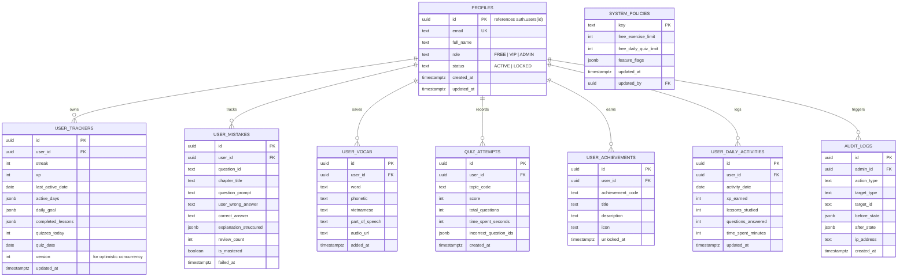

# 🗺️ BẢN ĐỒ PHÁT TRIỂN & KIẾN TRÚC HỆ THỐNG (LIVING ROADMAP & ENTERPRISE ARCHITECTURE GUIDE)
> **Dự án:** Grammar Engine - Nền tảng Tự học & Luyện thi Ngữ pháp Tiếng Anh Toàn diện (Personalized English Grammar Learning Platform)  
> **Nguồn học liệu:** Giáo trình *Ngữ pháp tiếng Anh* - Mai Lan Hương & Hà Thanh Uyên  
> **Kiến trúc:** Enterprise EdTech (Next.js + Supabase PostgreSQL 17 + Offline Sync Engine)  
> **Phiên bản hiện tại:** `v2.0-architect-enhanced`  
> **Cập nhật gần nhất:** 11/11/2026  
> **Tài liệu điều hướng tối cao:** Mọi phiên làm việc / Prompt tiếp theo **BẮT BUỘC ĐỌC FILE NÀY ĐẦU TIÊN** để nắm bắt chính xác tiến độ, kiến trúc và bước đi tiếp theo.

---

## 📌 1. ĐỊNH VỊ GIAI ĐOẠN HIỆN TẠI (CURRENT PHASE STATUS)

```
[ Phase 1: Frontend MVP & Gamified Core ] ---> [ Phase 2: Enterprise Cloud & Learning Platform (HIỆN TẠI) ] ---> [ Phase 3: AI Tutor & Monetization ]
                  ✅ HOÀN THÀNH                                        🚀 ĐANG TÁI CẤU TRÚC & TRIỂN KHAI                                  ⏳ KẾ TIẾP
```

* **Trọng tâm hiện tại:** **GIAI ĐOẠN 2 - NÂNG CẤP LÊN PERSONALIZED GRAMMAR LEARNING PLATFORM CHUYÊN SÂU**.
* **Mục tiêu cấp thiết nhất:** 
  1. Tách lớp kiến trúc Client/Server/Services/Repositories bảo mật tuyệt đối `SERVICE_ROLE_KEY`.
  2. Nâng cấp schema Supabase PostgreSQL 17 (9 bảng), thiết lập RLS đa tầng chống đệ quy (No Infinite Recursion), triggers idempotent với `search_path = public`, composite indexes.
  3. Xây dựng **Offline Sync Engine** đa tầng giải quyết triệt để xung đột LocalStorage / IndexedDB <-> Cloud.
  4. Chuẩn hóa **Structured Pedagogical Explanation Engine** (JSON schema 5 thành phần), **Grammar Visualization Engine** (sơ đồ riêng cho từng chuyên đề), và hệ thống **Learning Analytics & Smart Recommendation**.
* **Thông tin Môi trường kết nối:**
  - 🌐 **Production URL:** [https://grammar-platform.vercel.app](https://grammar-platform.vercel.app)
  - 🐙 **GitHub Repository:** [doanphuongtanthoihiep-crypto/grammar-platform](https://github.com/doanphuongtanthoihiep-crypto/grammar-platform)
  - ⚡ **Vercel Project ID:** `prj_yfOLrVVbBV0b8O8G2ihrDhR5HLsa`
  - 🐘 **Supabase Project:**
    - Project ID / Ref: `wtvlbbcyvtqqygtojxay`
    - Tên Project: `doanphuongtanthoihiep-crypto's Project`
    - Region: `ap-northeast-2` (Seoul, độ trễ cực thấp về Việt Nam)
    - URL Endpoint: `https://wtvlbbcyvtqqygtojxay.supabase.co`
    - Trạng thái DB: `ACTIVE_HEALTHY` (PostgreSQL 17)

---

## 🏛️ 2. MA TRẬN PHÂN CHIA MILESTONE & THỨ TỰ ƯU TIÊN (PRIORITY MATRIX)

Nhằm giảm thiểu tối đa rủi ro gián đoạn hệ thống và đảm bảo tính liên tục của nền tảng học tập, lộ trình Phase 2 được tổ chức theo thứ tự ưu tiên kiến trúc nghiêm ngặt:

| Nhóm chức năng | Milestone | Tên Milestone | Mức độ ưu tiên | Trạng thái |
| :--- | :--- | :--- | :---: | :---: |
| **Infrastructure** | **2.1** | **Database Provisioning, Security Hardening & RLS** | **P0 (Critical)** | 🚀 Tái cấu trúc |
| **Infrastructure** | **2.2** | **Supabase SDK Layering (Client / Server / Services)** | **P0 (Critical)** | 🚀 Tái cấu trúc |
| **Infrastructure** | **2.3** | **Auth & Offline Sync Engine (Conflict Resolution)** | **P0 (Critical)** | 🚀 Tái cấu trúc |
| **Management** | **2.4** | **Enterprise Admin Dashboard & Server Audit Logs** | **P1 (High)** | 🔄 Nâng cấp |
| **Content** | **2.5** | **Structured Pedagogical Explanation Engine (JSON Schema)**| **P1 (High)** | 🔄 Nâng cấp |
| **Design** | **2.6** | **Design Token System & White/Dark Mode WCAG AA** | **P2 (Medium)**| ✅ Core Ready |
| **Content** | **2.7** | **Grammar Visualization Engine & Audio Engine** | **P1 (High)** | 🔄 Nâng cấp |
| **Intelligence** | **2.8** | **Learning Analytics Engine (Topic & Pattern Tracking)**| **P2 (High)** | ⏳ Kế tiếp |
| **Intelligence** | **2.9** | **Smart Diagnostic & Recommendation Engine** | **P2 (High)** | ⏳ Kế tiếp |
| **Gamification** | **2.10**| **Achievement, Level & Gamification System** | **P2 (Medium)**| ⏳ Kế tiếp |
| **Quality** | **2.11**| **Performance, Security Hardening & Verification** | **P0 (Pre-Prod)**| ⏳ Kế tiếp |

---

## 🏛️ 3. KIẾN TRÚC DỰ ÁN & PHÂN TÁCH LỚP (LAYERED ARCHITECTURE)

Hệ thống Next.js Pages Router được phân tầng rõ rệt nhằm triệt tiêu hoàn toàn rủi ro lộ khóa bảo mật và đảm bảo code clean, dễ kiểm thử tự động:

```
grammar-platform/
├── lib/
│   ├── supabase/
│   │   ├── client.js            # Browser Supabase Client (Chỉ dùng NEXT_PUBLIC_SUPABASE_ANON_KEY)
│   │   ├── server.js            # Server-side Client (Sử dụng SUPABASE_SERVICE_ROLE_KEY, chỉ chạy trên Node.js/API)
│   │   └── middleware.js        # Session check & token refresh helper
│   ├── sync/
│   │   ├── indexed-db.js        # Local Database adapter cho lưu trữ lớn
│   │   ├── sync-queue.js        # Hàng đợi Offline Write Queue
│   │   └── sync-manager.js      # Bộ điều phối đồng bộ & giải quyết xung đột (Conflict Resolution)
│   ├── audio/
│   │   ├── audio.service.js     # Trình phát âm thanh & Cache
│   │   └── speech.service.js    # Web Speech API & TTS Fallback (US / UK accents, Playback speed)
│   └── tokens/
│       └── design-tokens.js     # Bảng mã màu, khoảng cách, typography tập trung
├── services/
│   ├── auth.service.js          # Nghiệp vụ đăng ký, đăng nhập, phân quyền
│   ├── profile.service.js       # Nghiệp vụ thông tin tài khoản & vai trò
│   ├── tracker.service.js       # Nghiệp vụ XP, Streak, Bài học hoàn thành
│   ├── mistakes.service.js      # Nghiệp vụ Sổ tay câu sai & thuật toán ôn tập
│   ├── vocabulary.service.js    # Nghiệp vụ Sổ tay từ vựng
│   ├── quiz.service.js          # Nghiệp vụ bộ đề trắc nghiệm & lưu kết quả
│   ├── policy.service.js        # Nghiệp vụ cấu hình hạn mức người dùng
│   ├── analytics.service.js     # Phân tích độ chính xác, tỷ lệ sai theo chuyên đề
│   └── recommendation.service.js# Chẩn đoán điểm yếu & gợi ý bài học cá nhân hóa
├── repositories/
│   ├── user.repository.js       # Truy cập DB bảng profiles, user_learning_trackers
│   ├── quiz.repository.js       # Truy cập DB bảng quiz_attempts
│   ├── mistakes.repository.js   # Truy cập DB bảng user_mistakes
│   ├── vocabulary.repository.js # Truy cập DB bảng user_vocabularies
│   ├── activity.repository.js   # Truy cập DB bảng user_daily_activities
│   └── audit.repository.js      # Truy cập DB bảng audit_logs (Server-side Only)
├── pages/
│   ├── api/
│   │   ├── admin/
│   │   │   ├── users.js         # API quản trị tài khoản có xác thực Admin Server-side
│   │   │   ├── policy.js        # API cập nhật hạn mức hệ thống
│   │   │   └── audit-logs.js    # API lấy lịch sử hoạt động Admin
│   │   ├── sync/
│   │   │   └── batch.js         # Endpoint nhận đồng bộ mẻ từ Sync Queue
│   │   └── dictionary.js        # Serverless API tra từ điển
│   ├── _app.js                  # Global wrappers, Theme Provider & Offline Sync Provider
│   └── index.js                 # Single-Page Application (Navigation, Dashboard, Study, Quiz, Mistakes, Admin)
├── data/
│   ├── normalized/
│   │   └── full_import_data.json # 7.2MB quan hệ gốc 53 lessons, 982 rules
│   └── ui/
│       ├── preview_data.json    # 12 chương, 53 bài, cheat-sheets, song ngữ
│       └── quiz_bank.json       # 2.939 câu trắc nghiệm đã làm sạch
└── ROADMAP_AND_ARCHITECTURE.md  # SINGLE SOURCE OF TRUTH
```

---

## 🐘 4. THIẾT KẾ CƠ SỞ DỮ LIỆU CHUẨN POSTGRESQL 17 (9 TABLES & RLS ARCHITECTURE)

### 4.1. Sơ đồ Thực thể Dữ liệu Mở rộng (Extended ERD)



### 4.2. RLS Security Model (Chống Đệ quy & Phân quyền Độc lập)

1. **Hàm bảo mật xác thực Admin (Security Definer Helper Function):**
   Tránh lỗi `infinite recursion` khi RLS policy trên `profiles` truy vấn ngược chính bảng `profiles`:
   ```sql
   CREATE OR REPLACE FUNCTION public.is_admin()
   RETURNS boolean AS $$
   BEGIN
     RETURN EXISTS (
       SELECT 1 FROM public.profiles
       WHERE id = auth.uid() AND role = 'ADMIN' AND status = 'ACTIVE'
     );
   END;
   $$ LANGUAGE plpgsql SECURITY DEFINER SET search_path = public;
   ```

2. **Chính sách phân quyền 2 tầng rõ rệt:**
   - **Bảng người dùng (`profiles`, `user_learning_trackers`, `user_mistakes`, `user_vocabularies`, `quiz_attempts`, `user_achievements`, `user_daily_activities`):**
     * `SELECT`: `auth.uid() = user_id` HOẶC `is_admin() = true`.
     * `INSERT`: `auth.uid() = user_id` (Không cho phép user tự chỉ định `user_id` khác).
     * `UPDATE`: `auth.uid() = user_id` (Cấm user cập nhật cột `role` trong bảng `profiles` thông qua trigger / column privilege).
     * `DELETE`: `auth.uid() = user_id` HOẶC `is_admin() = true`.
   - **Bảng hệ thống (`system_policies`):**
     * `SELECT`: Mọi người dùng đã đăng nhập (`auth.role() = 'authenticated'`) hoặc công khai.
     * `INSERT / UPDATE / DELETE`: Chỉ dành riêng cho Admin (`is_admin() = true`).
   - **Bảng ghi log (`audit_logs`):**
     * `SELECT`: Chỉ dành riêng cho Admin (`is_admin() = true`).
     * `INSERT`: Chỉ cho phép thực hiện từ Server-Side qua `SERVICE_ROLE_KEY` hoặc `is_admin() = true`. Không cho phép chỉnh sửa hoặc xóa log (Append-only).

3. **Cơ chế Trigger Khởi tạo An toàn & Idempotent:**
   ```sql
   CREATE OR REPLACE FUNCTION public.handle_new_user()
   RETURNS trigger AS $$
   BEGIN
     -- Insert profile
     INSERT INTO public.profiles (id, email, full_name, role, status)
     VALUES (
       new.id,
       new.email,
       COALESCE(new.raw_user_meta_data->>'full_name', split_part(new.email, '@', 1)),
       'FREE',
       'ACTIVE'
     )
     ON CONFLICT (id) DO UPDATE
     SET email = EXCLUDED.email,
         full_name = EXCLUDED.full_name;

     -- Insert learning tracker
     INSERT INTO public.user_learning_trackers (user_id, streak, xp, last_active_date)
     VALUES (new.id, 1, 50, CURRENT_DATE)
     ON CONFLICT (user_id) DO NOTHING;

     RETURN new;
   EXCEPTION WHEN OTHERS THEN
     RAISE WARNING 'handle_new_user error: %', SQLERRM;
     RETURN new;
   END;
   $$ LANGUAGE plpgsql SECURITY DEFINER SET search_path = public;
   ```

4. **Composite Performance Indexes:**
   ```sql
   CREATE INDEX IF NOT EXISTS idx_mistakes_user_ch ON public.user_mistakes(user_id, chapter_title);
   CREATE INDEX IF NOT EXISTS idx_vocab_user_date ON public.user_vocabularies(user_id, added_at DESC);
   CREATE INDEX IF NOT EXISTS idx_quiz_user_date ON public.quiz_attempts(user_id, created_at DESC);
   CREATE INDEX IF NOT EXISTS idx_daily_user_date ON public.user_daily_activities(user_id, activity_date DESC);
   CREATE INDEX IF NOT EXISTS idx_audit_admin_date ON public.audit_logs(admin_id, created_at DESC);
   ```

---

## 🔄 5. KIẾN TRÚC OFFLINE SYNC ENGINE & CHIẾN LƯỢC XUNG ĐỘT (HYBRID SYNC)

### 5.1. Mô hình Đồng bộ Dữ liệu

```text
[ Browser Event: Complete Question / Learn Lesson ]
                       │
                       ▼
       [ Local Storage / IndexedDB Storage ]
                       │
                       ▼
            [ Offline Write Queue ]
                       │
           ┌───────────┴───────────┐
      (Online)                  (Offline)
           │                         │
           ▼                         ▼
   [ Sync Manager ]           [ Pending Changes State (🟠) ]
           │                         │
    (Conflict Rules)                 ▼
           │                  [ Auto-retry when online ]
           ▼
[ Supabase PostgreSQL 17 via API ]
           │
           ▼
[ Synced State (🟢) with Last Sync Timestamp ]
```

### 5.2. Ma trận Chiến lược Giải quyết Xung đột (Conflict Resolution Matrix)

| Loại dữ liệu | Chiến lược xử lý | Cơ chế thực thi |
| :--- | :--- | :--- |
| **Điểm kinh nghiệm (XP)** | Transactional Increment | Tính toán phần gia tăng (delta) ở client; server thực hiện phép toán cộng dồn nguyên tử `xp = xp + delta` thay vì ghi đè giá trị tuyệt đối. |
| **Chuỗi ngày học (Streak)**| Server-side Calculation | Server đối chiếu `last_active_date` với `CURRENT_DATE`: nếu là ngày kế tiếp thì tăng 1; nếu trùng thì giữ nguyên; nếu đứt quãng thì reset về 1. |
| **Lượt thi Quiz (Quiz Attempts)**| Immutable Records | Mỗi lần thi xong là một bản ghi bất biến với UUID riêng; không cập nhật bản ghi cũ, chỉ append bản ghi mới. |
| **Sổ tay câu sai (Mistakes)** | Upsert theo Unique Key | Cặp `(user_id, question_id)` làm khóa duy nhất: nếu làm sai lại thì cập nhật `failed_at` và `review_count += 1`; nếu làm đúng trong chế độ ôn thì set `is_mastered = true`. |
| **Sổ từ vựng (Vocabulary)** | Merge theo Word ID | Hợp nhất danh sách từ vựng cục bộ và cloud theo khóa từ (`word`). |
| **Tiến độ học tập (Progress)** | Version-based Merge | Sử dụng trường `version` trong `user_learning_trackers`: hợp nhất tập hợp mảng `completed_lessons` (Union Set) để không bao giờ làm mất bài học đã hoàn thành. |

---

## 📐 6. STRUCTURED PEDAGOGICAL EXPLANATION ENGINE (JSON SCHEMA)

Toàn bộ giải thích câu hỏi bài tập và đề thi được chuẩn hóa thành cấu trúc dữ liệu JSON sư phạm thay vì các chuỗi văn bản tự do:

```json
{
  "signal": {
    "title": "Dấu hiệu nhận biết",
    "content": "Xuất hiện trạng từ chỉ thời gian 'for 5 years' kết hợp ngữ cảnh hành động bắt đầu từ quá khứ và vẫn tiếp diễn ở hiện tại.",
    "keywords": ["for 5 years", "since", "so far"]
  },
  "rule": {
    "title": "Quy tắc ngữ pháp",
    "formula": "S + have/has + V3/V-ed",
    "explanation": "Thì Hiện tại hoàn thành (Present Perfect Tense) diễn tả hành động xảy ra trong quá khứ và kéo dài đến hiện tại."
  },
  "translation": {
    "vi": "Họ đã sống ở thành phố này được 5 năm.",
    "en": "They have lived in this city for 5 years."
  },
  "common_mistakes": [
    "Dùng nhầm thì Quá khứ đơn (lived) vì thấy hành động đã bắt đầu từ trước.",
    "Quên chia 'has' với ngôi thứ ba số ít."
  ],
  "exam_tips": [
    "Phân biệt 'since' (mốc thời gian cụ thể: since 2018) và 'for' (khoảng thời gian: for 5 years)."
  ],
  "difficulty": "Intermediate",
  "category": "TENSES"
}
```

### 4 Tính năng Sư phạm Mở rộng:
1. **Phân cấp độ khó (Difficulty Levels):** `Beginner`, `Elementary`, `Intermediate`, `Advanced`.
2. **Kiểm toán chất lượng giải thích (Explanation Quality Validation):** Tuyệt đối không thay đổi đáp án đúng để ép theo lời giải. Kiểm tra tính nhất quán giữa công thức, từ khóa và bản dịch.
3. **Gợi ý học tập bù đắp (Learning Recommendation):** Tự động phát hiện lỗi sai liên quan đến chuyên đề và dẫn đường cho học viên ôn lại phần lý thuyết tương ứng kèm 5 câu bài tập tương tự.
4. **Phản hồi học liệu (Student Feedback):** Nút đánh giá trực tiếp trên từng lời giải: `👍 Hữu ích`, `👎 Chưa rõ ràng`, `🚩 Báo lỗi đáp án`.

---

## 🎨 7. GRAMMAR VISUALIZATION ENGINE (SƠ ĐỒ TRỰC QUAN TƯƠNG TÁC THEO CHUYÊN ĐỀ)

Không áp dụng một mẫu Cheat-sheet đơn điệu cho mọi bài học. Mỗi chủ điểm ngữ pháp được thiết kế một hình thức trực quan chuyên biệt:

| Chủ điểm Ngữ pháp | Hình thức Trực quan Hóa | Trải nghiệm Tương tác |
| :--- | :--- | :--- |
| **13 Thì tiếng Anh (Tenses)** | **Dòng thời gian (Timeline Axis)** | Trục thời gian Quá khứ - Hiện tại - Tương lai kèm điểm mốc và khoảng hành động. |
| **Câu điều kiện (Conditionals)** | **Cây quyết định (Decision Tree)** | Phân nhánh theo tính khả thi: Có thật ở hiện tại -> Loại 1; Giả định hiện tại -> Loại 2; Giả định quá khứ -> Loại 3. |
| **Câu bị động (Passive Voice)** | **Sơ đồ Biến đổi (Transformation Diagram)** | Mũi tên chuyển vị trí S -> By O, O -> S, và động từ V -> Be + V3 sinh động. |
| **Câu gián tiếp (Reported Speech)** | **Bảng Lùi thì & Chuyển đổi (Conversion Flow)** | Luồng lùi thì mũi tên (Present -> Past -> Past Perfect) và quy tắc đổi đại từ/thời gian. |
| **Mệnh đề quan hệ (Relative Clauses)** | **Sơ đồ Cấu trúc Câu (Sentence Tree)** | Highlight danh từ đi trước và liên kết với đại từ quan hệ (Who, Whom, Which, Whose, That). |
| **So sánh (Comparisons)** | **Thẻ So sánh Đa cấp (Comparison Scale)** | Biểu diễn trực quan tỷ lệ Bằng nhau (=), Hơn (>), Nhất (MAX). |
| **Động từ khuyết thiếu (Modal Verbs)**| **Ma trận Cấp độ Nghĩa (Meaning Matrix)** | Thang đo độ chắc chắn từ 0% đến 100% (Might -> May -> Could -> Should -> Must). |
| **Từ loại & Cấu tạo từ (Word Forms)** | **Cây Họ từ (Word Family Tree)** | Cây phân nhánh Gốc từ -> Danh từ -> Động từ -> Tính từ -> Trạng từ kèm hậu tố. |

---

## 🔊 8. CHUẨN HÓA KIẾN TRÚC AUDIO ENGINE

Thay thế các lời gọi `playWordAudio` rải rác bằng một hệ thống **Audio Service** tập trung:
- **Tập trung hóa:** `lib/audio/speech.service.js` và `lib/audio/pronunciation.service.js`.
- **Đa dạng ngữ điệu:** Hỗ trợ tùy chọn giọng đọc Anh - Anh (UK - British English) và Anh - Mỹ (US - American English).
- **Điều chỉnh tốc độ:** `0.75x` (chậm cho người mới bắt đầu), `1.0x` (chuẩn), `1.25x` (luyện nghe nhanh).
- **Bộ nhớ đệm âm thanh (Audio Caching):** Lưu cache audio URL từ từ điển, tránh gọi trùng lặp mạng.

---

## 🛡️ 9. ENGINEERING QUALITY GATES (TIÊU CHUẨN NGHIỆM THU BẮT BUỘC)

Trước khi đánh dấu hoàn thành `[x]` cho bất kỳ milestone nào, agent và lập trình viên bắt buộc phải vượt qua bảng tiêu chí kiểm soát chất lượng kỹ thuật sau:

| Quality Gate | Tiêu chuẩn Đánh giá | Bằng chứng Bắt buộc (Verification Evidence) |
| :--- | :--- | :--- |
| **1. Architecture Compliance** | Tuân thủ tuyệt đối cấu trúc Client / Server / Services / Repositories. | Không import server code vào browser, không dùng `SERVICE_ROLE_KEY` ở client. |
| **2. Security & RLS** | RLS không đệ quy, không bypass authorization, người dùng không thể tự phong quyền Admin. | Script chạy test RLS đóng vai trò Anonymous, Free User, VIP User và Admin. |
| **3. Database Migration** | Migration chạy thành công, hỗ trợ rollback, idempotent. | Log kết quả chạy SQL từ Supabase MCP tool `execute_sql`. |
| **4. Zero Compilation Error** | Bản build Next.js thành công 100%, không lỗi cú pháp hoặc JSON escape. | Vercel Deployment đạt trạng thái `READY` trên production. |
| **5. Functional Integrity** | Tính năng hoạt động chuẩn xác theo nghiệp vụ mô tả. | Test luồng end-to-end từ UI -> API -> Supabase DB. |
| **6. Regression Proof** | Không làm hỏng hoặc mất mát 12 chuyên đề, 53 bài học và 2.939 câu hỏi hiện có. | Kiểm tra đối soát số lượng record dữ liệu sau khi cập nhật. |
| **7. Design & Responsive** | Hiển thị hoàn hảo trên cả White Mode và Dark Mode, đáp ứng tốt Mobile / Tablet / Desktop. | Đảm bảo tương phản WCAG AA, không bị thanh đen, nút chìm hay text tàng hình. |
| **8. Living Roadmap Sync** | File `ROADMAP_AND_ARCHITECTURE.md` được cập nhật đồng bộ ngay sau mỗi bước. | Commit Git có diff thể hiện việc cập nhật checklist tương ứng. |

---

## 📋 10. CHI TIẾT CÁC MILESTONE TIẾP THEO

### 🔹 Milestone 2.1: Database Provisioning, Security Hardening & RLS (P0)
- [ ] Chạy migration mở rộng 9 bảng trên Supabase Postgres: `profiles`, `user_learning_trackers`, `user_mistakes`, `user_vocabularies`, `system_policies`, `quiz_attempts`, `user_achievements`, `user_daily_activities`, `audit_logs`.
- [ ] Thiết lập hàm bảo mật `is_admin()` (Security Definer) ngăn ngừa triệt để lỗi Infinite Recursion trong RLS.
- [ ] Thiết lập RLS policies độc lập: User tables (Owner read/write), System tables (Authenticated read, Admin write), Audit logs (Append-only).
- [ ] Tạo trigger `on_auth_user_created` idempotent với `SET search_path = public` và bảo vệ lỗi ngoại lệ.
- [ ] Tạo composite indexes cho các câu truy vấn thực tế (`user_id`, `chapter_title`, `created_at DESC`).
- [ ] Chạy bộ kiểm thử tự động RLS Security Validation.

### 🔹 Milestone 2.2: Phân tách Kiến trúc Supabase SDK (Client / Server / Services / Repositories) (P0)
- [ ] Tách `lib/supabase/client.js` chỉ chứa browser client sử dụng `NEXT_PUBLIC_SUPABASE_ANON_KEY`.
- [ ] Tạo `lib/supabase/server.js` chỉ chạy phía server sử dụng `SUPABASE_SERVICE_ROLE_KEY`.
- [ ] Xây dựng thư mục `repositories/` chuyên trách các thao tác database.
- [ ] Xây dựng thư mục `services/` chuyên trách các quy tắc nghiệp vụ.
- [ ] Tạo các Next.js API Routes được bảo vệ quyền Admin phía server (`/api/admin/users`, `/api/admin/policy`, `/api/admin/audit-logs`).

### 🔹 Milestone 2.3: Offline Sync Engine & Hybrid Synchronization (P0)
- [ ] Xây dựng `lib/sync/sync-queue.js` quản lý hàng đợi ghi chép cục bộ khi mất mạng.
- [ ] Xây dựng `lib/sync/sync-manager.js` điều phối gửi mẻ dữ liệu đồng bộ khi có kết nối trở lại.
- [ ] Triển khai các quy tắc giải quyết xung đột (Conflict Resolution Rules): Transactional increment cho XP, Server calculation cho Streak, Immutable records cho Quiz, Upsert cho Mistakes, Set Union cho Progress.
- [ ] Thiết kế huy hiệu trạng thái đồng bộ trên UI: 🟢 Synced, 🟡 Syncing, 🟠 Pending Changes, 🔴 Sync Failed, ⚪ Offline Mode kèm thời gian đồng bộ thành công gần nhất.

### 🔹 Milestone 2.4: Nâng cấp Admin Dashboard Chuyên sâu & Audit Logs (P1)
- [ ] Bổ sung thanh tìm kiếm người dùng theo email và bộ lọc trạng thái (FREE / VIP / ADMIN).
- [ ] Hiển thị thống kê tổng thể: Tổng người dùng, Người dùng tích cực hàng ngày, Tỷ lệ trả lời chính xác trung bình, Top bài học khó nhất, Top câu hỏi sai nhiều nhất.
- [ ] Ghi nhận toàn bộ thao tác thay đổi quyền và cập nhật cấu hình vào bảng `audit_logs`.
- [ ] Xử lý khóa tài khoản (Ban/Unban) thực thi ở server-side API.

### 🔹 Milestone 2.5: Chuẩn hóa Structured Pedagogical Explanation Engine (JSON) (P1)
- [ ] Chuyển đổi định dạng giải thích sang chuẩn JSON sư phạm gồm 5 trường: `signal`, `rule`, `translation`, `common_mistakes`, `exam_tips`.
- [ ] Bổ sung nhãn phân cấp độ khó: Beginner, Elementary, Intermediate, Advanced.
- [ ] Bổ sung tính năng học viên gửi phản hồi chất lượng lời giải (Hữu ích / Báo lỗi).
- [ ] Tự động đề xuất bài học bù đắp khi học viên làm sai câu hỏi.

### 🔹 Milestone 2.6: Chuẩn hóa Design Token System & WCAG AA (P2)
- [ ] Định nghĩa Design Tokens tập trung trong `lib/tokens/design-tokens.js` và CSS Variables.
- [ ] Đảm bảo 100% tỷ lệ tương phản đạt chuẩn WCAG AA cho cả Light Theme và Dark Theme.
- [ ] Ngăn ngừa hiện tượng nhấp nháy giao diện khi tải trang (FOIT / FOUT).
- [ ] Bổ sung Skeleton Loading và các trạng thái Empty / Error đồng bộ.

### 🔹 Milestone 2.7: Xây dựng Grammar Visualization Engine & Audio Service (P1)
- [ ] Thiết kế sơ đồ trực quan hóa đặc thù cho từng nhóm ngữ pháp: Timeline (13 thì), Decision Tree (Câu điều kiện), Transformation Diagram (Câu bị động), Conversion Flow (Câu gián tiếp).
- [ ] Cho phép học viên tương tác click chọn từng thành phần trên sơ đồ trực quan.
- [ ] Chuẩn hóa `lib/audio/speech.service.js` với tùy chọn giọng đọc UK/US và thanh chỉnh tốc độ đọc (`0.75x`, `1.0x`, `1.25x`).

### 🔹 Milestone 2.8: Learning Analytics Engine (P2)
- [ ] Bảng điều khiển phân tích chi tiết: Tỷ lệ làm đúng theo từng chuyên đề ngữ pháp.
- [ ] Biểu đồ theo dõi sự tiến bộ theo thời gian và thời lượng học tập mỗi ngày.
- [ ] Thống kê các mẫu lỗi ngữ pháp tái diễn nhiều nhất của học viên.

### 🔹 Milestone 2.9: Smart Diagnostic & Recommendation Engine (P2)
- [ ] Thuật toán chẩn đoán điểm yếu (Weak Area Detection) dựa trên lịch sử làm bài.
- [ ] Lập lộ trình học bù đắp tự động: Ôn lý thuyết chuyên đề yếu -> Làm 10 câu luyện tập đích danh -> Làm mini-quiz đánh giá lại.

### 🔹 Milestone 2.10: Achievement & Gamification System (P2)
- [ ] Hệ thống huy hiệu thành tích mở khóa tự động (Ví dụ: "Bậc thầy 13 Thì", "Chuỗi lửa 7 ngày", "Thợ săn điểm 10").
- [ ] Bảng xếp hạng học tập (Leaderboard) tuần và tháng tạo động lực thi đua.
- [ ] Thử thách hàng ngày (Daily Challenges) nhận thêm điểm kinh nghiệm XP.

### 🔹 Milestone 2.11: Performance, Security Hardening & Pre-Production Verification (P0)
- [ ] Kiểm thử bảo mật RLS và API Authorization (Penetration testing mô phỏng tấn công chiếm quyền).
- [ ] Tối ưu hóa truy vấn cơ sở dữ liệu, kiểm tra EXPLAIN ANALYZE các query phức tạp.
- [ ] Đạt điểm số Google Lighthouse tối thiểu 90+ trên cả Mobile và Desktop.
- [ ] Thiết lập quy trình sao lưu định kỳ (Automated Backup) và kịch bản Rollback khi có sự cố.

---

## 📋 11. NGUYÊN TẮC VẬN HÀNH DÀNH CHO AGENT / DEVELOPER (OPERATIONAL PROTOCOL)

1. **Đọc tài liệu này đầu tiên:** Trong mọi lượt tương tác phát triển mới, agent phải đọc `ROADMAP_AND_ARCHITECTURE.md` để nắm đúng bối cảnh, kiến trúc và mục tiêu kế tiếp.
2. **Tuân thủ Quality Gates:** Tuyệt đối không tự ý báo cáo hoàn thành một milestone nếu chưa cung cấp đầy đủ bằng chứng thực thi theo bảng Tiêu chuẩn Nghiệm thu tại Mục 9.
3. **Bảo tồn tính toàn vẹn của học liệu:** Không làm mất mát hoặc xáo trộn 12 chuyên đề, 53 bài học lý thuyết và 2.939 câu hỏi thực hành đã được số hóa.
4. **Cập nhật trạng thái liên tục:** Sau khi hoàn thành bất kỳ mục nào trong Milestone 2.x, agent phải đánh dấu `[x]` vào checklist của tài liệu này và commit lên git.
5. **Kiểm thử trên Production:** Mọi code mới sau khi commit phải được push lên GitHub và xác nhận Vercel Deployment đạt trạng thái `READY` trước khi bàn giao cho người dùng.
