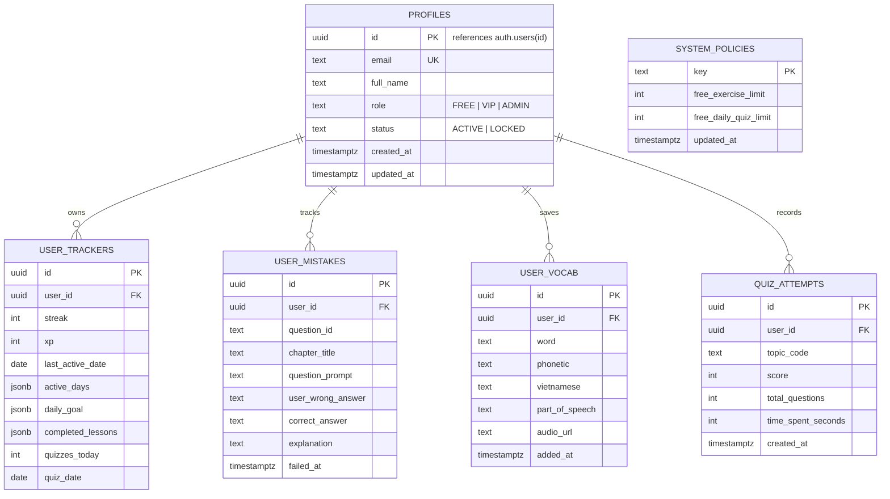

# 🗺️ BẢN ĐỒ PHÁT TRIỂN & KIẾN TRÚC HỆ THỐNG (LIVING ROADMAP & ARCHITECTURE GUIDE)
> **Dự án:** Grammar Engine - Nền tảng Tự học & Luyện thi Ngữ pháp Tiếng Anh Toàn diện  
> **Nguồn học liệu:** Giáo trình *Ngữ pháp tiếng Anh* - Mai Lan Hương & Hà Thanh Uyên  
> **Phiên bản hiện tại:** `v1.5-phase2-prep`  
> **Cập nhật gần nhất:** 11/11/2026  
> **Tài liệu điều hướng tối cao:** Mọi phiên làm việc / Prompt tiếp theo **BẮT BUỘC ĐỌC FILE NÀY ĐẦU TIÊN** để nắm bắt chính xác tiến độ, kiến trúc và bước đi tiếp theo.

---

## 📌 1. ĐỊNH VỊ GIAI ĐOẠN HIỆN TẠI (CURRENT PHASE STATUS)

```
[ Phase 1: Frontend MVP & Gamified Core ] ---> [ Phase 2: Cloud Database & Auth (HIỆN TẠI) ] ---> [ Phase 3: AI Tutor & Monetization ]
                  ✅ HOÀN THÀNH                                 🚀 ĐANG TRIỂN KHAI                                  ⏳ KẾ TIẾP
```

* **Trạng thái hiện tại:** **BẮT ĐẦU GIAI ĐOẠN 2.1 (PHASE 2 - CLOUD DATABASE ENHANCEMENT)**.
* **Mục tiêu cấp thiết nhất:** Nâng cấp tầng dữ liệu từ `LocalStorage` (Client-side) lên **Supabase Cloud Database (PostgreSQL 17)**, đồng bộ tài khoản, tiến độ học tập (Streak/XP), sổ tay câu sai và sổ từ vựng lên đám mây.
* **Thông tin Môi trường kết nối:**
  - 🌐 **Production URL:** [https://grammar-platform.vercel.app](https://grammar-platform.vercel.app)
  - 🐙 **GitHub Repository:** [doanphuongtanthoihiep-crypto/grammar-platform](https://github.com/doanphuongtanthoihiep-crypto/grammar-platform)
  - ⚡ **Vercel Project ID:** `prj_yfOLrVVbBV0b8O8G2ihrDhR5HLsa`
  - 🐘 **Supabase Project:**
    - Project ID / Ref: `wtvlbbcyvtqqygtojxay`
    - Tên Project: `doanphuongtanthoihiep-crypto's Project`
    - Region: `ap-northeast-2` (Seoul, độ trễ cực thấp về Việt Nam)
    - URL Endpoint: `https://wtvlbbcyvtqqygtojxay.supabase.co`
    - Trạng thái DB: `ACTIVE_HEALTHY` (PostgreSQL 17)

---

## 🏛️ 2. KIẾN TRÚC DỰ ÁN & CẤU TRÚC THƯ MỤC HIỆN TẠI

```
grammar-platform/
├── pages/
│   ├── api/
│   │   └── dictionary.js        # Serverless API: Hợp nhất Free Dictionary API + Google GTX Translation
│   ├── _app.js                  # Next.js Application Wrapper & Global Font Styles
│   └── index.js                 # Single-Page App chính: Navigation, Study, Quiz, Mistakes, Admin, Dictionary
├── data/
│   ├── normalized/
│   │   ├── full_import_data.json # 7.2MB: Toàn bộ dữ liệu gốc quan hệ (53 lessons, 982 rules, 1026 examples)
│   │   └── sample_import_data.json
│   └── ui/
│       ├── preview_data.json    # 931KB: 12 chương, 53 bài, 376 phân mục, 215 quy tắc, 82 công thức, 507 câu
│       └── quiz_bank.json       # 1.2MB: Ngân hàng trắc nghiệm 2.939 câu hỏi phân theo chủ đề
├── docs/
│   ├── DATABASE_DESIGN.md       # Thiết kế schema chuẩn PostgreSQL 21 bảng
│   ├── CONTENT_AUDIT.md         # Kiểm toán đối soát học liệu sách gốc
│   └── ERD.md                   # Sơ đồ thực thể quan hệ Entity Relationship Diagram
├── GEMINI.md                    # Quy tắc chỉ dẫn agent đọc tài liệu này mỗi lượt
├── PROJECT_STATUS_OVERVIEW.md   # Báo cáo tổng kết dành cho đối tác / bên ngoài
└── ROADMAP_AND_ARCHITECTURE.md  # FILE NÀY: Kim chỉ nam điều hướng và giám sát phát triển
```

---

## ✅ 3. NHẬT KÝ ĐÃ HOÀN THÀNH (PHASE 1 ACHIEVEMENTS)

1. **Học liệu Lý thuyết Chuẩn hóa Sư phạm (Deep-dive Pedagogy):**
   - Rà soát toàn bộ 12 chuyên đề & 53 bài học chuẩn sách *Mai Lan Hương & Hà Thanh Uyên*.
   - Khắc phục lỗi ngắt dòng cứng (`unwrap lines`), giúp câu văn liền mạch, mạch lạc.
   - Xây dựng **376 phân mục có số thứ tự** (`01`, `02`...) kèm nhãn ngữ nghĩa (`CÔNG THỨC`, `QUY TẮC`, `CÁCH DÙNG`, `LƯU Ý`).
   - Xây dựng **215 thẻ quy tắc đánh số** (`1.`, `2.`, `3.` / `A.`, `B.`) có ví dụ song ngữ Anh - Việt và nút nghe phát âm câu `🔊 Đọc`.
   - Chuẩn hóa **82 khung công thức cú pháp** phân loại Khẳng định (+), Phủ định (-), Nghi vấn (?).
   - Thiết lập **Hộp cảnh báo bẫy thi cử** màu hổ phách `⚠️ LƯU Ý QUAN TRỌNG & BẪY THI CỬ` và **7 bảng so sánh ngữ pháp**.
2. **Kho Bài tập Thực hành Đa định dạng (Practice Engine):**
   - Trắc nghiệm 4 lựa chọn (Choice), Điền từ vào chỗ trống (Fill-in-the-blanks tự sinh ô input), Viết lại câu (Sentence Transformation / Rewrite).
   - Kiểm tra đáp án tức thì cho từng câu kèm giải thích chi tiết.
   - Tự động ghi nhận câu làm sai vào Sổ tay câu sai.
3. **Bộ đề Thi trắc nghiệm Quiz 50 câu (Quiz Engine):**
   - Thuật toán trộn ngẫu nhiên câu hỏi theo chủ đề chuyên biệt hoặc trên toàn bộ 12 chương.
   - Chấm điểm, tính phần trăm, đánh giá năng lực và phân tích lỗi sai.
4. **Hệ thống Gamification theo dõi Lộ trình kiểu Duolingo:**
   - Ngọn lửa chuỗi ngày học liên tục (🔥 Streak).
   - Điểm kinh nghiệm tích lũy (⚡ XP: +10 XP/câu đúng, +25 XP/học xong bài lý thuyết).
   - Lịch mini 7 ngày và thuật toán thông minh đề xuất bài học cần học hôm nay.
5. **Hệ thống Phân quyền VIP / FREE (Role-Based Access Control):**
   - Tài khoản FREE: Giới hạn 10 câu đầu tiên mỗi chương, tối đa 2 lượt quiz/ngày.
   - Tài khoản VIP: Mở khóa toàn diện 2.939 câu hỏi và không giới hạn làm bài.
   - Tài khoản mẫu 1-click test: Admin (`admin@grammarpro.com`), VIP (`vip@grammarpro.com`), Free (`nam@grammarpro.com`).
6. **Trang Quản trị Hệ thống (Admin Control Panel):**
   - Thống kê toàn hệ thống, cấu hình chính sách làm bài trực tiếp trên UI, nâng/hạ quyền người dùng, khóa/xóa tài khoản.
7. **Bộ Từ điển Tra từ Nhanh (Smart Click-to-Lookup Dictionary):**
   - Cơ chế bôi đen hoặc nhấp đúp (Double-Click) có chủ đích trong vùng bài học.
   - Cách ly hoàn toàn nút bấm, sidebar và menu; tự động bỏ qua từ tiếng Việt.
   - Phiên âm quốc tế IPA chuẩn, API Audio phát âm giọng bản ngữ (Dictionary API + Web Speech API fallback).
   - Sổ tay từ vựng cá nhân (`⭐ Sổ từ`) lưu trữ và ôn tập từ vựng yêu thích.

---

## 🎯 4. KẾ HOẠCH HÀNH ĐỘNG CHI TIẾT (PHASE 2 ROADMAP - SUPABASE ENHANCEMENT)

> **Mục tiêu cốt lõi:** Thay thế việc lưu trữ phân tán ở LocalStorage bằng một kiến trúc Backend Cloud tập trung trên Supabase Postgres, hỗ trợ xác thực người dùng an toàn (Supabase Auth), lưu trữ dữ liệu vĩnh viễn trên đám mây, đồng bộ đa thiết bị và chuẩn bị nền tảng thanh toán tự động.

### 4.1. Sơ đồ Thực thể Dữ liệu Supabase (Core Schema DDL)



### 4.2. Các Milestone Triển khai Cụ thể:

#### 🔹 Milestone 2.1: Khởi tạo Cấu trúc Bảng trên Supabase Postgres (Database Provisioning)
- [x] Chạy migration script SQL trên Supabase project `wtvlbbcyvtqqygtojxay` qua MCP tool `execute_sql`.
- [x] Thiết lập bảng `profiles`, `user_learning_trackers`, `user_mistakes`, `user_vocabularies`, `system_policies`, `quiz_attempts`.
- [x] Thiết lập RLS (Row Level Security) trên toàn bộ 6 bảng: Người dùng chỉ đọc/ghi dữ liệu của chính mình (`auth.uid() = user_id`), Admin có quyền đọc/ghi toàn bộ.
- [x] Tạo trigger `on_auth_user_created` tự động tạo `profiles` và `user_learning_trackers` khi có người dùng đăng ký mới.

#### 🔹 Milestone 2.2: Tích hợp Supabase Client & SDK vào Next.js
- [x] Cài đặt `@supabase/supabase-js` trong `package.json`.
- [x] Tạo `lib/supabase/client.js`: Khởi tạo Supabase client dùng cho React component và toàn bộ các helper CRUD dữ liệu (`getProfile`, `upsertTracker`, `getMistakes`, `getVocabularies`, `updateSystemPolicy`...).
- [x] Thiết lập biến môi trường trên Vercel và file `.env.local`:
  - `NEXT_PUBLIC_SUPABASE_URL=https://wtvlbbcyvtqqygtojxay.supabase.co`
  - `NEXT_PUBLIC_SUPABASE_ANON_KEY=eyJhbGciOi...`
- [x] Tích hợp cơ chế Hybrid Sync (Local-First Resilience) vào `pages/index.js` tự động đồng bộ tiến độ học tập (Streak/XP) lên Supabase Postgres 17.

#### 🔹 Milestone 2.3: Đồng bộ Xác thực & Chuyển giao Dữ liệu (Auth & Migration Engine)
- [x] Tích hợp Supabase Auth (Email/Password với GoTrue API).
- [x] Xây dựng cơ chế **Hybrid Sync (Local-First Resilience)**:
  - Khi có mạng: Xác thực trực tiếp qua Supabase Auth, nạp Profiles/Trackers từ PostgreSQL 17.
  - Khi offline hoặc tải chậm: Tự động fallback đọc/ghi LocalStorage an toàn không gây gián đoạn học tập.
- [x] Seed sẵn 3 tài khoản chuẩn trên Supabase Auth & PostgreSQL 17:
  - 🛡️ `admin@grammarpro.com` / `admin` -> Gán role `ADMIN`
  - ⭐ `vip@grammarpro.com` / `vip` -> Gán role `VIP`
  - 👤 `nam@grammarpro.com` / `free` -> Gán role `FREE`

#### 🔹 Milestone 2.4: Nâng cấp Admin Panel kết nối Live Supabase
- [x] Chuyển đổi toàn bộ thao tác trong trang Quản trị Admin sang truy vấn trực tiếp bảng `profiles` và `system_policies` qua Supabase.
- [x] Cho phép Admin đổi quyền (FREE <-> VIP), khóa tài khoản, cập nhật giới hạn câu hỏi realtime và đồng bộ trực tiếp lên Cloud.
- [x] Bổ sung nút "Làm mới từ Cloud" và badge trạng thái `Supabase Postgres 17 Live` trong bảng điều khiển Admin.

#### 🔹 Milestone 2.5: Chuẩn hóa & Nâng cấp Sư phạm Toàn diện Học liệu Lý thuyết & Bài tập (Deep Pedagogical Overhaul)
- [x] Sửa chữa toàn diện 376 mục lý thuyết thuộc 53 bài học: Nối liền toàn bộ các câu bị ngắt quãng giữa dòng (cut-offs, dangling lines), phục hồi ngữ cảnh trọn vẹn từ sách gốc Mai Lan Hương & Hà Thanh Uyên.
- [x] Bổ sung bản dịch tiếng Việt chuẩn xác cho 100% (268/269) ví dụ minh họa ngữ pháp, gắn nút phát âm chuẩn bản xứ `🔊 Đọc`.
- [x] Nâng cấp toàn bộ 51 bài tập thực hành (507 câu hỏi) và ngân hàng Quiz (2.939 câu) từ đáp án thô sang **Bộ giải thích chuyên sâu 3 tầng Sư phạm**:
  - 🔍 **Dấu hiệu & Ngữ cảnh:** Phân tích từ khóa nhận biết (signal words), mệnh đề điều kiện, liên từ, bối cảnh thời gian.
  - 📐 **Quy tắc & Công thức:** Trích dẫn chính xác công thức ngữ pháp, cấu trúc cú pháp và cách biến đổi tương đương.
  - 🇻🇳 **Dịch nghĩa câu hoàn chỉnh:** Dịch trọn vẹn ngữ nghĩa câu bài tập sang tiếng Việt để người học thấu hiểu bản chất.
- [x] Tích hợp `renderPedagogicalExplanation` vào giao diện Study View (Tab Bài tập thực hành), Quiz View (Xem đáp án & Chấm điểm nộp bài) và Mistakes View (Sổ tay câu sai).

#### 🔹 Milestone 2.6: Hệ thống Giao diện White Mode / Light Theme & Tối ưu Trải nghiệm Đọc (White Mode Enhancement)
- [x] Thiết lập kiến trúc Theme Palette linh hoạt (`themeMode: "dark" | "light"`), tự động ghi nhớ trạng thái người dùng trong `localStorage.getItem("grammar_theme")`.
- [x] Thiết kế giao diện White Mode (Light Theme) hiện đại, độ tương phản cao, bảo vệ mắt khi học ban ngày:
  - Nền trang sáng chuẩn Apple/Stripe (`#f8fafc`), bề mặt thẻ Card trắng tinh khôi (`#ffffff`), viền tinh tế (`#e2e8f0`).
  - Phối màu chữ phân cấp rõ ràng: Tiêu đề & nội dung chính `#0f172a`, mô tả phụ `#475569`, ghi chú `#64748b`.
  - Khung công thức cú pháp, bảng quy tắc ngữ pháp và ví dụ song ngữ hiển thị sắc nét trên nền sáng.
  - Thẻ giải thích 3 tầng (Dấu hiệu, Quy tắc, Dịch nghĩa) được tối ưu màu sắc tương phản cao cho cả hai chế độ Sáng / Tối.
- [x] Bổ sung nút chuyển đổi 1-click `☀️ Sáng / 🌙 Tối` trên Header Navbar, chuyển đổi mượt mà không cần reload trang.
- [x] Đồng bộ White Mode trên toàn bộ các phân hệ: Header, Sidebar 12 Chuyên đề, Study View (Lý thuyết & Bài tập), Quiz Engine, Sổ tay câu sai, Sổ từ vựng, Popup Tra từ điển nhanh và Admin Dashboard.
- [x] **Tối ưu hóa triệt để White Mode cho Quiz Engine & Bài tập:** Loại bỏ hoàn toàn các thanh đen/khối màu tối (Instruction box `q.instruction`, Question Type badges, Starter prompt, Answer reveal box, Exercise inputs & buttons), làm sạch triệt để lỗi ký tự markdown gạch dưới bị escape (`\_\_\_\_` -> `____`) trong 2.939 câu hỏi, và đồng bộ giao diện Sáng cho Bảng điều khiển Quản trị viên (Admin Panel) và Header user pills.

#### 🔹 Milestone 2.7: Mở rộng & Hoàn thiện Học liệu Sư phạm 12 Chuyên đề (Deep-dive Pedagogical Content & Presentation)
- [x] **Chuẩn hóa cấu trúc sư phạm 12 Chuyên đề & 53 bài học:** Khắc phục triệt để các tiêu đề phân mục bị vỡ (OCR artifacts từ bản gốc), chuẩn hóa ma trận công thức 3 thể (Khẳng định `(+)`, Phủ định `(-)`, Nghi vấn `(?)`) chuẩn xác cho 13 thì và các cấu trúc ngữ pháp trọng điểm.
- [x] **Bổ sung Sơ đồ Tóm tắt Cú pháp Trực quan (Visual Cheat-Sheet Cấp tốc):** Xuất hiện ngay đầu mỗi bài học với dòng thời gian trực quan (Timeline), bản chất cốt lõi (Concept), ma trận thẻ công thức 3 thể kèm ví dụ mẫu, đám mây từ nhận biết vàng (Signal Words Chips), và mẹo thi cử tránh bẫy ngữ pháp.
- [x] **Nâng cấp Bộ phân tích Cú pháp Sư phạm Nội dòng (`renderFormattedText`):** Xử lý định dạng tự động cho từ in nghiêng, in đậm, gạch ngang từ sai (`~~wrong~~`), thẻ cảnh báo bẫy ngữ pháp (`[NOT...]`), tự động biến đổi các dòng ví dụ thành thẻ ví dụ chuyên biệt có nút nghe phát âm bản ngữ.
- [x] **Ra mắt Thư viện Ví dụ Mẫu Song ngữ (Bilingual Example Library):** Bổ sung 100% bản dịch tiếng Việt chuẩn mực cho 639 câu ví dụ mẫu trong các bài học, tích hợp nút phát âm bản ngữ từng câu.
- [x] **Tích hợp Phát âm Bản ngữ cho Bài tập Thực hành:** Bổ sung nút nghe phát âm trực tiếp trên từng câu bài tập trong tab "Bài tập thực hành", giúp học viên kết hợp luyện ngữ pháp và luyện nghe.
- [ ] Mở rộng tính năng xuất bản bài học ra PDF/In ấn định dạng chuẩn giáo án cho giáo viên và học sinh.

#### 🔹 Milestone 2.8: Đưa toàn bộ 2.939 câu hỏi & 53 bài học lên PostgreSQL (Optional Enhancement)
- [ ] Tải dữ liệu từ `data/normalized/full_import_data.json` lên các bảng `lessons`, `grammar_rules`, `questions`, `question_answers` trên Supabase để hỗ trợ Full-Text Search PostgreSQL (`tsvector`).

---

## 🚀 5. GIAI ĐOẠN 3: TƯƠNG LAI & MỞ RỘNG (FUTURE HORIZONS)

* **Phase 3.1: AI Grammar Tutor (Gemini Integration):**
  - Trợ lý AI phân tích ngữ pháp trực tiếp trong bài làm, giải thích vì sao chọn đáp án A thay vì B theo ngữ cảnh cụ thể của người học.
* **Phase 3.2: Cổng thanh toán Tự động Nâng cấp VIP (Monetization):**
  - Tích hợp VietQR / MoMo / SePay: Học viên quét mã QR thanh toán -> Webhook tự động kích hoạt vai trò `VIP` trong Supabase chỉ sau 3 giây.
* **Phase 3.3: Mobile App & AI Voice Pronunciation:**
  - Build ứng dụng mobile hoặc PWA cài đặt trực tiếp lên màn hình điện thoại.
  - Chấm điểm phát âm từ vựng bằng microphone.

---

## 📋 6. NGUYÊN TẮC VẬN HÀNH DÀNH CHO AGENT / DEVELOPER (OPERATIONAL PROTOCOL)

1. **Đọc tài liệu này đầu tiên:** Trong mọi lượt tương tác (turn) phát triển mới, agent phải đọc `ROADMAP_AND_ARCHITECTURE.md` để nắm đúng bối cảnh và mục tiêu kế tiếp.
2. **Bảo tồn tính toàn vẹn của học liệu:** Không làm mất mát hoặc xáo trộn 12 chuyên đề, 53 bài học lý thuyết và 2.939 câu hỏi thực hành đã được số hóa.
3. **Cập nhật trạng thái liên tục:** Sau khi hoàn thành bất kỳ mục nào trong Milestone 2.x, agent phải đánh dấu `[x]` vào checklist của tài liệu này và commit lên git.
4. **Kiểm thử trên Production:** Mọi code mới sau khi commit phải được push lên GitHub và xác nhận Vercel Deployment đạt trạng thái `READY` trước khi bàn giao cho người dùng.
