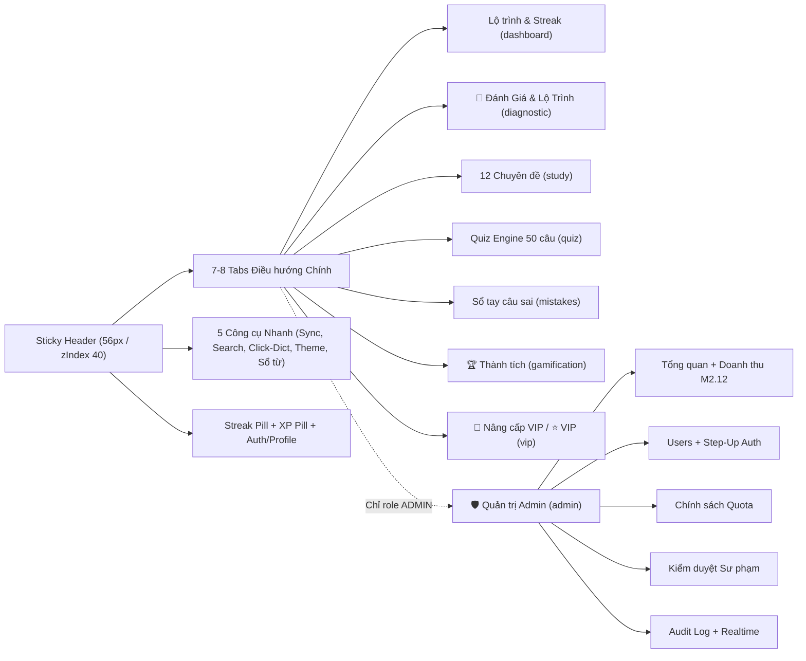
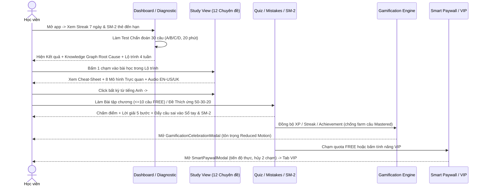

# 🎨 HỒ SƠ ĐẶC TẢ KIẾN TRÚC SẢN PHẨM & THIẾT KẾ UI/UX CHI TIẾT (3RD-PARTY DESIGN HANDOFF & REVIEW SPEC)

> **Sản phẩm:** Grammar Engine (`v1.4 PRO`) — Nền tảng Học & Luyện Ngữ pháp Tiếng Anh Thích ứng (*Giáo trình Mai Lan Hương & Hà Thanh Uyên*)  
> **Production URL:** `https://grammar-platform.vercel.app`  
> **Tech Stack Frontend:** Next.js `14.2.15` (Pages Router) + React `18.3.1` • CSS-in-JS Token Architecture (`lib/tokens/`) + Global CSS (`styles/design-system.css`) • Pure SVG Charts & Interactive Diagrams • Web Speech / Audio Pronunciation API • PWA + IndexedDB Offline-First  
> **Mục đích tài liệu:** Tài liệu nguồn duy nhất (**Single Source of Truth**) giúp đối tác thiết kế / đội UI-UX bên thứ 3 hiểu **100% bản chất sản phẩm, dữ liệu thực tế, kích thước hiển thị, mọi trạng thái màn hình, quy tắc nghiệp vụ bất biến**, để thiết kế chuẩn kích thước hoặc **tái cấu trúc (IA/Layout Restructuring)** phù hợp với nội dung giáo dục thực tế.

---

## MỤC LỤC NHANH
1. [Bức tranh Tổng thể & Quy mô Nội dung Thực tế (Content Metrics)](#1-bức-tranh-tổng-thể--quy-mô-nội-dung-thực-tế-content-metrics)
2. [Phân vai Người dùng, Quyền truy cập & Luật Nghiệp vụ Bất biến](#2-phân-vai-người-dùng-quyền-truy-cập--luật-nghiệp-vụ-bất-biến)
3. [Kiến trúc Thông tin (IA) & Sơ đồ Luồng Hành trình Người dùng](#3-kiến-trúc-thông-tin-ia--sơ-đồ-luồng-hành-trình-người-dùng)
4. [Hệ thống Design Tokens 3 Tầng, Kích thước Artboard & Thang Typography](#4-hệ-thống-design-tokens-3-tầng-kích-thước-artboard--thang-typography)
5. [Thư viện Primitive Components Dùng chung (`components/design-system/`)](#5-thư-viện-primitive-components-dùng-chung-componentsdesign-system)
6. [Đặc tả Sâu Từng Màn hình: Bố cục Wireframe, Kích thước & Trạng thái (8 Views + 6 Overlays)](#6-đặc-tả-sâu-từng-màn-hình-bố-cục-wireframe-kích-thước--trạng-thái-8-views--6-overlays)
7. [Trợ năng (WCAG 2.2 AA), Offline-First & Hiệu năng UX](#7-trợ-năng-wcag-22-aa-offline-first--hiệu-năng-ux)
8. [Phân tích Ma sát UI/UX Hiện tại & Biên độ Tái cấu trúc cho Bên thứ 3](#8-phân-tích-ma-sát-uiux-hiện-tại--biên-độ-tái-cấu-trúc-cho-bên-thứ-3)

---

## 1. BỨC TRANH TỔNG THỂ & QUY MÔ NỘI DUNG THỰC TẾ (CONTENT METRICS)

Để thiết kế **không bị vỡ card, cắt chữ hay thiết kế sai loại input**, bên thứ 3 cần nắm chính xác cấu trúc và **độ dài ký tự thực tế** đo trực tiếp từ `data/ui/preview_data.json` và `data/ui/quiz_bank.json`:

### 1.1 Bản đồ 12 Chuyên đề (Giáo trình chuẩn)

| Chương | Tên Tiếng Việt (Tiếng Anh) | Số Bài học | Số Bài tập (`questions`) |
| :---: | :--- | :---: | :---: |
| **01** | Các thì (*Tenses*) | 13 | 8 bài (82 câu) |
| **02** | Sự phối hợp các thì (*Sequence of Tenses*) | 2 | 4 bài (46 câu) |
| **03** | Mệnh đề và Cụm từ (*Clauses and Phrases*) | 9 | 8 bài (88 câu) |
| **04** | Sự diễn tả về số lượng (*Expression of Quantity*) | 4 | 7 bài (62 câu) |
| **05** | Văn phong (*Styles*) | 2 | 3 bài (34 câu) |
| **06** | Dạng nhấn mạnh (*Emphasis*) | 2 | 1 bài (12 câu) |
| **07** | Từ loại (*The Parts of Speech*) | 10 | 8 bài (43 câu) |
| **08** | Từ vựng học (*Word Study*) | 4 | 2 bài (24 câu) |
| **09** | Lời nói gián tiếp (*Reported Speech*) | 2 | 1 bài (12 câu) |
| **10** | Câu chủ động - Câu bị động (*The Passive and Active Sentences*) | 2 | 4 bài (46 câu) |
| **11** | Câu (*Sentences*) | 2 | 4 bài (46 câu) |
| **12** | Bài tập tổng hợp (*Comprehensive Practice Test*) | 1 | 1 bài (12 câu) |
| **Tổng** | **12 Chương** | **53 Bài học** | **51 Bộ bài tập Chương (507 câu) + Ngân hàng Quiz 2,939 câu** |

*(Lưu ý phân bổ bất đối xứng quan trọng cho IA Sidebar: Chương 1 có **13 bài**, Chương 7 có **10 bài**, Chương 3 có **9 bài**, trong khi các chương 2, 5, 6, 9, 10, 11 chỉ có **2 bài** và Chương 12 có **1 bài**).*

### 1.2 Thống kê Độ dài Văn bản Thực tế (Text Envelope — Đo từ JSON)

> **Cảnh báo thiết kế quan trọng:** Toàn bộ **2,939 câu hỏi** trong ngân hàng luyện tập (`quiz_bank.json` & bài tập chương) là dạng **tự luận ngắn / điền từ / viết lại câu (`has choices/options = 0`)**; CHỈ CÓ bài **Chẩn đoán đầu vào 30 câu (`DiagnosticTestSession`)** sử dụng trắc nghiệm **4 lựa chọn A / B / C / D**.

| Thành phần Nội dung | Tổng số | Min | Trung bình | P95 (95%) | Max | Lưu ý Thiết kế UI |
| :--- | :---: | :---: | :---: | :---: | :---: | :--- |
| Tên Chương (`title_vi`) | 12 | 3 | 15.3 | 32 | 32 | Vừa 1 dòng trên Card/Sidebar `280px+` |
| Tên Bài học (`title_vi`) | 53 | 5 | 25.6 | 51 | 66 | Cần hỗ trợ wrap tối đa **2 dòng** trên sidebar hẹp |
| Tóm tắt bài (`overview`) | 53 | 127 | 170.3 | 220 | 239 | ~2–3 dòng trong Card tổng quan bài học |
| Tiêu đề Mục (`section.title`) | 373 | 5 | 34.0 | 75 | 115 | Có mục dài 115 ký tự ➔ Header mục bắt buộc cho phép wrap |
| Tiêu đề Quy tắc (`rule.title`) | 215 | 2 | 26.4 | 53 | 138 | Đi kèm badge số thứ tự `01..22` |
| Nội dung Quy tắc (`rule.content`) | 215 | 0 | 54.1 | 154 | 258 | Kèm trung bình `1.3` ví dụ (max `22` ví dụ trong 1 rule!) |
| Công thức (`formula.text`) | 94 | 5 | 44.3 | 120 | 165 | Font `Geist Mono`; công thức max `165` ký tự cần scroll ngang hoặc wrap |
| Đề câu hỏi (`question.stem`) | 2,939 | 8 | 53.6 | 86 | **749** | 95% ngắn `<= 86` ký tự, nhưng có câu đoạn văn tới **749** ký tự! |
| Gợi ý mở đầu (`starter_prompt`) | 347 | — | — | — | — | Box vàng riêng kiểu `"BẮT ĐẦU VỚI: Although..."` |
| Giải thích (`explanation`) | 2,939 | 184 | 303.6 | 396 | **1,190** | Phân rã thành **5 khối sư phạm** trong `StructuredExplanation` |
| Ví dụ song ngữ (`examples`) | 639 | — | — | — | — | Cặp câu EN + VN + nút 🔊 nghe phát âm |
| Tóm tắt nhanh (`cheatSheet`) | 13 | — | — | — | — | Hiện có ở **13/53 bài** (công thức `(+)/(-)/(?)`, timeline, từ nhận biết) |

- **9 loại bài tập trong dữ liệu:** `FILL_IN_THE_BLANKS` (19), `SENTENCE_TRANSFORMATION` (10), `REWRITE_SENTENCES` (7), `MULTIPLE_CHOICE` (5), `MATCHING` (4), `COMPLETE_SENTENCES` (3), `TRANSLATION` (1), `WORD_FORMATION` (1), `SHORT_ANSWER` (1). Tất cả hiện dùng chung ô `<input type="text">` nhập câu trả lời + phím `Enter` chấm điểm.

---

## 2. PHÂN VAI NGƯỜI DÙNG, QUYỀN TRUY CẬP & LUẬT NGHIỆP VỤ BẤT BIẾN

### 2.1 Ma trận Phân quyền & Trạng thái Giao diện

| Quyền / Tính năng | `Khách` (`guest`) | `FREE` (Đã đăng nhập) | `VIP` (Trả phí / Trial) | `ADMIN` |
| :--- | :---: | :---: | :---: | :---: |
| Lý thuyết 12 Chương / 53 Bài học + 8 Mô hình Trực quan | Toàn quyền | Toàn quyền | Toàn quyền | Toàn quyền |
| Click tra từ điển Anh–Việt + IPA + Phát âm (`#dict-popup`) | Toàn quyền | Toàn quyền | Toàn quyền | Toàn quyền |
| Lưu Sổ từ vựng & Sổ tay câu sai | Chỉ `localStorage` | Sync Cloud Multi-Device | Sync Cloud Multi-Device | Sync Cloud |
| Bài tập Thực hành trong 12 Chương | Giới hạn `freeExerciseLimit` (mặc định **10 câu/chương**), câu 11+ hiện thẻ khóa | Giới hạn **10 câu/chương**, câu 11+ hiện thẻ khóa + CTA Smart Paywall | **Không giới hạn** (2,939 câu) | Không giới hạn |
| Quiz Engine (50 câu) & Đề Thích Ứng `50/30/20` | Giới hạn `freeDailyQuizLimit` (**2 đề/ngày**) | Giới hạn **2 đề/ngày**; vượt mức hiện Banner khóa đỏ | **Không giới hạn** | Không giới hạn |
| Chẩn đoán 30 câu + Lộ trình 4 tuần + Knowledge Graph | Xem & thi thử (lưu local) | Lưu Server + Cooldown `7` ngày | Toàn quyền + AI Study Coach | Toàn quyền |
| Xuất Báo cáo Năng lực (`export-report`) | Khóa (API trả HTTP `403`) | Khóa (hiển thị Paywall) | Tải JSON/Báo cáo trực tiếp | Toàn quyền |
| Tab `🏆 Thành tích` (XP, Challenge, Badge, Leaderboard) | Chế độ Preview (Banner nhắc đăng nhập) | Tham gia đầy đủ (XP thật trên Server) | Tham gia đầy đủ | Tham gia đầy đủ |
| Tab `🛡️ Quản trị Admin` | Ẩn hoàn toàn | Ẩn hoàn toàn | Ẩn hoàn toàn | **Hiển thị đầy đủ 6 Sub-tab** |

### 2.2 Các Quy tắc Nghiệp vụ & Đạo đức Bắt buộc Khi Thiết kế Lại

Bên thứ 3 **không được phép** thiết kế các pattern vi phạm 4 nguyên tắc sau:
1. **FTC Anti-Dark-Pattern (Bắt buộc trên Paywall & VIP Hub):**
   - **CẤM** đồng hồ đếm ngược giả, số lượng người đang xem giả, thông báo khan hiếm ảo, hoặc câu hù dọa *"Bạn sẽ mất hết chuỗi/điểm nếu không mua VIP"*.
   - **BẮT BUỘC** hiển thị rõ giá sau dùng thử (ví dụ: *99,000đ/tháng hoặc 699,000đ/năm*), chiến dịch giảm giá có ngày kết thúc thực từ DB, và luồng **Hủy VIP minh bạch trong 2 chạm** kèm cam kết giữ 100% XP, Streak & Sổ tay câu sai.
   - **CẤM** chen ngang Smart Paywall khi người dùng đang làm dở bài tập miễn phí (`NO_INTERRUPT_MID_FREE_EXERCISE`), và phải tôn trọng giới hạn tần suất (`daily_cap: 2/ngày`, cooldown `60 phút` sau khi dismiss).
2. **Server-Authoritative Gamification & Anti-Farming (Minh bạch cho User):**
   - Server kiểm soát XP: không cộng điểm khi lặp lại câu đã `Mastered`, áp dụng **6 yếu tố Mastery** (*Accuracy, Consistency, Retention, Difficulty, Recency, Topic Coverage*) và **Suy giảm trí nhớ** (`-5%/tuần` nếu quá hạn ôn tập > 14 ngày). Giao diện cần truyền đạt rõ *tại sao* điểm thành thạo tăng/giảm.
   - **6 Level Bands chính thức:** Lv 1–5 (`0–500 XP` *Beginner* 🌱) • Lv 6–10 (`501–1,500 XP` *Grammar Explorer* 🧭) • Lv 11–20 (`1,501–5,000 XP` *Grammar Fighter* ⚔️) • Lv 21–30 (`5,001–12,000 XP` *Grammar Expert* 🎓) • Lv 31–40 (`12,001–25,000 XP` *Grammar Master* 👑) • Lv 41+ (`25,001+ XP` *Grammar Legend* 💎).
   - **Bảng xếp hạng (Privacy-First):** Bắt buộc có 3 tùy chọn riêng tư (`Công khai`, `Ẩn danh #ABCD`, `Tắt tham gia`) và hiển thị **cách tính điểm hòa** (*Accuracy Tie-breaker*).
3. **Pedagogical Clarity (Cấu trúc Lời giải Sư phạm 5 Bước):**
   - Mọi giải thích câu hỏi khi mở rộng đều tuân theo 5 khối trực quan cố định: **(1) Dấu hiệu & Ngữ cảnh (Signal)** ➔ **(2) Quy tắc & Công thức (Rule)** ➔ **(3) Dịch nghĩa & Từ vựng + Audio** ➔ **(4) Bẫy hay gặp (Common Mistakes)** ➔ **(5) Chiến thuật thi cử (Exam Tips)**, kèm bộ chuyển độ sâu (*Basic / Intermediate / Advanced*) và nút báo lỗi nội dung.
4. **Offline-First Transparency:**
   - Trạng thái mạng và hàng đợi đồng bộ IndexedDB (`SYNCED`, `SYNCING`, `PENDING (N)`, `OFFLINE`, `ERROR`) phải luôn dễ quan sát trên thanh công cụ để học viên biết tiến độ offline vẫn an toàn.

---

## 3. KIẾN TRÚC THÔNG TIN (IA) & SƠ ĐỒ LUỒNG HÀNH TRÌNH NGƯỜI DÙNG

### 3.1 Cấu trúc App Shell Hiện tại



### 3.2 Hành trình Khép kín: Học ➔ Đánh giá ➔ Củng cố ➔ Chuyển đổi



---

## 4. HỆ THỐNG DESIGN TOKENS 3 TẦNG, KÍCH THƯỚC ARTBOARD & THANG TYPOGRAPHY

### 4.1 Kích thước Khung Thiết kế Chuẩn (Target Artboards & Breakpoints)
Được định nghĩa trong `lib/tokens/spacing.tokens.js` (`BREAKPOINTS`, `CONTAINERS`) và `tests/visual-regression.spec.mjs`:

| Thiết bị / Artboard | Viewport Width x Height | Max Content Width (Hiện hành) | Khuyến nghị Grid Columns cho Design System |
| :--- | :--- | :--- | :--- |
| **Desktop Wide** (Chính) | `1440 × 900 px` | `1120px` (Admin) / `1020px` (VIP, Gamification) / `980px` (Dashboard, Study Main) / `960px` (Diagnostic) / `860px` (Quiz, Mistakes) | 12 Columns (`gutter: 24px`, `margin: 40px`) |
| **Laptop Standard** | `1280 × 800 px` | Tương tự trên (Header `56px` dễ quá tải nếu không thu gọn) | 12 Columns (`gutter: 20px`, `margin: 24px`) |
| **Tablet Portrait** | `768 × 1024 px` | Full-width `padding: 24px` | 8 Columns (`gutter: 16px`, `margin: 24px`) |
| **Mobile Standard** | `375 × 812 px` | Full-width `padding: 16px` *(Lưu ý: hiện thiếu media query thu gọn Header & Sidebar 320px)* | 4 Columns (`gutter: 12px`, `margin: 16px`) |

### 4.2 Bảng Màu 2 Giao diện (Light & Dark Mode — Đã kiểm định WCAG 2.2 AA `28/28` cặp)

Nguồn: `lib/tokens/design-tokens.js` & kết quả chạy `python scripts/validate-design-tokens.py`:

| Vai trò Token | Light Mode (`[data-theme="light"]`) | Tương phản trên `bg` / `card` | Dark Mode (`[data-theme="dark"]`) | Tương phản trên `bg` / `card` |
| :--- | :--- | :---: | :--- | :---: |
| **Canvas nền chính (`bg`)** | `#f8fafc` (Slate 50) | — | `#09090b` (Zinc 950) | — |
| **Nền phụ / Sidebar (`bgSub`)** | `#ffffff` (White) | — | `#121215` | — |
| **Bề mặt Card (`card`)** | `#ffffff` (White) | — | `#111115` | — |
| **Card nhạt / Input lồng (`bgElevated`)** | `#f1f5f9` (Slate 100) | — | `#18181b` (Zinc 900) | — |
| **Viền Card / Chia khối (`cardBorder` / `border`)** | `#e2e8f0` / `#cbd5e1` | — | `#272733` / `#27272a` | — |
| **Chữ Chính (`text`)** | `#0f172a` (Slate 900) | `17.06:1` / `17.85:1` | `#fafafa` (Zinc 50) | `19.06:1` / `18.05:1` |
| **Chữ Phụ / Nội dung đọc (`textSecondary`)** | `#334155` (Slate 700) | `9.90:1` / `10.35:1` | `#d4d4d8` (Zinc 300) | `13.46:1` / `12.74:1` |
| **Chữ Mờ / Nhãn phụ (`textMuted`)** | `#475569` (Slate 600) | `7.24:1` / `7.58:1` | `#a1a1aa` (Zinc 400) | `7.76:1` / `7.35:1` |
| **Màu Nhấn / Brand CTA (`accent`)** | `#2563eb` (Blue 600) | `4.94:1` / `5.17:1` | `#38bdf8` (Sky 400) | `9.29:1` / `8.79:1` |
| **Thành công / Đúng (`success`)** | `#047857` (Emerald 700) | `5.24:1` / `5.48:1` | `#34d399` (Emerald 400) | `10.35:1` / `9.80:1` |
| **Cảnh báo / Streak (`warning`)** | `#b45309` (Amber 700) | `4.80:1` / `5.02:1` | `#fbbf24` (Amber 400) | `11.92:1` / `11.28:1` |
| **Lỗi / Nguy hiểm (`danger`)** | `#dc2626` (Red 600) | `4.62:1` / `4.83:1` | `#f87171` (Red 400) | `7.19:1` / `6.81:1` |
| **Nền Tag Ngữ nghĩa (`*Bg` / `*Border`)** | `#eff6ff`, `#ecfdf5`, `#fffbeb`, `#fef2f2` | — | `#0c4a6e30`, `#064e3b30`, `#451a0330`, `#450a0a30` | — |
| **Backdrop Modal (`backdrop`)** | `rgba(15, 23, 42, 0.56)` | — | `rgba(2, 6, 23, 0.74)` | — |

### 4.3 Thang Typography, Spacing Grid (4px), Radii & Z-Index
- **Font Families (`typography.tokens.js`):**
  - UI & Đọc hiểu: `Geist` (fallback `Inter, -apple-system, sans-serif`)
  - Mã bài học, Công thức cú pháp, Số đếm, Phiên âm IPA: `Geist Mono` (`JetBrains Mono, ui-monospace`)
- **Type Scale 10 bậc:**
  - `display`: `clamp(1.75rem, 3.2vw, 2.5rem)` (`28–40px`, `800`, `lh 1.2`)
  - `h1`: `clamp(1.5rem, 2.5vw, 2rem)` (`24–32px`, `800`, `lh 1.2`)
  - `h2`: `clamp(1.25rem, 2vw, 1.5rem)` (`20–24px`, `700`, `lh 1.35`)
  - `h3`: `clamp(1.1rem, 1.5vw, 1.25rem)` (`17.6–20px`, `700`, `lh 1.35`)
  - `h4`: `18px` (`600`) • `bodyLg`: `16px` (`500`, `lh 1.65`) • `body`: `14px` (`500`, `lh 1.5`) • `bodySm`: `13px` • `caption`: `12px` • `overline`: `11px` (`700`, uppercase, `+0.08em`)
- **4px Grid (`SPACING`):** `4, 8, 12, 16, 20, 24, 32, 40, 48, 64 px`.
- **Border Radii (`RADII`):** `4px` (tag/input), `8px` (button/small card), `12px` (section card), `16px` (modal/hero), `20px` (spotlight), `9999px` (pills).
- **Z-Index Layers:** Base `1` • Sticky Header `40` • Dropdown `100` • Popover `200` • `#vocab-modal` / `#auth-modal` `1000` • Design System `<Modal>` `1200` • Toast `1400` • `#dict-popup` `9999`.

---

## 5. THƯ VIỆN PRIMITIVE COMPONENTS DÙNG CHUNG (`components/design-system/`)

Nếu bên thứ 3 mở rộng hoặc giữ nguyên Design System, mọi màn hình mới cần dùng lại 6 nhóm component chuẩn sau:

1. **Buttons (`Button`, `IconButton`, `ButtonGroup`):**
   - 5 biến thể: `primary` (xanh `#2563eb`), `secondary` (nền `bgElevated` + viền), `ghost` (trong suốt), `danger` (`#dc2626`), `success` (`#047857`/`#059669`).
   - 3 kích thước: `sm` (`minHeight: 30px`, `padding: 0.35rem 0.72rem`, `12.5px`), `md` (`minHeight: 36px`, `0.55rem 1.05rem`, `13.6px`), `lg` (`minHeight: 44px`, `0.75rem 1.45rem`, `15.2px`).
   - `IconButton`: hình tròn (`9999px`), tối thiểu `24px` (mặc định `36px`), bắt buộc `aria-label`.
2. **Forms (`Input`, `Select`, `Textarea`, `Checkbox`, `Switch`):**
   - `Input` / `Select`: `minHeight: 38px`, `border: 1.5px solid`, tự động gắn `label` + `hint` + thông báo `error` màu `T.danger`.
   - `Switch`: công tắc trượt gạt cho các cài đặt Privacy, Reduced Motion, Marketing Opt-out.
3. **Feedback (`Badge`, `Alert`, `Progress`, `Tooltip`):**
   - `Badge`: pill bo tròn `9999px`, `fontSize: 0.72rem`, `fontWeight: 700`, 5 tone (`neutral / accent / success / warning / danger`).
   - `Alert`: hộp viền trái dày `4px`, `padding: 0.75rem 1rem`, kèm icon ngữ nghĩa (`ℹ️ / ✅ / ⚠️ / 🚨`).
   - `Progress`: thanh tiến trình `height: 5–10px`, transition `300ms`.
4. **Layout (`Card`, `Container`, `Grid`, `Divider`):**
   - `Card`: `padding: 1.25rem`, `borderRadius: 12px`; `Grid`: tự chia cột `minmax(240px, 1fr)`, `gap: 1rem`.
5. **Overlays (`Modal`):**
   - Khung dialog chuẩn `borderRadius: 16px`, `maxHeight: 90vh`, `backdropFilter: blur(5px)`, **Focus Trap + Esc + trả focus**.
6. **States (`Skeleton`, `EmptyState`):**
   - `Skeleton`: `.ds-skeleton` hiệu ứng shimmer `1.4s`, **Zero CLS**.
   - `EmptyState`: icon lớn `2.2rem` + `title` + `description` (`maxWidth: 460px`) + nút CTA.

---

## 6. ĐẶC TẢ SÂU TỪNG MÀN HÌNH: BỐ CỤC WIREFRAME, KÍCH THƯỚC & TRẠNG THÁI (8 VIEWS + 6 OVERLAYS)

### 6.0 Global Sticky App Shell (`pages/index.js:3185-3650`)

```text
+----------------------------------------------------------------------------------------------------------+
| [G] Grammar Engine [v1.4 PRO] | [Tabs Segmented Control (7-8 nút)] | [Sync][Search][Tra từ][Theme][Sổ từ] | [🔥][⚡][User] |
+----------------------------------------------------------------------------------------------------------+
  Height: 56px | Position: sticky top: 0 | zIndex: 40 | Padding: 0 24px | Border-bottom: 1px
```

- **Chi tiết từng cụm (trái ➔ phải):**
  - Logo box `28x28px` + Title `Grammar Engine` + Pill `v1.4 PRO`.
  - `<nav>` chứa các tab ngang (`padding: 0.4rem 0.85rem`, `fontSize: 0.825rem`). Active tab ở Light mode nổi nền `#ffffff` + shadow nhẹ; Dark mode nổi nền `#27272a`. Riêng tab `🎯 Đánh Giá & Lộ Trình` dùng màu nhấn xanh dương riêng biệt; tab `🛡️ Quản trị Admin` dùng chữ đỏ.
  - Quick Tools: `SyncStatusIndicator` (5 trạng thái), Search box `width: 135px; height: 30px`, nút toggle `⚡ Tra từ: BẬT` / `💤 TẮT`, nút theme `☀️ Sáng` / `🌙 Tối`, nút `⭐ Sổ từ (N)`.
  - User cluster: Streak pill (`🔥 N ngày`), XP pill (`⚡ N XP`), nút `Đăng nhập` (`#2563eb`) hoặc Pill tài khoản (tên truncate `maxWidth: 110px`).

---

### 6.1 View 0 — `Lộ trình & Streak` (`dashboard`, `maxWidth: 980px`, `padding: 32px 24px`)

```text
+---------------------------------------------------------------------------------------------------+
| [1. HERO BANNER]  🔥 Chuỗi học tập N ngày của [Tên]               |  LỊCH HOẠT ĐỘNG 7 NGÀY         |
|   [Badge Cấp bậc]  [XP / nextXp]  [CTA Nâng cấp VIP (nếu FREE)]   |  (CN)(T2)(T3)(T4)(T5)(T6)(T7)  |
+---------------------------------------------------------------------------------------------------+
| [2. DIAGNOSTIC CTA BANNER (Gradient)]  🎯 Chưa biết xuất phát điểm? -> [Khám phá trình độ ngay ➔]  |
+---------------------------------------------------------------------------------------------------+
| [3. SPACED REPETITION PANEL (SM-2)]  Hàng đợi thẻ đến hạn + Đáp án + Lời giải 5 bước + DAG Roots   |
+---------------------------------------------------------------------------------------------------+
| [4. MASTERY INTELLIGENCE DASHBOARD (Milestone 2.9)]                                               |
|   + 2 Khuyến nghị hành động (Alert + nút Ôn tập) + 4 KPI nhỏ (Mastery/Short/Long/Consistency)     |
|   + Cột trái: SVG 12-Axis Radar (270x245) + 12 thanh Progress     | Cột phải: Đường cong Quên     |
|     (mỗi hàng có nút [Ôn tập] nhảy thẳng sang Quiz chuyên đề đó)   | lãng SVG + 5-State + Heatmap  |
+---------------------------------------------------------------------------------------------------+
| [5. SMART DAILY RECOMMENDATION]  Đề xuất hôm nay: Chương X        |  [Bắt đầu học ngay hôm nay →]  |
|   Mục tiêu hàng ngày: solved / targetQuestions [======== 60% ====]                                |
+---------------------------------------------------------------------------------------------------+
| [6. 4 ANALYTICS KPI CARDS]   [Bài đã học]  [Câu đã đúng]  [Tổng XP]  [Sổ tay câu sai]            |
+---------------------------------------------------------------------------------------------------+
| [7. BẢN ĐỒ 12 CHUYÊN ĐỀ]  Grid 2-3 cột (minmax 280px) -> Card Chương 01..12 (% + Progress Bar)     |
+---------------------------------------------------------------------------------------------------+
```

- **Trạng thái đặc biệt:**
  - Nếu đang tải `MasteryIntelligenceDashboard` ➔ `<Skeleton height="22px" />` + `<Skeleton height="140px" />`.
  - Nếu `SpacedRepetitionPanel` đang tải ➔ Box thông báo `⏳ Đang phân tích Knowledge Graph...`.
  - Khi người dùng trả lời đúng/sai 1 thẻ SM-2 ngay trên Dashboard ➔ hiện ngay kết quả chu kỳ mới (`1 -> 3 -> 7 -> 14 -> 30 ngày`) + nhúng trực tiếp **`StructuredExplanation`** bên dưới thẻ đó.
  - **SVG Specs cho Designer:**
    - Radar 12 trục: `viewBox="0 0 270 245"`, 4 vòng đồng tâm `25 / 50 / 75 / 100`, nhãn `C1..C12`, polygon tô nền `T.accentBg` + viền `2px T.accent`.
    - Forgetting Curve: `viewBox="0 0 295 130"`, 5 điểm mốc `1d / 3d / 7d / 14d / 30d`, đường nối `strokeWidth: 2.5`.
    - 14-Day Activity Heatmap: lưới 14 ô ngang (`gridTemplateColumns: repeat(14, 1fr)`).

---

### 6.2 View 1 — `🎯 Đánh Giá & Lộ Trình` (`diagnostic`)

Chứa **4 màn hình con chuyển đổi theo state `diagnosticMode`**:

| Mode | Container | Bố cục & Thành phần Chính | Tương tác & Phím tắt |
| :--- | :--- | :--- | :--- |
| **`onboarding`** (`DiagnosticOnboarding.jsx`) | `920px` | Hero Gradient Card + 4 Feature Badges (`30 Câu`, `15-20 Phút`, `10 Nhóm kiến thức`, `Lộ trình 4 Tuần`) + Ma trận 10 nhóm ngữ pháp + Nút bắt đầu & Nút xem lại lộ trình cũ (nếu đã từng làm) | Click Start ➔ gọi `/api/diagnostic/test` |
| **`testing`** (`DiagnosticTestSession.jsx`) | `960px`, `minHeight: 85vh` | Top bar (`✕ Thoát`, `Câu X/30`, Timer `⏱️ 20:00` đổi sang đỏ khi `< 3 phút`) + Thanh progress `6px` + Card câu hỏi (Badge chuyên đề, Độ khó `Dễ/TB/Khó`, nút `🚩 Đánh dấu xem lại`, **4 nút Radio lớn A/B/C/D** có circle badge `36x36px`) + Bảng **Question Palette 30 ô (`32px` height)** phân 3 màu (Xanh lá đã chọn, Vàng đánh dấu, Trắng/xám chưa chọn) + Modal xác nhận nộp bài | **Phím tắt:** Bấm phím `A/B/C/D` chọn đáp án; `ArrowLeft`/`ArrowRight` chuyển câu; hết giờ tự động nộp bài; theo dõi `time_spent_seconds` từng câu |
| **`results`** (`DiagnosticAnalysisDashboard.jsx`) | `960px` | Hero Kết quả + Vòng/Badge trình độ + Tóm tắt đúng/sai & mục tiêu kế tiếp + **Thẻ Tăng trưởng đa lượt (Analytics 2.8)** + **Knowledge Graph Root Cause DAG** (chỉ ra lỗi gốc rễ) + **Skill Breakdown 10 nhóm** + **`AiAdvisorDrawer`** (chip câu hỏi nhanh + ô chat hỏi AI Coach + gợi ý bài học có nút nhảy thẳng View 2) + Modal Xem lại 30 câu | Click `Xem lại chi tiết 30 câu` ➔ mở `DiagnosticQuestionReview`; Click `Xem Lộ trình 4 tuần` ➔ chuyển sang `roadmap` |
| **`roadmap`** (`PersonalizedRoadmapView.jsx`) | `960px` | Hero Lộ trình (`estimated_level` ➔ `target_level`, Version `vN`, nút `Adaptive Adjust`) + Tabs lọc tuần (`Tất cả \| Tuần 1 \| 2 \| 3 \| 4`) + Checklist nhiệm vụ từng tuần kèm nút **1 chạm mở thẳng bài học** trong View `12 Chuyên đề` + Nhúng `AiAdvisorDrawer` | Đánh dấu hoàn thành từng task + xem lịch sử phiên bản lộ trình |

---

### 6.3 View 2 — `12 Chuyên đề` (`study` — Explorer 2 Cột)

```text
+-------------------------------+--------------------------------------------------------------------+
| ASIDE: #chapter-sidebar       | MAIN: #learning-content-area (maxWidth: 980px, padding: 32px 40px) |
| Width cố định: 320px          | Breadcrumbs: Chương N / Tên chương / Tên bài                      |
| +---------------------------+ | H1 Tên bài học + Sub-tab: [Lý thuyết & Quy tắc] | [Bài tập]       |
| | 🔍 Lọc 12 chuyên đề... [x]| +------------------------------------------------------------------+
| +---------------------------+ | 1. Overview Card (Mã bài, đếm mục/công thức/ví dụ, nút +25 XP,   |
| | 01 Các thì (13 bài)       |    Anchor Pills #sec-0..#sec-N)                                    |
| |   ├─ 1.1 Present Simple   | 2. Cheat-Sheet Cấp tốc (nếu có): Bản chất + 3 Card (+)/(-)/(?) +   |
| |   ├─ 1.2 Present Cont...  |    Chips Từ nhận biết vàng                                         |
| | 02 Sự phối hợp các thì    | 3. Khối GrammarVisualization (1 trong 8 mô hình tương tác)         |
| | ...                       | 4. Các Phân mục 01..N (Badge CÁCH DÙNG/CÔNG THỨC/LƯU Ý + Công thức |
| | 12 Bài tập tổng hợp       |    Mono viền trái màu + Quy tắc đánh số + AudioPlayer)             |
| +---------------------------+ | 5. Thư viện Ví dụ Song ngữ (Grid thẻ >=320px + nút 🔊 Nghe)        |
| (data-no-dict="true")         | 6. Thanh Hoàn thành cuối bài (+25 XP & CTA -> Tab Bài tập)         |
+-------------------------------+--------------------------------------------------------------------+
```

- **Chi tiết Tab 2 (`Bài tập thực hành`) bên trong Study View:**
  - Trên cùng có **Status Banner**: nếu `VIP` hiện nền vàng nhạt *"Toàn quyền 2,939 câu"*; nếu `FREE` hiện nền xanh *"Tối đa 10 câu đầu mỗi chuyên đề"* + nút `Nâng cấp VIP ngay ⭐`.
  - Mỗi Exercise Group card (`EXERCISE I`, tiêu đề VN/EN, nút `Kiểm tra toàn bộ` + `Làm lại`) liệt kê từng câu hỏi:
    - **Câu `<= 10` (hoặc tài khoản `VIP`):** Card câu hỏi gồm Số câu, Badge loại câu (`typeInfo.tag`), nút **`🔊 Nghe câu`**, hộp vàng **`GỢI Ý MỞ ĐẦU:`** (nếu có `starter_prompt`), ô `<input type="text">` nhập đáp án + nút `Kiểm tra` / `Xem đáp án` + **`StructuredExplanation`** (5 bước sư phạm + nút báo lỗi) + **`RemedialRecommendationCard`** nếu trả lời sai.
    - **Câu `>= 11` (chỉ tài khoản `FREE`/`guest`):** Thay toàn bộ nội dung câu hỏi bằng Card khóa nét đứt (`border: 1px dashed T.warningBorder`), tiêu đề `🔒 Câu N: Nội dung khóa dành riêng cho Thành viên VIP` + nút CTA `Nâng cấp VIP ngay ➔` mở `SmartPaywallModal`.

- **Chi tiết 8 Mô hình Trực quan hóa Ngữ pháp (`GrammarVisualization.jsx`):**
  Container có Header (Icon + Tên mô hình + Badge + Mô tả), nút **`Mở rộng / Thu gọn chiều cao`** (`VisualizationControls`), công tắc ẩn/hiện khối (`Thu gọn / Mở sơ đồ`), chú thích (`VisualizationLegend`), và tự động chọn đúng mô hình theo bài học đang mở:
  1. `⏱️ Trục Thời Gian 13 Thì` (`TimelineVisualization`) — 3 miền Quá khứ/Hiện tại/Tương lai, 4 thể, so sánh 2 thì song song.
  2. `🌳 Cây Quyết Định Câu Điều Kiện` (`DecisionTreeVisualization`) — Phân nhánh Zero / Loại 1 / 2 / 3 / Mixed & Đảo ngữ.
  3. `🔄 Sơ Đồ Biến Đổi Câu Bị Động` (`TransformationDiagram`) — 5 bước S-V-O mã màu & quy tắc bỏ *By + Agent*.
  4. `💬 Luồng Chuyển Đổi Câu Gián Tiếp` (`ConversionFlowVisualization`) — Quy trình 7 bước, Ma trận Lùi thì & Bảng trạng từ.
  5. `🌿 Sơ Đồ Mệnh Đề Quan Hệ` (`SentenceTreeVisualization`) — Liên kết *Who/Whom/Which/Whose/That* & rút gọn V-ing/V3.
  6. `📊 Thang Đo So Sánh Đa Cấp` (`ComparisonScaleVisualization`) — Bằng (`=`), Hơn (`>`), Nhất (`MAX`), So sánh kép & Bất quy tắc.
  7. `🎯 Ma Trận Động Từ Khuyết Thiếu` (`ModalMatrixVisualization`) — Thang chắc chắn 0–100%, ma trận chức năng & Perfect Modals.
  8. `🌱 Cây Họ Từ & Động Cơ Hậu Tố` (`WordFamilyTreeVisualization`) — Nhánh Danh-Động-Tính-Trạng từ & hậu tố nhận diện.

---

### 6.4 View 3 — `Quiz Engine (50 câu)` (`quiz`, `maxWidth: 860px`, `padding: 32px 24px`)

- **Top State — Limit Gate:** Nếu `FREE` đạt `freeDailyQuizLimit` (`2 đề/ngày`), hiển thị Card cảnh báo khóa đỏ (`🔒 Giới hạn lượt thi Quiz hôm nay`) + vô hiệu hóa nút tạo đề + CTA `Nâng cấp VIP ngay ⭐`.
- **Quiz Control Card:**
  - 3 nút hành động: **`🎯 Đề Thích Ứng (50/30/20)`** (tạo 20 câu theo tỷ lệ 50% chuyên đề yếu / 30% Spaced Repetition / 20% nâng cao), **`Trộn đề mới (50 câu)`**, và **`Nộp bài chấm điểm`** (khi chưa nộp).
  - Nếu đang dùng Đề Thích Ứng ➔ hiện dải `adaptiveQuizMeta` hiển thị số lượng cụ thể `Weak • SR Review • Challenge`.
  - Hàng dưới: Dropdown lọc theo **12 Chuyên đề hoặc Tất cả** (`selectedQuizTopic`) + bộ đếm câu đã điền.
- **Question List Cards:** Hiển thị 20 hoặc 50 thẻ câu hỏi xếp dọc (`CÂU 1 / 50`, badge `adaptive_bucket`, badge loại câu `typeInfo.tag`, hộp xanh **`Yêu cầu:`** `instruction`, đề bài, hộp vàng **`BẮT ĐẦU VỚI:`** `starter_prompt`, ô `<input type="text">` nhập câu trả lời + nút kiểm tra lẻ / xem đáp án + `StructuredExplanation` & `RemedialRecommendationCard` sau khi chấm).
- **Post-Submit Summary:** Card điểm số lớn (`score / total`), danh sách câu đúng/sai, và tự động đẩy toàn bộ câu sai sang Sổ tay câu sai + Queue Sync.

---

### 6.5 View 4 — `Sổ tay câu sai` (`mistakes`, `maxWidth: 860px`, `padding: 32px 24px`)

- **Header:** Tiêu đề + tổng số câu sai đang lưu + Dropdown lọc theo chuyên đề.
- **Empty State:** Hiển thị khi danh sách trống (`Chưa có câu sai nào được lưu`).
- **Mistake Retry Cards:** Từng câu sai kèm đề bài, `starter_prompt`, `<input type="text">` để gõ lại trực tiếp (`Enter` chấm ngay), nút **`Kiểm tra lại`**, toggle **`Xem đáp án / Ẩn đáp án`**, phản hồi đúng/sai tức thì và `StructuredExplanation` mở rộng bên dưới.

---

### 6.6 View 5 — `🏆 Thành tích` (`gamification`, `maxWidth: 1020px`, `padding: 32px 24px`)

- **Tối ưu Loading UX:** Áp dụng SWR Client Cache (`gamificationSummaryCache`, `gamificationLeaderboardCache`) + Prefetch tự động sau 1s mở trang & khi hover/focus vào nút tab ➔ gần như không hiện Skeleton khi bấm tab.
- **Cấu trúc 5 Khối chính (`gap: 20px`):**
  1. **Guest Banner (nếu chưa đăng nhập):** `Alert tone="info"` thông báo chế độ xem trước.
  2. **Top Split Grid (`minmax(300px, 1fr)`):**
     - *Trái:* **Level & Authoritative XP Card** — Icon hạng + `Level X — Title` + Badge tổng XP + `<Progress height={10} />` lên level kế + nút `🎯 Kiếm XP (Đề 50/30/20)`.
     - *Phải:* **Streak & 7-Day Calendar Card** — Chuỗi hiện tại / kỷ lục dài nhất / số `Freeze Tokens` + nút `❄️ Khôi phục Chuỗi` (nếu `can_recover`) + lưới 7 ô lịch (`CN..T7`) + ghi chú reset `00:00 UTC+7`.
  3. **`⚡ Thử Thách Ngày & Tuần`:** Grid thẻ (`minmax(250px, 1fr)`), phân 2 badge `Thử thách Ngày (+50 XP)` và `Mục tiêu Tuần (+150 XP)`, thanh tiến độ `Progress`, và nút `🔄 Đổi thử thách` cho thử thách ngày đang `active`.
  4. **`🏅 Bộ Sưu Tập Huy Hiệu (20 badges)`:** Header kèm **4 nút lọc category** (`Tất cả`, `Learning Consistency`, `Grammar Mastery`, `Accuracy & Performance`, `Learning Milestones`) + lưới card (`minmax(225px, 1fr)`) chia 4 bậc `Bronze / Silver / Gold / Diamond` + trạng thái mở/mờ (`opacity: 0.72`) và **huy hiệu bí ẩn che metadata** khi chưa mở khóa.
  5. **Bottom Split (`minmax(320px, 1fr)`):**
     - *Trái:* **`🏆 Bảng Xếp Hạng` (5 Mode Tabs + Top 10/50):** Tabs `weekly_xp`, `monthly_xp`, `all_time_xp`, `weekly_consistency`, `grammar_mastery`; banner nổi vị trí hiện tại của user + tie-breaker accuracy; danh sách cuộn `maxHeight: 340px`.
     - *Phải (2 card xếp dọc):* **Quyền riêng tư & Hiệu ứng** (Dropdown `Công khai / Ẩn danh / Tắt tham gia` + Switch `Reduced Motion`) và **Lịch sử Giao dịch XP** (cuộn `maxHeight: 215px`).

---

### 6.7 View 6 — `💎 Nâng cấp VIP` (`vip`, `maxWidth: 1020px`, `padding: 32px 24px`)

- **Tối ưu Loading UX:** Có SWR Cache + Hover/Idle Prefetch tương tự tab Thành tích.
- **Cấu trúc 5 Khối + 2 Modal thuộc View:**
  1. **Behavioral Psychology Value Banner:** Badge trạng thái (`FREE` hoặc `⭐ VIP ACTIVE`) + Behavioral Segment Badge + thông điệp Progress Anchoring trích từ tiến độ thật + nút **`📄 Xuất Báo cáo Năng lực (VIP API)`** + nút **`Quản lý / Hủy gói VIP`** (khi đang có gói).
  2. **Ethical Verified Campaigns Strip:** Tối đa 2 banner chiến dịch khuyến mãi đang chạy kèm **ngày kết thúc thực tế** (`ends_at`).
  3. **Grid 4 Gói Subscription (`minmax(225px, 1fr)`):**
     - `VIP_MONTHLY` (`99,000đ`), `VIP_QUARTERLY` (`249,000đ`), `VIP_YEARLY` (`699,000đ` — Recommended, viền nổi `2px T.accent`), `VIP_LIFETIME` (`1,990,000đ`).
     - Mỗi card hiển thị Badge, Tên gói, Giá niêm yết + Giá gạch ngang (nếu có), Giá quy đổi/tháng, Số tiền tiết kiệm thực, nút `Chọn gói VIP` và nút phụ `🎁 Dùng thử 7 ngày miễn phí` (nếu chưa từng dùng trial).
  4. **`📊 So sánh Quyền lợi FREE vs VIP`:** Bảng 3 cột (`1.6fr 0.7fr 0.8fr`) so từng tính năng: `Free: Giới hạn (N) / 🔒 Khóa` vs `✅ VIP: Không giới hạn`.
  5. **Bottom Split (`minmax(300px, 1fr)`):** *Trái:* `🧾 Lịch sử Giao dịch Thanh toán` (`maxHeight: 210px`); *Phải:* `🔔 Cài đặt Thông báo & Quyền Người tiêu dùng` (`Switch 1-Click Unsubscribe` + cam kết idempotency/bảo lưu).
  6. **2 Modal `<Modal>` đi kèm:**
     - *Checkout Modal (`maxWidth: 520px`):* Tóm tắt giá gói + chọn cổng thanh toán (`VNPay / MoMo / Stripe`) + ô nhập mã giảm giá (`WELCOME15`, `STUDENT20`) + nút `Áp dụng` tính giá real-time + `Xác nhận Thanh toán VIP ➔`.
     - *Cancel VIP Modal (`maxWidth: 480px`):* Luồng hủy minh bạch **2 chạm**, Alert cam kết giữ nguyên 100% XP/Streak/Sổ tay, ô lý do hủy tùy chọn, nút `Giữ lại gói VIP` và `Xác nhận Hủy VIP ngay`.

---

### 6.8 View 7 — `🛡️ Quản trị Admin` (`admin`, `maxWidth: 1120px`, `padding: 32px 24px`)

- **Header Admin:** Icon `🛡️`, Badge xanh `Supabase Postgres 17 Live`, nút `🔄 Làm mới` và nút `+ Tạo tài khoản` (`#new-user-modal`).
- **6 Sub-Tabs:**
  1. `📊 Tổng quan Vận hành`: `AdminOverviewPanel` (tổng users, bài thi, sức khỏe DB) + `AdminMonetizationPanel` (6 KPI doanh thu: `Total Revenue`, `MRR`, `ARR`, `Active VIP`, `Churn Rate`, `Est. LTV`; thẻ `A/B Testing` kèm `Z-Score & Lift`; 6 công tắc bật/tắt `Paywall Triggers`; thanh tiến độ **14-Stage Funnel**).
  2. `👥 Quản lý Người dùng`: Thanh lọc theo tên/role/status + bảng user kèm nút sửa Role (`FREE`/`VIP`/`ADMIN`), khóa/mở tài khoản (mỗi thao tác kích hoạt `StepUpConfirmModal`).
  3. `⚙️ Chính sách Truy cập`: Form chỉnh `freeExerciseLimit`, `freeDailyQuizLimit`, `diagnosticCooldownDays`, `offlineSyncMaxBatch` có đánh số `policyVersion`.
  4. `🎓 Kiểm duyệt Sư phạm`: `PedagogicalQualityDashboard` (lọc báo lỗi `all / flagged / critical`, nút 1 chạm Batch Ingest 2,939 lời giải lên Supabase, trình sửa trực tiếp JSON 5 trường + validate schema trước khi xuất bản).
  5. `🛡️ Kiểm toán Server`: Bảng nhật ký bất biến từ Postgres Trigger.
  6. `📜 Hoạt động Realtime`: Log hành vi thời gian thực + nút xuất CSV UTF-8 BOM.

---

### 6.9 Chi tiết 6 Lớp phủ Toàn cục (Overlays, Modals & Popovers)

| Lớp phủ | Trigger mở | Kích thước & Vị trí | Chi tiết Giao diện & Chức năng |
| :--- | :--- | :--- | :--- |
| **`#dict-popup`** *(Click Dictionary)* | Click bất kỳ từ tiếng Anh trong bài học/quiz hoặc Enter ô Search Navbar | `width: 330px`, `position: fixed` tại tọa độ click `(x, y)`, `zIndex: 9999`, `borderRadius: 14px`, `blur(12px)` | Tên từ (Sky 400 bold) + Badge từ loại (`NOUN/VERB/...`) + hộp IPA (`Geist Mono`) + nút `🔊 Nghe phát âm` + hộp nghĩa Tiếng Việt nền emerald nhạt + từ đồng nghĩa + định nghĩa EN + nút `☆ Lưu vào Sổ từ` + link `Cambridge ↗` |
| **`#vocab-modal`** *(Sổ từ vựng)* | Click `⭐ Sổ từ (N)` trên Header | `maxWidth: 680px`, `maxHeight: 85vh`, `zIndex: 1000` | Danh sách từ đã lưu theo user, kèm IPA, nút nghe Audio và xóa từ |
| **`#auth-modal`** *(Tài khoản)* | Click `Đăng nhập` hoặc pill User đang login | `maxWidth: 460px`, `padding: 2rem`, `zIndex: 1000` | Nếu đã đăng nhập: Box trên cùng hiện `ĐANG ĐĂNG NHẬP: Tên (ROLE)` + Email + nút `💎 Nâng cấp VIP` (nếu FREE) + nút `🚪 Đăng xuất`. Dưới là 2 tab `Đăng nhập` / `Đăng ký mới` với form Email, Mật khẩu, Họ tên |
| **`SmartPaywallModal`** | 6 trigger hành vi hoặc bấm tính năng khóa VIP | `<Modal maxWidth="580px">` (`zIndex: 1200`) | Badge *Đề xuất theo Tiến độ Thực tế*, tiêu đề biến thể A/B (`progress_anchored` vs `control`), box Alert tiến độ thật, Card xem trước tính năng đang bấm, box **Cam kết Minh bạch 100%** (giá sau dùng thử + hủy 2 chạm), nút Đóng / Xem bảng giá / Dùng thử 7 ngày |
| **`GamificationCelebrationModal`** | Vừa thăng Level, đạt mốc Streak, hoặc mở khóa Huy hiệu | `<Modal maxWidth="520px">` (`zIndex: 1200`) | Box Thăng cấp (`Level A ➔ B`), Box Cột mốc Streak (`🔥`), danh sách Huy hiệu vừa mở + thưởng XP; tắt transition nếu bật `reducedMotion` |
| **`StepUpConfirmModal`** | Admin đổi Role, khóa User hoặc đổi Policy quota | Dialog `zIndex >= 1200`, hỗ trợ `Esc` | Bắt buộc gõ chính xác chuỗi `CONFIRM_SECURITY_ACTION` mới mở nút xác nhận để ghi Audit Log bất biến |
| **`SyncStatusIndicator` Popover** | Click vào pill Đồng bộ trên Header | Popover neo dưới pill Header | 5 trạng thái (`🟢 Đã đồng bộ`, `🟡 Đang đồng bộ`, `🟠 Chờ gửi N`, `⚪ Offline`, `🔴 Thử lại`) + telemetry chi tiết + nút Đồng bộ ngay / Kéo dữ liệu từ Cloud |

---

## 7. TRỢ NĂNG (WCAG 2.2 AA), OFFLINE-FIRST & HIỆU NĂNG UX

1. **Accessibility (`styles/design-system.css`):**
   - `scroll-padding-top: 76px` trên `html` để khi Tab di chuyển focus không bị Header (`56px`) che mất (**WCAG 2.4.11 Focus Not Obscured**).
   - `:focus-visible` ép vòng focus `2px solid` tương phản cao + halo `3px` trên mọi nút, link, input, `[tabindex]`.
   - Target Size (**WCAG 2.5.8**): tối thiểu `24×24px` desktop, tự động nâng lên `44×44px` với `.ds-btn` và `.ds-touch-target` khi `@media (pointer: coarse)`.
   - `@media (prefers-reduced-motion: reduce)`: ép `animation-duration: 0.01ms` toàn trang.
2. **Anti-FOUC & Performance UX:**
   - Inline script trong `pages/_app.js` đọc `localStorage('grammar_theme')` / `prefers-color-scheme` gán `data-theme` và `backgroundColor` *trước khi React hydrate* để triệt tiêu chớp sáng trắng.
   - Server API đặt tại vùng **Singapore (`sin1`)**, cache Edge `Cache-Control` + SWR Cache ở client cho tab Thành tích và VIP, kèm background prefetch sau 1 giây & khi rê chuột.
   - PWA Service Worker (`public/sw.js`) + IndexedDB v2 + `SyncManager` đồng bộ ngầm đa tab (`BroadcastChannel` / Web Locks).

---

## 8. PHÂN TÍCH MA SÁT UI/UX HIỆN TẠI & BIÊN ĐỘ TÁI CẤU TRÚC CHO BÊN THỨ 3

Phần này tổng hợp các **sự thật kỹ thuật** từ kiểm toán mã nguồn hiện tại để bên thứ 3 biết chính xác chỗ nào cần thiết kế mới / sửa triệt để:

### 8.1 Các Điểm Ma sát Nghiêm trọng (Audit Findings)

| Mức độ | Vấn đề Phát hiện trong Codebase | Bằng chứng Kỹ thuật Đo được | Ảnh hưởng Trải nghiệm (UX Impact) |
| :---: | :--- | :--- | :--- |
| **🔴 P0** | **Thiếu hoàn toàn Responsive Viewport Breakpoints** | Quét toàn bộ CSS/JSX chỉ thấy `2` media query (`pointer: coarse` và `prefers-reduced-motion`), **`0` câu lệnh `@media (max-width: ...)`** cho màn hình Mobile `375px` hay Tablet `768px`. | Dàn trang chỉ phụ thuộc CSS Grid `auto-fit` và `flexWrap`; các khối cố định chiều rộng không co giãn hợp lý trên điện thoại. |
| **🔴 P0** | **Sticky Header quá tải trên Laptop & Vỡ trên Mobile** | `<header>` cao cố định `56px` không `flexWrap` phải chứa: Brand + **7–8 Tab** + Sync Pill + Search `135px` + Tra từ + Theme + Sổ từ + Streak + XP + User (`16` phần tử tương tác trên 1 hàng!). | Trên màn `< 1280px`, `768px`, `375px`, Header bị chèn ép, che mất nút hoặc gây **tràn ngang (`horizontalOverflow`)**. |
| **🔴 P0** | **Sidebar Study Mode cố định `320px`** | `<aside id="chapter-sidebar" style={{ width: "320px", flexShrink: 0 }}>` nằm cạnh `<main>` trên viewport `375px`. | Trên điện thoại `375px`, cột nội dung bài học chỉ còn lại ~`55px` hoặc đẩy tràn màn hình sang ngang! |
| **🟠 P1** | **Kiến trúc Design Token "2 Tốc độ" (Chưa đồng bộ 100%)** | Nhóm 18 file mới (`design-system`, `admin`, `sync`, `gamification`, `monetization`, `learning`) có **`0` mã HEX cứng**. Ngược lại, **2,205 mã HEX cứng** vẫn nằm rải rác trong `grammar-visualization/*` (`1,121`), `pages/index.js` (`696`), `diagnostic/*` (`202`), `StructuredExplanation` (`138`), `AudioPlayer` (`48`). | Một số vùng cũ trong `pages/index.js` còn sót màu chữ tối (`#d4d4d8`, `#a1a1aa`, `#71717a`) gây giảm tương phản nhẹ ở Light Mode và khó đổi theme đồng loạt. |
| **🟠 P1** | **Legacy Modals thiếu Focus Trap** | `#auth-modal`, `#new-user-modal`, `#vocab-modal` và `#dict-popup` tự viết overlay `position: fixed` thủ công thay vì dùng shared `<Modal>` (`Modal.jsx`). | Người dùng bàn phím/Screen Reader có thể Tab thoát ra ngoài nền tối phía sau Modal; thiếu `Esc` đồng nhất trên các modal cũ. |
| **🟡 P1** | **Trùng lặp Nhãn Tab & Quá tải Dọc trên Dashboard** | Tab 0 (`Lộ trình & Streak`) và Tab 1 (`🎯 Đánh Giá & Lộ Trình`) đặt tên gần giống nhau; trang `dashboard` xếp dọc tới **7 khối lớn + 12 Card chương** (bao gồm cả thẻ ôn SM-2 lẫn Radar SVG lẫn Roadmap Callout). | Người dùng mới bị choáng ngợp thông tin (Cognitive Overload); phải cuộn trang rất dài mới thấy bản đồ 12 chuyên đề. |
| **🟢 P2** | **Thiếu đồng nhất Iconography & Kiểu câu hỏi hỗn hợp** | Giao diện dùng nhiều Emoji OS (`🎯 🏆 💎 🛡️ 📖 🔥`) vốn hiển thị lệch giữa Windows/macOS/Android; các câu hỏi dạng `MULTIPLE_CHOICE` / `MATCHING` trong bài tập chương hiện vẫn render ô `<input type="text">` thay vì radio/kéo-thả chuyên biệt. | Độ thẩm mỹ chưa đồng bộ kiểu EdTech cao cấp; thao tác trả lời dạng `MULTIPLE_CHOICE` trong bài tập chương chưa mượt như bên `DiagnosticTestSession`. |

### 8.2 Hướng dẫn Cho phép Bên thứ 3 Tái cấu trúc (Restructuring Scope)

Nếu đội thiết kế bên thứ 3 muốn **thiết kế lại cấu trúc giao diện (IA & Layout Redesign)** để hiện đại và thân thiện mobile hơn, có thể tự do tái cấu trúc theo bảng phân ranh dưới đây:

| Hạng mục | Quyền Tái cấu trúc của Bên thứ 3 | Gợi ý Phương án Tối ưu |
| :--- | :--- | :--- |
| **App Shell & Thanh Điều hướng** | **Tự do Tái cấu trúc toàn phần** | • **Desktop:** Gộp 7–8 tab thành **4–5 Hub chính** (*Tổng quan*, *Học & Chẩn đoán*, *Luyện tập & Ôn sai*, *Thành tích*, *VIP*) + Sidebar/Dropdown phụ cho `ADMIN`. Đưa Quick Search + Sync + Theme vào cụm gọn.<br>• **Mobile (`375px`):** Dùng **Bottom Navigation Bar** (5 icon) + Top Minimal Bar (`Logo + Streak/XP + Account`). |
| **Study Mode (`12 Chuyên đề`)** | **Tự do Tái cấu trúc Bố cục 2 Cột** | • **Desktop:** Thu gọn Sidebar từ `320px` xuống `260–280px` có nút collapse (*Focus Reading Mode* rộng tối đa `760–820px` để đọc quy tắc dài & công thức `165 chars` dễ chịu hơn).<br>• **Mobile/Tablet:** Biến Sidebar thành **Slide-over Drawer** hoặc Dropdown chọn Bài học ghim đầu trang. |
| **Dashboard (`View 0`)** | **Tự do Tái tổ chức Thứ tự & Sub-tabs** | Tách làm 2 vùng rõ ràng: **(A) Hành động Hôm nay** (*Daily Goal + Hàng đợi SM-2 đến hạn + Bài học gợi ý*) đứng ngay Above-the-Fold `900px`, và **(B) Phân tích Chuyên sâu** (*Radar 12 chuyên đề, Forgetting Curve, 12 Chương*) dưới dạng Tab hoặc Accordion. |
| **Thẻ Câu hỏi (Quiz & Exercises)** | **Tự do Tái thiết kế UI Input theo Loại câu** | Hỗ trợ 2 mẫu Card chính:<br>1) **Text/Transformation Card** (dành cho 2,939 câu ngân hàng: xử lý tốt đề dài `max 749 chars`, box `starter_prompt`, và ngăn `StructuredExplanation` dài `1,190 chars`).<br>2) **MCQ A/B/C/D Card** (dành cho 30 câu Diagnostic + nâng cấp cho `5` bộ `MULTIPLE_CHOICE` trong chương). |
| **Hệ thống Màu & Typography** | **Giữ nguyên Semantic Contract** (hoặc nâng cấp palette đảm bảo `>= 4.5:1`) | Phải giữ đủ 2 chế độ **Light + Dark**, bộ token ngữ nghĩa cho **4 trạng thái** (`accent/info`, `success`, `warning`, `danger`), mã màu phân biệt `(+)/(-)/(?)` ở Công thức, và bảng màu phân tách rõ ràng cho **8 sơ đồ Grammar Visualization**. |
| **Nội dung Sư phạm, Paywall & Quyền** | **BẮT BUỘC GIỮ NGUYÊN 100%** | Không cắt bớt 5 trường của `StructuredExplanation`, không bỏ `Hidden Achievement masking`, không bỏ `Privacy selector` ở Leaderboard, không thêm đồng hồ đếm ngược giả hoặc ẩn nút Hủy VIP 2 chạm. |

---

## 9. CHECKLIST BÀN GIAO CHO ĐỐI TÁC THIẾT KẾ (DELIVERABLES MONG ĐỢI)

Để đội ngũ kỹ thuật có thể code lại trơn tru từ bản thiết kế mới của bên thứ 3, bộ file bàn giao thiết kế (Figma / Design Specs) cần đáp ứng đủ:
1. **Figma Component Library & Token Sheet** đồng bộ tên token với `DESIGN_TOKENS` (`light`/`dark`), đạt tương phản `WCAG 2.2 AA >= 4.5:1`.
2. **4 Bộ Artboard đầy đủ** cho từng màn hình trọng yếu: **Desktop (`1440px`)**, **Laptop (`1280px`)**, **Tablet (`768px`)**, **Mobile (`375px`)** ở cả Light & Dark Mode.
3. **Đủ mọi State (Edge Cases):** `Guest` vs `FREE` vs `FREE hit limit (câu 11+ / vượt 2 quiz/ngày)` vs `VIP` vs `ADMIN`, `EmptyState`, `Skeleton Loading`, `Offline / Syncing / Error`, và bản xem trước text dài cực đại (**Rule `258` ký tự, Formula `165` ký tự, Question stem `749` ký tự, Explanation `1,190` ký tự**).
4. **Prototype Luồng Tương tác Chính:** `Diagnostic 30Q -> Knowledge Graph -> 1-Click Lesson -> Click #dict-popup -> Exercise Lock Gate -> SmartPaywallModal -> Checkout & 2-Click Cancel`.
