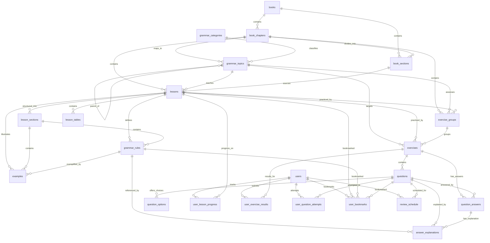

# Entity-Relationship Diagram & Schema Reference (`ERD.md`)

## 1. Mermaid Entity-Relationship Diagram

## 2. Entity Cardinality & Foreign Key Matrix

| Child Table | Foreign Key Column | Parent Table (`PK`) | Cardinality | `ON DELETE` Rule | Purpose |
| :--- | :--- | :--- | :---: | :---: | :--- |
| `book_chapters` | `book_id` | `books(id)` | `N:1` | `CASCADE` | Links chapter to source textbook |
| `book_sections` | `book_id` | `books(id)` | `N:1` | `CASCADE` | Links book section to source textbook |
| `book_sections` | `chapter_id` | `book_chapters(id)` | `N:1` | `CASCADE` | Links section to its parent chapter |
| `grammar_topics` | `category_id` | `grammar_categories(id)` | `N:1` | `RESTRICT` | Groups topic under top-level category |
| `grammar_topics` | `parent_topic_id` | `grammar_topics(id)` | `N:1` (Self) | `SET NULL` | Enables multi-level topic hierarchy |
| `grammar_topics` | `chapter_id` | `book_chapters(id)` | `N:1` | `SET NULL` | Optional link to source book chapter |
| `lessons` | `chapter_id` | `book_chapters(id)` | `N:1` | `RESTRICT` | Preserves chapter ordering |
| `lessons` | `book_section_id` | `book_sections(id)` | `1:1` / `N:1` | `RESTRICT` | Traces lesson to physical book section |
| `lessons` | `topic_id` | `grammar_topics(id)` | `N:1` | `RESTRICT` | Connects lesson to curriculum topic tree |
| `lesson_sections` | `lesson_id` | `lessons(id)` | `N:1` | `CASCADE` | Breaks lesson into Form, Usage, Note, etc. |
| `grammar_rules` | `lesson_id` | `lessons(id)` | `N:1` | `CASCADE` | Links rule/formula to parent lesson |
| `grammar_rules` | `section_id` | `lesson_sections(id)` | `N:1` | `CASCADE` | Links rule/formula to specific theory section |
| `examples` | `lesson_id` | `lessons(id)` | `N:1` | `CASCADE` | Links example sentence to parent lesson |
| `examples` | `section_id` | `lesson_sections(id)` | `N:1` | `CASCADE` | Links example sentence to theory section |
| `examples` | `grammar_rule_id` | `grammar_rules(id)` | `N:1` | `SET NULL` | Links example directly to the rule it illustrates |
| `lesson_tables` | `lesson_id` | `lessons(id)` | `N:1` | `CASCADE` | Stores structured Markdown tables for lesson |
| `exercise_groups` | `chapter_id` | `book_chapters(id)` | `N:1` | `RESTRICT` | Links `# EXERCISES` block to chapter |
| `exercise_groups` | `lesson_id` | `lessons(id)` | `N:1` | `RESTRICT` | Links `# EXERCISES` block to lesson |
| `exercise_groups` | `topic_id` | `grammar_topics(id)` | `N:1` | `RESTRICT` | Links `# EXERCISES` block to grammar topic |
| `exercises` | `exercise_group_id` | `exercise_groups(id)` | `N:1` | `CASCADE` | Links Roman-numeral exercise to group |
| `exercises` | `lesson_id` | `lessons(id)` | `N:1` | `RESTRICT` | Links exercise to lesson |
| `exercises` | `topic_id` | `grammar_topics(id)` | `N:1` | `RESTRICT` | Links exercise to grammar topic |
| `questions` | `exercise_id` | `exercises(id)` | `N:1` | `CASCADE` | Links individual question to exercise |
| `question_options` | `question_id` | `questions(id)` | `N:1` | `CASCADE` | Links MC/TF options to question & `blank_index` |
| `question_answers` | `question_id` | `questions(id)` | `N:1` | `CASCADE` | Links verified/flagged answer to question |
| `question_answers` | `exercise_id` | `exercises(id)` | `N:1` | `CASCADE` | Denormalized FK for fast exercise-level grading |
| `answer_explanations` | `question_answer_id` | `question_answers(id)` | `N:1` | `CASCADE` | Links explanation to specific answer key |
| `answer_explanations` | `question_id` | `questions(id)` | `N:1` | `CASCADE` | Links explanation to question |
| `answer_explanations` | `grammar_rule_id` | `grammar_rules(id)` | `N:1` | `SET NULL` | Links explanation to underlying grammar rule |
| `user_lesson_progress` | `user_id`, `lesson_id` | `users`, `lessons` | `N:1` | `CASCADE` | Tracks user progress per lesson |
| `user_exercise_results` | `user_id`, `exercise_id` | `users`, `exercises` | `N:1` | `CASCADE` | Stores exercise submission summary |
| `user_question_attempts` | `user_id`, `question_id` | `users`, `questions` | `N:1` | `CASCADE` | Logs every user answer attempt |
| `user_bookmarks` | `user_id` + target FKs | `users`, `lessons`/`rules`/`questions` | `N:1` | `CASCADE` | Saves user bookmarks |
| `review_schedule` | `user_id`, `question_id` | `users`, `questions` | `N:1` | `CASCADE` | Manages spaced-repetition intervals |
